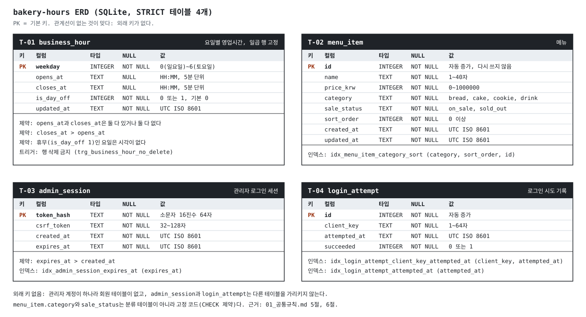

# 02 DB

> 테이블의 타입, 제약, 인덱스의 최종 권위 문서다. 이름은 `01_공통규칙.md` 7절을 글자 그대로 쓴다.
> 실행 파일: `db/schema.sql`(스키마), `db/seed.sql`(처음 상태), `db/check-schema.js`(검증). 이 문서와 세 파일이 다르면 세 파일을 실행한 결과가 맞고 문서를 고친다.
> 대상: SQLite 3.51.3, Node 24.15.0 내장 `node:sqlite`. 런타임 의존성은 없다.

## 1. 확정된 사실과 가정

| 구분 | 내용 | 근거 |
|---|---|---|
| [관찰] | 테이블은 네 개이고 이름과 컬럼 이름은 고정이다 | `01_공통규칙.md` 7절 |
| [관찰] | 처음 상태는 `business_hour` 일곱 행(시각 없음)과 빈 `menu_item`이다 | `01_공통규칙.md` 7절 |
| [관찰] | 휴무인 요일은 시각이 없다 | `00_기획서.md` 4-5 |
| [관찰] | `login_attempt.client_key`는 IP 주소를 해시한 값이고 보존 기간은 이 문서가 정한다 | `00_기획서.md` 4-2 |
| [관찰] | 값의 형식은 요일 0~6, 시각 `HH:MM` 5분 단위, 가격 0~1,000,000 정수, 이름 1~40자, 시각 기록 UTC ISO 8601이다 | `01_공통규칙.md` 9절 |
| [실측] | STRICT 테이블, WITHOUT ROWID, CHECK 안의 `strftime`, `VACUUM INTO`가 이 기기에서 실행된다 | 2026-11-17 `node db/check-schema.js` 42/42 |
| [추론] | 메뉴 삭제는 행을 지우는 것이다 | 고정 컬럼에 삭제 표시 컬럼이 없고 R-06은 삭제를 요구한다 |
| [추론] | 테이블 사이에 외래 키가 필요 없다 | 관리자 계정이 하나라 회원 테이블이 없고 분류는 고정 코드 네 개다 |

공통 규칙이 정하지 않아 이 문서가 기본값을 고른 것은 아래와 같다. 묻지 않고 기본값으로 진행한다.

- [결정필요] 닫는 시각 `24:00` 표기. 이유: 공통 규칙은 24시간 `HH:MM`과 자정을 넘기지 않는 영업만 정했다. 기본값: 받지 않는다. 가장 늦은 닫는 시각은 `23:55`다.
- [결정필요] 공백만 있는 메뉴 이름. 이유: 공통 규칙은 1자 이상 40자 이하만 정했다. 기본값: 거부한다(공백을 뺀 길이가 1 이상이어야 한다).
- [결정필요] `token_hash`의 형식. 이유: 공통 규칙에 해시 방식이 없다. 기본값: 세션 토큰 원문의 SHA-256을 소문자 16진수 64자로 저장하고 원문은 저장하지 않는다.
- [결정필요] `client_key`를 만드는 해시 방식. 이유: `00_기획서.md`는 IP 주소를 해시한 값이라고만 정했다. 기본값: 접속 주소를 `SESSION_SECRET`으로 HMAC-SHA-256 한 16진수 64자이며 주소 원문은 저장하지 않는다. DB는 길이 1~64자만 검사한다.
- [결정필요] 세션 유효 시간. 이유: 공통 규칙에 값이 없다. 기본값: 24시간. 값의 최종 권위는 `05_소스.md`이고 DB는 `expires_at`이 `created_at`보다 늦은지만 검사한다.
- [결정필요] 로그인 시도 보관 기간. 이유: 공통 규칙에 값이 없다. 기본값: 24시간. 횟수 제한을 세는 시간 폭(`05_소스.md`가 정한다)보다 길어야 한다.
- [결정필요] 백업 파일 보관 수. 이유: `00_기획서.md` 4-3은 하루 한 번 복사만 정했고 몇 개를 둘지는 운영자만 답할 수 있다. 기본값: 날짜가 들어간 파일 이름으로 만들고 최근 7개를 둔다.

## 2. 테이블 목록과 ERD

| ID | 이름 | 용도 | 기본 키 | 저장 방식 | 처음 행 수 |
|---|---|---|---|---|---|
| T-01 | business_hour | 요일별 여는 시각, 닫는 시각, 휴무 | weekday | STRICT, WITHOUT ROWID | 7 |
| T-02 | menu_item | 메뉴 이름, 가격, 분류, 판매 상태, 순서 | id | STRICT | 0 |
| T-03 | admin_session | 관리자 로그인 세션 | token_hash | STRICT, WITHOUT ROWID | 0 |
| T-04 | login_attempt | 로그인 시도 기록(횟수 제한) | id | STRICT | 0 |



외래 키는 없다. 네 테이블은 서로를 가리키지 않는다. `menu_item.category`와 `menu_item.sale_status`는 다른 테이블이 아니라 고정 코드(CHECK 제약)다. ERD에 관계선이 없는 것이 맞다.

`menu_item`의 `AUTOINCREMENT` 때문에 SQLite가 내부 테이블 `sqlite_sequence`를 만든다. 이 테이블은 직접 읽거나 쓰지 않는다.

## 3. 테이블 명세

열의 뜻: 컬럼은 이름, 타입은 STRICT 타입, NULL은 비울 수 있는지, 기본값은 값을 넣지 않았을 때 들어가는 값, 제약은 DB가 막는 규칙과 제약 이름, 인덱스는 그 컬럼이 들어간 인덱스, 설명은 쓰임새다.

`지금 시각`은 `strftime('%Y-%m-%dT%H:%M:%fZ', 'now')`의 결과이고 JS의 `toISOString()`과 같은 모양이다. `UTC ISO 8601 검사`는 넣은 값을 `strftime`으로 다시 만든 값과 글자 그대로 같은지 보는 제약이다. 형식이 다르거나 없는 날짜면 막힌다.

### 3.1 T-01 business_hour

| 컬럼 | 타입 | NULL | 기본값 | 제약 | 인덱스 | 설명 |
|---|---|---|---|---|---|---|
| weekday | INTEGER | NOT NULL | 해당 없음 | 기본 키. 0 이상 6 이하 (`ck_business_hour_weekday`) | 기본 키 | 요일. 0 일요일부터 6 토요일 |
| opens_at | TEXT | NULL 허용 | NULL | `HH:MM`, 00:00부터 23:55, 분의 끝자리는 0 또는 5 (`ck_business_hour_opens_at`) | 해당 없음 | 여는 시각(가게 시간대). 비어 있으면 영업 상태 unset |
| closes_at | TEXT | NULL 허용 | NULL | `HH:MM`, 00:00부터 23:55, 분의 끝자리는 0 또는 5 (`ck_business_hour_closes_at`) | 해당 없음 | 닫는 시각(가게 시간대). 이 시각부터 영업 종료 |
| is_day_off | INTEGER | NOT NULL | 0 | 0 또는 1 (`ck_business_hour_is_day_off`) | 해당 없음 | 휴무 여부. 1이면 그 요일은 dayoff |
| updated_at | TEXT | NOT NULL | 지금 시각 | UTC ISO 8601 검사 (`ck_business_hour_updated_at`) | 해당 없음 | 마지막으로 고친 때 |

테이블 단위 제약과 트리거:

| 제약 | 규칙 | 막는 예 |
|---|---|---|
| `ck_business_hour_pair` | opens_at과 closes_at은 둘 다 있거나 둘 다 비어 있다 | 여는 시각만 07:30 |
| `ck_business_hour_order` | 둘 다 있으면 closes_at이 opens_at보다 늦다 | 19:00~07:30, 09:00~09:00, 22:00~02:00 |
| `ck_business_hour_day_off` | is_day_off가 1이면 opens_at과 closes_at이 비어 있다 | 휴무이고 07:30~19:00 |
| `trg_business_hour_no_delete` | 행을 지울 수 없다(일곱 행 고정) | DELETE 전체, DELETE 한 요일 |

휴무와 시각의 규칙: 휴무인 요일은 시각이 없다(`00_기획서.md` 4-5). 요일을 휴무로 저장하는 문장은 두 시각을 NULL로 함께 넣는다. 휴무를 풀면 그 요일은 시각을 새로 넣기 전까지 unset이다. 한 요일의 행은 세 모양뿐이다: 시각 없음과 휴무 아님(unset), 시각 있음과 휴무 아님(open 또는 closed), 시각 없음과 휴무(dayoff).

### 3.2 T-02 menu_item

| 컬럼 | 타입 | NULL | 기본값 | 제약 | 인덱스 | 설명 |
|---|---|---|---|---|---|---|
| id | INTEGER | NOT NULL | 자동 증가 | 기본 키, AUTOINCREMENT(지운 번호를 다시 쓰지 않는다) | 기본 키, `idx_menu_item_category_sort` 셋째 | 메뉴 번호. API 경로의 `{id}` |
| name | TEXT | NOT NULL | 해당 없음 | 40자 이하이고 공백을 뺀 길이 1 이상 (`ck_menu_item_name`) | 해당 없음 | 메뉴 이름. 글자 수는 유니코드 글자 단위 |
| price_krw | INTEGER | NOT NULL | 해당 없음 | 0 이상 1000000 이하 (`ck_menu_item_price_krw`). 소수는 STRICT가 막는다 | 해당 없음 | 가격(원) |
| category | TEXT | NOT NULL | 해당 없음 | bread, cake, cookie, drink 중 하나 (`ck_menu_item_category`) | `idx_menu_item_category_sort` 첫째 | 분류 코드. 화면 표시와 순서는 `01_공통규칙.md` 6절 |
| sale_status | TEXT | NOT NULL | on_sale | on_sale, sold_out 중 하나 (`ck_menu_item_sale_status`) | 해당 없음 | 판매 상태 코드 |
| sort_order | INTEGER | NOT NULL | 해당 없음 | 0 이상 (`ck_menu_item_sort_order`) | `idx_menu_item_category_sort` 둘째 | 분류 안의 순서. 작은 값이 먼저. 같은 값이면 id가 작은 것이 먼저 |
| created_at | TEXT | NOT NULL | 지금 시각 | UTC ISO 8601 검사 (`ck_menu_item_created_at`) | 해당 없음 | 만든 때 |
| updated_at | TEXT | NOT NULL | 지금 시각 | UTC ISO 8601 검사 (`ck_menu_item_updated_at`) | 해당 없음 | 마지막으로 고친 때 |

`sort_order`는 겹쳐도 된다(유일 제약 없음). 순서를 바꿀 때 두 행의 값을 맞바꾸는 중간 상태를 막지 않기 위해서다. 새 메뉴는 같은 분류의 가장 큰 `sort_order`에 1을 더한 값으로 넣고, 그 분류가 비어 있으면 0을 넣는다. 이름의 유일 제약도 없다. 공통 규칙에 같은 이름을 막으라는 말이 없다.

DB가 이름에서 막는 것은 길이와 공백뿐이다. 줄바꿈 같은 제어 문자를 거르는 일은 입력 검증(`05_소스.md`)의 몫이다.

### 3.3 T-03 admin_session

| 컬럼 | 타입 | NULL | 기본값 | 제약 | 인덱스 | 설명 |
|---|---|---|---|---|---|---|
| token_hash | TEXT | NOT NULL | 해당 없음 | 기본 키. 소문자 16진수 64자 (`ck_admin_session_token_hash`) | 기본 키 | 세션 토큰의 SHA-256. 토큰 원문은 쿠키에만 있다 |
| csrf_token | TEXT | NOT NULL | 해당 없음 | 32자 이상 128자 이하 (`ck_admin_session_csrf_token`) | 해당 없음 | 이 세션의 쓰기 요청 확인 값 |
| created_at | TEXT | NOT NULL | 지금 시각 | UTC ISO 8601 검사 (`ck_admin_session_created_at`) | 해당 없음 | 로그인한 때 |
| expires_at | TEXT | NOT NULL | 해당 없음 | UTC ISO 8601 검사 (`ck_admin_session_expires_at`). created_at보다 늦다 (`ck_admin_session_expiry`) | `idx_admin_session_expires_at` | 이 시각부터 세션은 무효 |

DB 파일이 새어 나가도 `token_hash`로는 로그인할 수 없다. 원문을 알아야 같은 해시가 나온다.

### 3.4 T-04 login_attempt

| 컬럼 | 타입 | NULL | 기본값 | 제약 | 인덱스 | 설명 |
|---|---|---|---|---|---|---|
| id | INTEGER | NOT NULL | 자동 증가 | 기본 키 | 기본 키 | 기록 번호 |
| client_key | TEXT | NOT NULL | 해당 없음 | 1자 이상 64자 이하 (`ck_login_attempt_client_key`) | `idx_login_attempt_client_key_attempted_at` 첫째 | 접속을 구분하는 값. 주소 원문이 아니다 |
| attempted_at | TEXT | NOT NULL | 지금 시각 | UTC ISO 8601 검사 (`ck_login_attempt_attempted_at`) | `idx_login_attempt_client_key_attempted_at` 둘째, `idx_login_attempt_attempted_at` | 시도한 때 |
| succeeded | INTEGER | NOT NULL | 해당 없음 | 0 또는 1 (`ck_login_attempt_succeeded`) | 해당 없음 | 1 성공, 0 실패 |

## 4. 인덱스

| 인덱스 | 테이블 | 컬럼 | 쓰는 질의 | 쓰는 API |
|---|---|---|---|---|
| 기본 키 | business_hour | weekday | `SELECT ... FROM business_hour ORDER BY weekday`, `UPDATE ... WHERE weekday = ?` | A-01, A-05, A-06 |
| 기본 키 | menu_item | id | `UPDATE ... WHERE id = ?`, `DELETE ... WHERE id = ?` | A-09, A-10, A-11 |
| `idx_menu_item_category_sort` | menu_item | category, sort_order, id | `SELECT ... ORDER BY category, sort_order, id`(정렬 단계 없이 읽는다), `SELECT max(sort_order) ... WHERE category = ?` | A-01, A-07, A-08 |
| 기본 키 | admin_session | token_hash | `SELECT ... WHERE token_hash = ? AND expires_at > ?`, `DELETE ... WHERE token_hash = ?` | A-03부터 A-11까지 |
| `idx_admin_session_expires_at` | admin_session | expires_at | `DELETE ... WHERE expires_at <= ?` | A-02(정리) |
| 기본 키 | login_attempt | id | 해당 없음(행 번호로만 쓴다) | 해당 없음 |
| `idx_login_attempt_client_key_attempted_at` | login_attempt | client_key, attempted_at | `SELECT count(*) ... WHERE client_key = ? AND attempted_at >= ? AND succeeded = 0` | A-02(횟수 제한) |
| `idx_login_attempt_attempted_at` | login_attempt | attempted_at | `DELETE ... WHERE attempted_at < ?`, `SELECT count(*) ... WHERE attempted_at >= ? AND succeeded = 0` | A-02(정리, 전체 실패 횟수 제한) |

메뉴 목록은 분류 코드 순서로 읽고, 화면은 `01_공통규칙.md` 6절의 표시 순서대로 분류 묶음을 놓는다. 지금 네 코드의 글자 순서(bread, cake, cookie, drink)가 표시 순서와 같은 것은 우연이므로 코드가 그 순서에 기대지 않는다.

`business_hour`는 일곱 행이라 기본 키 말고 인덱스가 필요 없다. `sale_status`로 거르는 질의는 없다(품절도 목록에 나온다). 그래서 그 컬럼의 인덱스는 만들지 않았다.

## 5. 상태

### 5.1 menu_item.sale_status 전이표

| 지금 상태 | 사건 | 다음 상태 | API | DB에 일어나는 일 |
|---|---|---|---|---|
| 행 없음 | 관리자가 메뉴를 추가한다 | on_sale | A-08 메뉴 추가 | INSERT. sale_status를 넣지 않으면 기본값 on_sale |
| on_sale | 관리자가 품절로 표시한다 | sold_out | A-09 메뉴 수정 | UPDATE sale_status, updated_at |
| sold_out | 관리자가 품절을 푼다 | on_sale | A-09 메뉴 수정 | UPDATE sale_status, updated_at |
| on_sale | 관리자가 메뉴를 지운다 | 행 없음 | A-10 메뉴 삭제 | DELETE |
| sold_out | 관리자가 메뉴를 지운다 | 행 없음 | A-10 메뉴 삭제 | DELETE |

두 코드 말고 다른 상태는 없다. 시간이 지나서 저절로 바뀌는 전이도 없다. DB는 추가할 때 sold_out도 받는다. A-08이 그 값을 받을지는 `05_소스.md`가 정한다. 상태가 바뀌어도 `sort_order`는 그대로다.

### 5.2 영업 상태 도출 규칙

영업 상태는 저장하지 않는다. 요청이 올 때마다 아래 순서로 계산한다.

입력을 만드는 법: 요청 시각(UTC)을 가게 시간대(`SHOP_TIME_ZONE`)로 바꿔 요일(0 일요일~6 토요일)과 시각 `HH:MM`을 얻는다. 그 요일의 `business_hour` 한 행을 읽는다. 요청 시각은 5분 단위가 아니어도 된다(예: 12:34). 시각 비교는 `HH:MM` 문자열 비교다.

| 순서 | 조건 | 결과 코드 | 화면 표시 |
|---|---|---|---|
| 1 | `is_day_off`가 1이다 | dayoff | 휴무 |
| 2 | `opens_at`이 비어 있다 | unset | 영업시간 정보 없음 |
| 3 | 시각이 `opens_at` 이상이고 `closes_at` 미만이다 | open | 영업 중 |
| 4 | 위 세 가지가 아니다 | closed | 영업 종료 |

위 조건이 먼저 맞으면 아래는 보지 않는다. 휴무인 요일은 늘 시각이 비어 있으므로 순서 1이 순서 2보다 먼저여야 unset이 아니라 dayoff가 된다. 여는 시각 정각은 open이고 닫는 시각 정각은 closed다. 자정을 넘기는 영업이 없으므로 다른 요일의 행은 보지 않는다.

[실측] 2026-11-17 `node db/check-schema.js`의 규칙 40이 이 표를 SQL로 옮겨 8가지 경우(07:29 closed, 07:30 open, 12:34 open, 18:59 open, 19:00 closed, 23:59 closed, 휴무 dayoff, 시각 없음 unset)를 통과했고, 규칙 41이 UTC 시각을 `Asia/Seoul`과 `America/New_York`의 요일과 시각으로 바꾸는 3가지 경우를 통과했다.

## 6. 데이터 흐름

API마다 읽는 테이블과 쓰는 테이블이다. 권한이 admin인 API는 모두 먼저 `admin_session`에서 세션을 읽는다.

| ID | 이름 | 읽는 테이블 | 쓰는 테이블 | DB에서 하는 일 |
|---|---|---|---|---|
| A-01 | 방문자 화면 자료 | business_hour, menu_item | 해당 없음 | 일곱 행과 메뉴 전체를 읽고 영업 상태를 계산한다 |
| A-02 | 로그인 | login_attempt | login_attempt, admin_session | 최근 실패 수를 세고, 시도 한 행을 넣고, 성공이면 세션 한 행을 넣는다. 이때 만료된 세션과 오래된 시도를 지운다 |
| A-03 | 로그아웃 | admin_session | admin_session | 자기 세션 행을 지운다 |
| A-04 | 세션 확인 | admin_session | 해당 없음 | 만료되지 않은 세션 행이 있는지 본다 |
| A-05 | 영업시간 읽기 | admin_session, business_hour | 해당 없음 | 일곱 행을 읽는다 |
| A-06 | 영업시간 저장 | admin_session | business_hour | 일곱 행을 한 트랜잭션으로 고친다. 휴무인 요일은 두 시각을 NULL로 넣는다 |
| A-07 | 메뉴 읽기 | admin_session, menu_item | 해당 없음 | 메뉴 전체를 분류와 순서대로 읽는다 |
| A-08 | 메뉴 추가 | admin_session, menu_item | menu_item | 같은 분류의 가장 큰 순서를 읽고 한 행을 넣는다 |
| A-09 | 메뉴 수정 | admin_session | menu_item | id가 같은 한 행을 고친다 |
| A-10 | 메뉴 삭제 | admin_session | menu_item | id가 같은 한 행을 지운다 |
| A-11 | 메뉴 순서 저장 | admin_session | menu_item | 여러 행의 sort_order를 한 트랜잭션으로 고친다 |

요구와 테이블의 연결:

| ID | 이름 | 쓰는 테이블 |
|---|---|---|
| R-01 | 지금 영업 상태 보기 | business_hour |
| R-02 | 요일별 영업시간 보기 | business_hour |
| R-03 | 메뉴 보기 | menu_item |
| R-04 | 관리자 로그인과 로그아웃 | admin_session, login_attempt |
| R-05 | 영업시간 수정 | business_hour, admin_session |
| R-06 | 메뉴 추가, 수정, 삭제, 품절 표시, 순서 변경 | menu_item, admin_session |

쓰기 규칙:

- 여러 행을 고치는 A-06과 A-11은 `BEGIN IMMEDIATE`로 시작하는 한 트랜잭션이다. 한 행이라도 제약에 걸리면 전부 되돌린다.
- 행을 고치는 문장은 `updated_at`을 지금 시각(UTC ISO 8601)으로 함께 넣는다. DB는 형식만 검사하고 스스로 바꾸지 않는다.
- 방문자 화면과 관리자 화면은 같은 테이블을 읽는다. 방문자용 사본 테이블은 없다.
- 제약에 걸린 쓰기는 SQLite 오류로 돌아온다. 오류 문장에 제약 이름(`ck_...`)이 들어 있다. 화면 문구로 바꾸는 일은 `05_소스.md`의 몫이고, DB 오류가 나기 전에 입력 검증이 먼저 걸러야 한다.

## 7. 보존과 정리

| 테이블 | 지우는 조건 | 지우는 때 | 쓰는 인덱스 |
|---|---|---|---|
| business_hour | 지우지 않는다(트리거가 막는다) | 해당 없음 | 해당 없음 |
| menu_item | 관리자가 지운 행 | A-10을 처리할 때 | 기본 키 |
| admin_session | `expires_at`이 지금 시각 이하인 행 | A-02를 처리할 때와 서버가 시작할 때 | `idx_admin_session_expires_at` |
| admin_session | 로그아웃한 세션의 행 | A-03을 처리할 때 | 기본 키 |
| login_attempt | `attempted_at`이 지금 시각에서 보관 기간(기본값 24시간)을 뺀 때보다 이른 행 | A-02를 처리할 때와 서버가 시작할 때 | `idx_login_attempt_attempted_at` |

만료된 세션 행이 정리 전에 남아 있어도 세션 조회가 `expires_at > 지금 시각`을 함께 보므로 로그인된 것으로 치지 않는다. 따로 도는 정리 작업(타이머)은 두지 않는다. 로그인이 없으면 두 테이블도 늘지 않기 때문이다.

`login_attempt`에는 접속 주소 원문과 입력한 비밀번호를 넣지 않는다. 컬럼이 없다.

## 8. 백업과 복원

DB는 파일 하나다. 경로는 환경 변수 `DB_FILE`이고 없으면 `data/bakery.sqlite`다. 저널 방식은 SQLite 기본값(DELETE)을 그대로 쓴다. WAL은 쓰지 않는다. 쓰기가 관리자 한 사람의 수정뿐이고, WAL을 켜면 파일이 셋으로 늘어 복사 한 번으로 끝나는 백업이 깨지기 때문이다.

서버가 꺼져 있으면 파일을 그대로 복사해도 된다(`00_기획서.md` 4-3의 «파일 하나를 복사한다»). 서버가 켜져 있으면 쓰는 도중의 파일이 복사될 수 있으므로 아래의 `VACUUM INTO`로 사본을 만든다.

백업 절차:

| 순서 | 하는 일 | 확인 |
|---|---|---|
| 1 | `VACUUM INTO '백업 파일 경로'`를 실행한다. 서버를 멈추지 않아도 된다 | 파일이 생긴다. 같은 이름의 파일이 이미 있으면 SQLite가 거부한다 |
| 2 | 백업 파일을 열어 `PRAGMA integrity_check`를 실행한다 | 결과가 `ok` |
| 3 | 백업 파일의 `business_hour` 행 수를 센다 | 7 |
| 4 | 백업 파일을 DB 파일과 다른 저장 장치에 둔다 | 운영자가 정한 위치 |

백업 한 줄 명령(백업 실행 파일을 따로 둘지는 `05_소스.md`가 정한다):

```
node -e "const {DatabaseSync}=require('node:sqlite');new DatabaseSync(process.env.DB_FILE||'data/bakery.sqlite').prepare('VACUUM INTO ?').run(process.argv[1])" 백업파일경로
```

복원 절차:

| 순서 | 하는 일 | 확인 |
|---|---|---|
| 1 | 서버를 멈춘다 | 포트가 닫힌다 |
| 2 | 지금 DB 파일의 이름을 바꿔 둔다. 옆에 `-journal` 파일이 있으면 같이 옮긴다 | 원래 경로에 파일이 없다 |
| 3 | 백업 파일을 DB 파일 경로로 복사한다 | 파일 크기가 백업과 같다 |
| 4 | `PRAGMA integrity_check`와 `business_hour` 행 수를 본다 | `ok`, 7 |
| 5 | 서버를 켜고 방문자 화면에서 영업시간과 메뉴를 본다 | 백업한 때의 내용 |
| 6 | 문제가 없으면 2에서 옮긴 파일을 지운다. 문제가 있으면 그 파일로 되돌린다 | 운영자가 판단한다 |

복원하면 백업 뒤에 고친 내용은 사라진다. 세션도 백업한 때의 것으로 돌아가므로 관리자는 다시 로그인한다.

[실측] 2026-11-17 위 한 줄 명령을 임시 폴더의 파일 DB(스키마와 시드만 넣은 것)에 실행했다. 저널 방식은 delete, 쉬는 동안 파일은 하나, 사본은 `integrity_check` ok와 일곱 행이었고, 같은 이름으로 다시 실행하면 «output file already exists»로 거부됐다.

[실측] 2026-11-17 `node db/check-schema.js`의 규칙 42가 `VACUUM INTO`로 만든 사본을 복사해 열고 `integrity_check` ok, 행 수, 스키마, 제약(weekday 7 거부)을 확인했다.

[미검증] 서버가 쓰는 도중에 만든 백업. 확인 방법: 구현 뒤 서버를 켠 채 A-06을 되풀이해 부르면서 백업 명령을 실행하고 사본의 `integrity_check`와 일곱 행을 본다.

## 9. 마이그레이션 절차

스키마 번호는 SQLite의 `PRAGMA user_version`에 둔다. 지금 스키마는 1번이다. `db/schema.sql`은 늘 가장 새 스키마 전체이고 `user_version`을 건드리지 않는다. 번호는 서버 시작 코드가 관리한다.

서버가 시작할 때:

| user_version | 뜻 | 하는 일 |
|---|---|---|
| 0 | 새 파일 | `schema.sql`, `seed.sql`을 실행하고 가장 새 번호로 올린다 |
| 가장 새 번호 | 맞는 파일 | 그대로 연다 |
| 가장 새 번호보다 작다 | 옛 파일 | 백업한 뒤 빠진 번호의 변경 파일을 순서대로 실행한다 |
| 가장 새 번호보다 크다 | 옛 코드가 새 파일을 열었다 | 시작하지 않고 두 번호를 알려 준다 |

스키마를 바꿀 때:

| 순서 | 하는 일 | 확인 |
|---|---|---|
| 1 | 이름이 바뀌면 `01_공통규칙.md`를 먼저 고친다 | 다른 세 산출물이 같은 이름을 쓴다 |
| 2 | 변경 파일 `db/migrations/0002_하는일.sql`을 쓴다(번호는 지금 번호에 1을 더한 네 자리). 폴더는 첫 변경 때 만든다 | 한 파일이 한 번호 |
| 3 | `db/schema.sql`을 변경 뒤의 전체 스키마로 고치고 `db/check-schema.js`에 새 규칙의 허용과 거부를 넣는다 | `node db/check-schema.js` 종료 코드 0 |
| 4 | 운영 파일의 백업 사본에 변경 파일을 실행한다 | `integrity_check` ok, 행 수가 전과 같다 |
| 5 | 사본의 스키마와 새 `schema.sql`로 만든 빈 DB의 스키마를 비교한다 | `sqlite_schema`의 `sql`이 같다 |
| 6 | 이 문서의 표와 `diagrams/erd.svg`를 고친다 | 문서, 그림, 실행 결과가 같다 |
| 7 | 서버를 멈추고 백업한 뒤 변경 파일을 실행하고 `user_version`을 올린다. 변경 파일 하나는 한 트랜잭션이다 | 실패하면 전부 되돌려지고 번호는 그대로다 |

SQLite의 `ALTER TABLE`은 CHECK 제약과 컬럼 타입을 바꾸지 못한다. 그런 변경은 새 이름으로 테이블을 만들고, 행을 복사하고, 옛 테이블을 지우고, 이름을 되돌리고, 인덱스와 트리거를 다시 만드는 순서로 한다. `business_hour`는 삭제 금지 트리거가 있으므로 옛 테이블을 지우기 전에 트리거를 먼저 지운다.

되돌리기는 변경 전에 만든 백업 파일로 8절의 복원 절차를 따른다. 거꾸로 가는 변경 파일은 만들지 않는다.

[미검증] 변경 파일을 실행하는 절차 전체. 확인 방법: 첫 스키마 변경 때 운영 파일의 사본으로 위 4번과 5번을 실행하고 결과를 이 절에 적는다.

## 10. 검증 결과

[실측] 2026-11-17 `node db/check-schema.js` 실행, 종료 코드 0, 마지막 줄 42/42. 스키마와 시드를 메모리 DB에 두 번 넣은 뒤 규칙마다 허용되는 값과 거부되는 값을 실제로 넣었다. 거부는 오류 문장에 기대한 제약 이름이 들어 있을 때만 통과로 센다.

```
PASS 01 스키마와 시드를 두 번 실행 | schema.sql, seed.sql, schema.sql, seed.sql 순서로 실행 뒤 business_hour 7행
PASS 02 처음 상태 | business_hour 0~6 일곱 행 모두 시각 없음과 휴무 아님, 나머지 세 테이블 0행
PASS 03 시드를 다시 실행해도 고친 영업시간이 남는다 | 요일 1을 07:30~19:00으로 고친 뒤 seed.sql 실행
PASS 04 테이블과 컬럼 이름이 공통 규칙과 같다 | 01_공통규칙.md 7절의 테이블 4개와 컬럼 목록을 실제 스키마와 비교
PASS 05 네 테이블이 모두 STRICT다 | PRAGMA table_list의 strict 값
PASS 06 외래 키가 없다 | 네 테이블의 PRAGMA foreign_key_list가 0행
PASS 07 요일은 0~6 | 허용: 요일 0 수정, 요일 6 수정 | 거부: weekday 7 추가, weekday -1 추가, weekday 1.5 추가
PASS 08 요일은 한 행씩이고 비울 수 없다 | 허용: 요일 3 행 수정 | 거부: weekday 3 한 번 더 추가, weekday NULL 추가
PASS 09 일곱 행은 지울 수 없다 | 허용: 요일 1 행 수정 | 거부: 요일 1 행 삭제, 전체 삭제
PASS 10 시각은 24시간 HH:MM | 허용: 00:00~23:55, 07:30~19:00 | 거부: opens_at 7:30, opens_at 0730, opens_at 07:30:00, opens_at 오전 7시, opens_at 빈 문자열, closes_at 24:00, closes_at 25:00, closes_at 19:60
PASS 11 시각은 5분 단위 | 허용: 07:35~19:05 | 거부: opens_at 07:31, opens_at 07:33, closes_at 19:59
PASS 12 여는 시각과 닫는 시각은 둘 다 있거나 둘 다 없다 | 허용: 둘 다 있음, 둘 다 없음 | 거부: 여는 시각만, 닫는 시각만
PASS 13 닫는 시각은 여는 시각보다 늦다 | 허용: 07:30~07:35 | 거부: 19:00~07:30, 09:00~09:00, 22:00~02:00(자정 넘김)
PASS 14 휴무 값은 0 또는 1 | 허용: is_day_off 1, is_day_off 0 | 거부: is_day_off 2, is_day_off -1, is_day_off 글자 yes, is_day_off NULL
PASS 15 휴무인 요일은 시각이 없다 | 허용: 휴무이고 시각 없음, 휴무가 아니고 07:30~19:00 | 거부: 휴무이고 07:30~19:00
PASS 16 business_hour.updated_at은 UTC ISO 8601 | 허용: 2026-11-17T04:00:00.000Z | 거부: 2026-11-17 04:00:00, 초 아래 자리 없음, +09:00 표기, 없는 날짜 2월 30일, NULL
PASS 17 메뉴 이름은 1~40자 | 허용: 1자, 한글 40자 | 거부: 빈 문자열, 한글 41자, 공백 3자, NULL
PASS 18 가격은 0~1,000,000 정수 | 허용: 0, 3500, 1000000 | 거부: -1, 1000001, 3500.5, 글자 삼천원, NULL
PASS 19 분류는 네 코드 | 허용: bread, cake, cookie, drink | 거부: pie, 대문자 Bread, 화면 표시 글자 빵, NULL
PASS 20 판매 상태는 두 코드 | 허용: on_sale, sold_out | 거부: hidden, 화면 표시 글자 품절, NULL
PASS 21 순서는 0 이상 정수이고 꼭 넣는다 | 허용: 0, 12 | 거부: -1, 1.5, 값을 넣지 않음
PASS 22 menu_item 시각 기록은 UTC ISO 8601 | 허용: created_at과 updated_at 2026-11-17T04:00:00.000Z | 거부: created_at 2026-11-17, updated_at 숫자 1763352000
PASS 23 menu_item 기본값 | name, price_krw, category, sort_order만 넣으면 sale_status는 on_sale, 두 시각 기록은 형식에 맞게 채워진다
PASS 24 지운 메뉴의 id를 다시 쓰지 않는다 | 메뉴 2개 추가, 마지막 것 삭제, 1개 추가 뒤 새 id가 더 큰지
PASS 25 token_hash는 소문자 16진수 64자이고 겹치지 않는다 | 허용: 16진수 64자 | 거부: 63자, 65자, 대문자 64자, 16진수가 아닌 글자 64자, NULL, 같은 값 두 번
PASS 26 csrf_token은 32~128자 | 허용: 32자, 128자 | 거부: 31자, 129자, NULL
PASS 27 세션 만료 시각은 만든 시각보다 늦다 | 허용: 04:00에 만들고 16:00에 만료 | 거부: 만든 시각과 같은 만료 시각, 만든 시각보다 이른 만료 시각, 만료 시각 NULL
PASS 28 admin_session 시각 기록은 UTC ISO 8601 | 허용: created_at을 넣지 않으면 지금 시각 | 거부: expires_at 2026-11-18, created_at 2026-11-17 04:00
PASS 29 client_key는 1~64자 | 허용: 1자, 64자 | 거부: 빈 문자열, 65자, NULL
PASS 30 succeeded는 0 또는 1이고 꼭 넣는다 | 허용: 0, 1 | 거부: 2, 글자 true, 값을 넣지 않음
PASS 31 login_attempt.attempted_at은 UTC ISO 8601 | 허용: 넣지 않으면 지금 시각 | 거부: 2026-11-17T04:00:00, NULL
PASS 32 JS toISOString 값은 모두 시각 기록 제약을 통과한다 | 2000~2099년의 임의 시각 20,000개와 경계 4개를 strftime 왕복 비교
PASS 33 인덱스 네 개의 컬럼 | PRAGMA index_info로 읽은 컬럼 순서
PASS 34 메뉴 전체 목록은 인덱스 순서로 읽는다 | EXPLAIN QUERY PLAN: SELECT id, name, price_krw, category, sale_status, sort_order FROM menu_item ORDER BY category, sort_order, id
PASS 35 한 분류의 마지막 순서는 인덱스로 찾는다 | EXPLAIN QUERY PLAN: SELECT max(sort_order) FROM menu_item WHERE category = ?
PASS 36 세션은 기본 키로 찾는다 | EXPLAIN QUERY PLAN: SELECT csrf_token, expires_at FROM admin_session WHERE token_hash = ? AND expires_at > ?
PASS 37 만료된 세션 정리는 인덱스를 쓴다 | EXPLAIN QUERY PLAN: DELETE FROM admin_session WHERE expires_at <= ?
PASS 38 최근 로그인 실패 세기는 인덱스를 쓴다 | EXPLAIN QUERY PLAN: SELECT count(*) FROM login_attempt WHERE client_key = ? AND attempted_at >= ? AND succeeded = 0
PASS 39 오래된 로그인 시도 정리는 인덱스를 쓴다 | EXPLAIN QUERY PLAN: DELETE FROM login_attempt WHERE attempted_at < ?
PASS 40 영업 상태 계산 | 요일 1은 07:30~19:00, 요일 2는 휴무, 요일 3은 시각 없음으로 두고 8가지 경우
PASS 41 요청 시각을 가게 시간대의 요일과 시각으로 바꾼다 | UTC 2026-11-17T04:00Z와 2026-11-16T15:30Z를 Asia/Seoul로, 2026-11-17T04:00Z를 America/New_York으로
PASS 42 백업 파일로 복원 | VACUUM INTO로 만든 사본을 복사해 열고 integrity_check, 행 수, 스키마, 제약 확인
42/42
```

[실측] 2026-11-17 검증 스크립트가 틀린 스키마를 잡는지 따로 보았다. 스키마 사본의 제약을 하나씩 약하게 바꾼 15가지(요일 범위, 5분 단위, 시각 짝, 시각 순서, 휴무의 시각, 가격 상한, 이름 길이, 분류 추가, 자동 증가 제거, STRICT 제거, 삭제 금지 트리거, 인덱스 컬럼, 컬럼 이름, 시각 기록 검사, 시드 덮어쓰기)에서 `node db/check-schema.js`가 모두 종료 코드 1로 끝났다. 변형을 만드는 스크립트는 임시 폴더에서 실행했고 저장소에 두지 않았다.

[관찰] 2026-11-17 `diagrams/erd.svg`를 브라우저에서 열어 글자 129개의 경계 상자를 쟀다. 서로 겹치는 글자 0건, 자기 테이블 상자 밖으로 나간 글자 0건이고 화면으로도 확인했다.

이 검증이 말하지 않는 것:

- 서버 코드가 이 제약에 맞는 값을 보내는지는 구현 뒤의 시험(`test/`)이 확인한다.
- 파일로 저장한 DB에서의 동시 쓰기와 전원이 끊긴 뒤의 복구는 실행하지 않았다. 메모리 DB와 임시 폴더의 사본으로만 실행했다.
