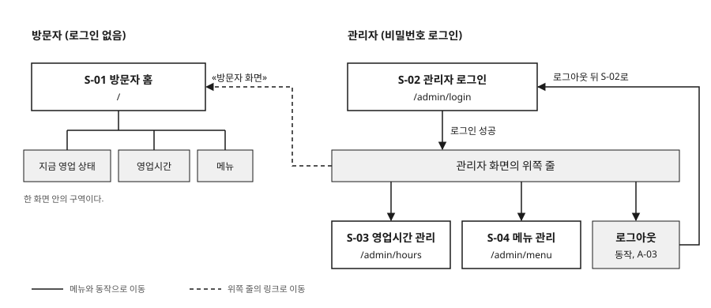
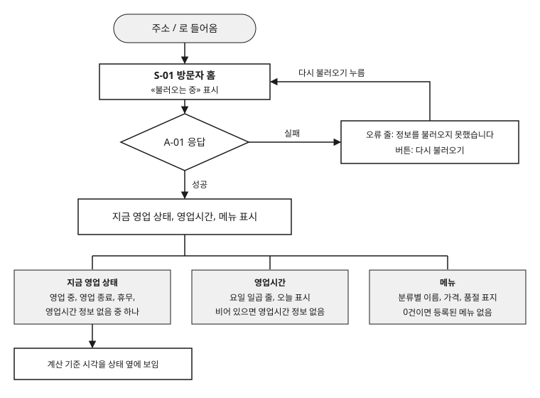
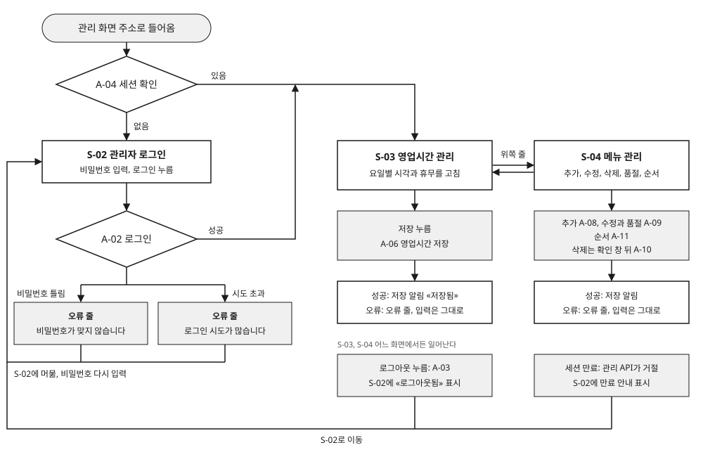
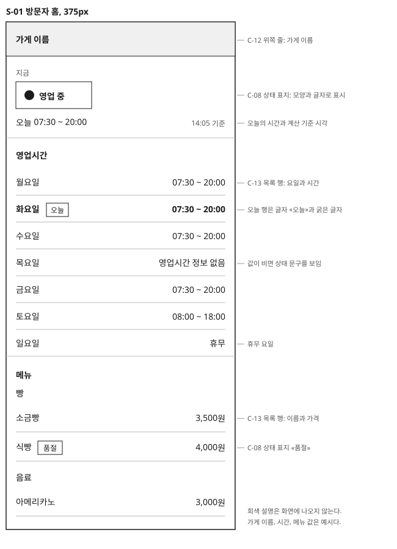
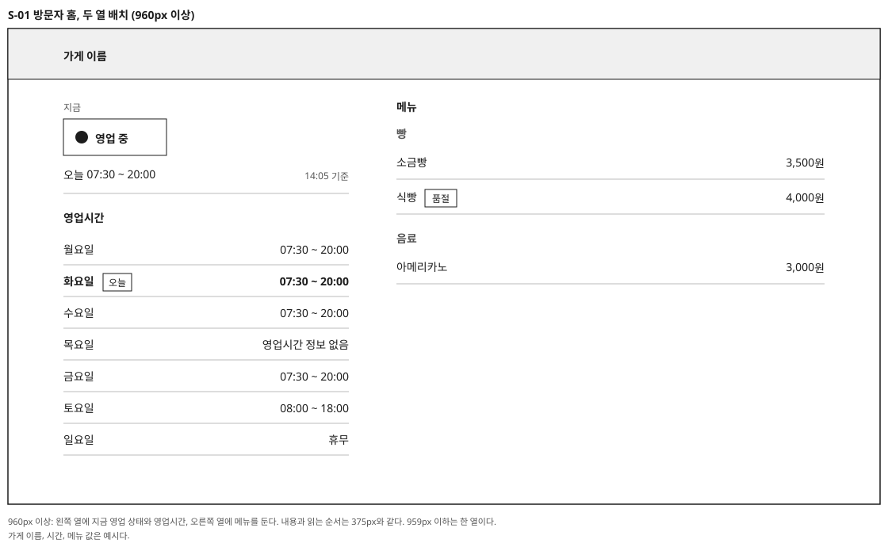
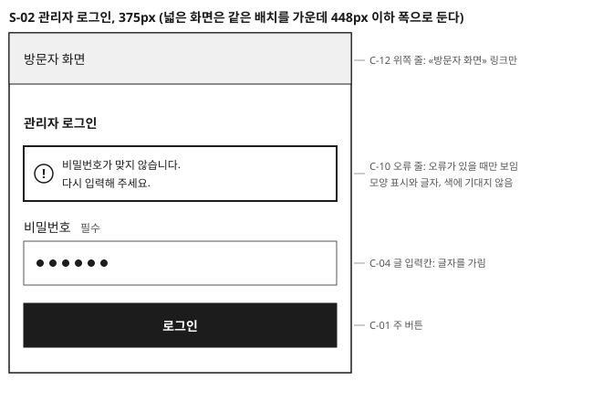
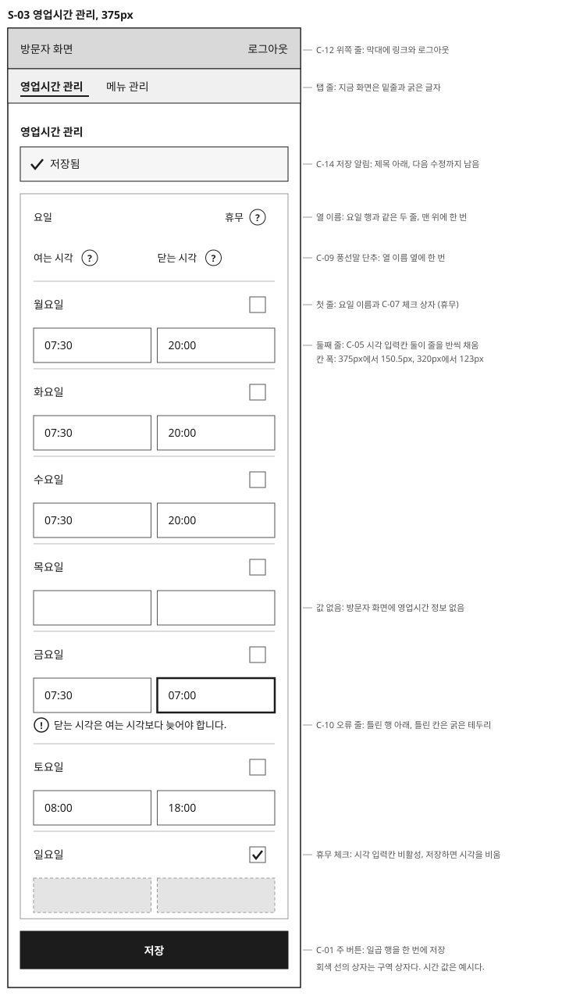
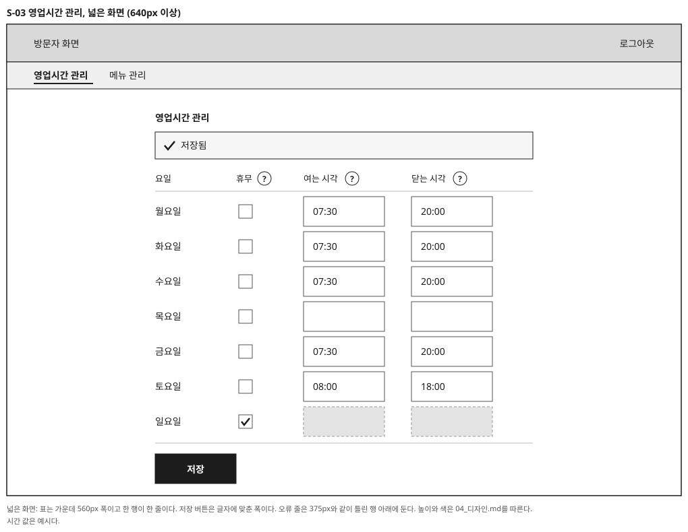
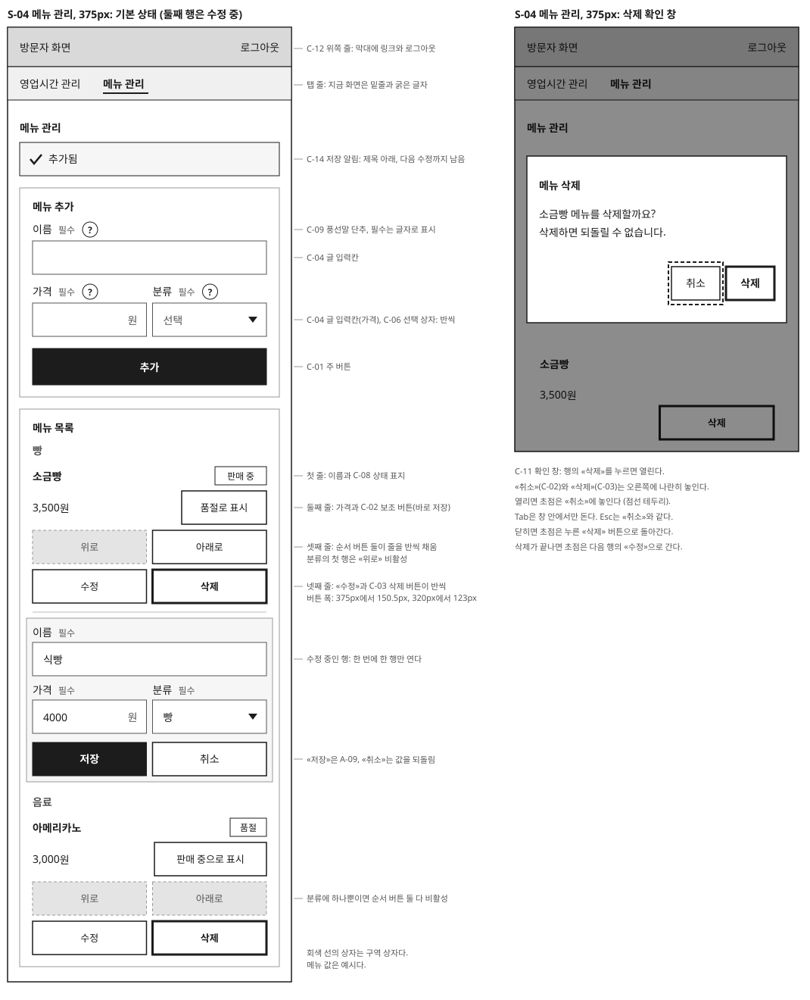
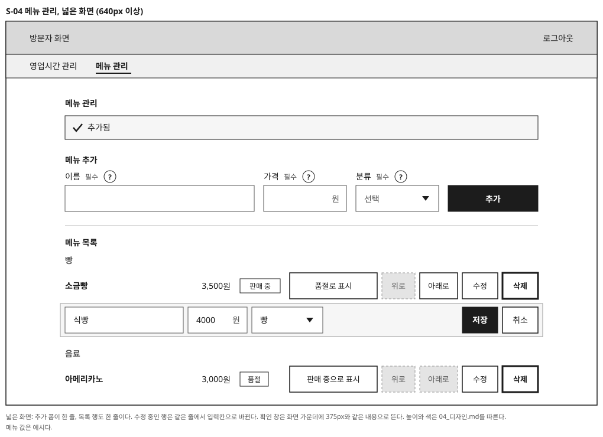

# 03 화면

> 화면 번호(S-01부터 S-04)와 화면 문구 키의 최종 권위 문서다. 요구, 역할, 상태 값, 분류, 컴포넌트, API, 컬럼의 이름은 `01_공통규칙.md`를 글자 그대로 쓴다.
> 범위는 요구 R-01부터 R-06이다. 화면은 네 개이고 이 밖의 화면, 메뉴, 기능은 두지 않는다.

## 0. 읽은 자료와 이 문서의 규칙

| 구분 | 내용 | 근거 |
|---|---|---|
| [관찰] | 화면은 네 개이고 이름, 경로, 역할이 정해져 있다 | `01_공통규칙.md` 8절 |
| [관찰] | 오류 응답은 `code`와 `text_key`만 싣고 숫자나 이름을 넣을 자리가 없다 | `01_공통규칙.md` 8-2절 |
| [관찰] | `business_hour`는 일곱 행이 항상 있고 `menu_item`은 비어서 시작한다 | `01_공통규칙.md` 7절 |
| [관찰] | 화면에는 설명 문장을 두지 않고 설명은 풍선말 한 줄, 10어절 이내로만 둔다 | `00_PLANNING_DOC_STANDARD.md` §2 원칙 2 |
| [관찰] | 휴무인 요일은 시각이 없다. 제약 `ck_business_hour_day_off`가 막는다 | `00_기획서.md` 4-5, `02_DB.md` T-01 |
| [관찰] | 쓰기 응답은 저장한 뒤 다시 읽은 값이고 화면은 그 값으로 다시 그린다 | `00_기획서.md` 4-5, `05_소스.md` 7절 |
| [관찰] | A-01은 영업 상태 코드, 문구 키, 오늘 요일, 계산 기준 시각을 준다. 세션 수명은 24시간이다 | `05_소스.md` 2-3절, 12절 |
| [실측] | `05_소스.md` 오류 표의 코드 29개가 모두 6.3절에 있고, 그 코드가 쓰는 문구 키 20개와 그 문서가 이름으로 부르는 문구 키 34개가 모두 이 문서의 사전에 있다 | 2026-11-17 6.3절에 코드 둘(`hours_day_off_has_time`, `menu_name_invalid`)을 더한 뒤 대조 스크립트를 다시 돌린 결과 |
| [관찰] | 배치가 바뀌는 폭은 640px이고 방문자 화면의 두 열은 960px부터다 | `04_디자인.md` 6절, `web/tokens.css` 머리 주석 |
| [실측] | 사전 표의 키 102개와 `web/text/ko.json`의 키 102개가 같고 문구도 같다 | 2026-11-17 대조 스크립트 실행 |
| [실측] | 도식 열 개를 PNG로 그려 눈으로 보았고 겹침과 잘림이 없었다. 고친 여덟 개(`menu-map.svg`, `flow-visitor.svg`, `wire-s01-mobile.svg`, `wire-s01-desktop.svg`, `wire-s03.svg`, `wire-s03-desktop.svg`, `wire-s04.svg`, `wire-s04-desktop.svg`)는 고친 뒤 다시 그려 보았다 | 2026-11-17 Chrome 헤드리스로 그린 결과 |

이 문서가 정하는 것과 정하지 않는 것은 다음과 같다.

| 정하는 것 | 정하지 않는 것 | 정하지 않는 것의 최종 권위 |
|---|---|---|
| 화면 구역, 상태, 입력칸, 버튼, 흐름 | 컴포넌트의 모양, 색, 글자 크기, 토큰, 중단점 | `04_디자인.md` |
| 화면 문구 키와 한국어 문구 | 요청과 응답의 필드, 오류 코드, 세션 길이, 로그인 제한 횟수 | `05_소스.md` |
| 입력칸이 어느 컬럼으로 가는지 | 컬럼의 타입, 제약, 인덱스 | `02_DB.md` |

## 1. 화면 목록과 메뉴 구성

### 1.1 화면 목록

| ID | 이름 | 경로 | 역할 | 쓰는 API |
|---|---|---|---|---|
| S-01 | 방문자 홈 | `/` | visitor | A-01 |
| S-02 | 관리자 로그인 | `/admin/login` | admin | A-02, A-04 |
| S-03 | 영업시간 관리 | `/admin/hours` | admin | A-03, A-04, A-05, A-06 |
| S-04 | 메뉴 관리 | `/admin/menu` | admin | A-03, A-04, A-07, A-08, A-09, A-10, A-11 |

### 1.2 요구가 놓이는 화면

| ID | 이름 | 화면과 구역 |
|---|---|---|
| R-01 | 지금 영업 상태 보기 | S-01의 지금 영업 상태 구역 |
| R-02 | 요일별 영업시간 보기 | S-01의 영업시간 구역 |
| R-03 | 메뉴 보기 | S-01의 메뉴 구역 |
| R-04 | 관리자 로그인과 로그아웃 | S-02 전체, S-03과 S-04의 위쪽 줄 «로그아웃» |
| R-05 | 영업시간 수정 | S-03 전체 |
| R-06 | 메뉴 추가, 수정, 삭제, 품절 표시, 순서 변경 | S-04 전체 |

### 1.3 API를 부르는 화면

| ID | 이름 | 부르는 화면 | 부르는 때 |
|---|---|---|---|
| A-01 | 방문자 화면 자료 | S-01 | 화면을 열 때, «다시 불러오기»를 누를 때 |
| A-02 | 로그인 | S-02 | «로그인»을 누를 때 |
| A-03 | 로그아웃 | S-03, S-04 | 위쪽 줄 «로그아웃»을 누를 때 |
| A-04 | 세션 확인 | S-02, S-03, S-04 | 화면을 열 때 |
| A-05 | 영업시간 읽기 | S-03 | 화면을 열 때, «다시 불러오기»를 누를 때 |
| A-06 | 영업시간 저장 | S-03 | «저장»을 누를 때 |
| A-07 | 메뉴 읽기 | S-04 | 화면을 열 때, «다시 불러오기»를 누를 때, 목록을 다시 맞출 때 |
| A-08 | 메뉴 추가 | S-04 | «추가»를 누를 때 |
| A-09 | 메뉴 수정 | S-04 | 수정 폼의 «저장», «품절로 표시», «판매 중으로 표시»를 누를 때 |
| A-10 | 메뉴 삭제 | S-04 | 확인 창의 «삭제»를 누를 때 |
| A-11 | 메뉴 순서 저장 | S-04 | «위로», «아래로»를 누를 때 |

열한 개 API 모두 부르는 화면이 있고, 화면이 부르는 API는 이 열한 개뿐이다.

### 1.4 메뉴 구성

| 역할 | 메뉴 항목 | 문구 키 | 가는 곳 | 보이는 화면 |
|---|---|---|---|---|
| admin | 방문자 화면 | `nav.home` | S-01 | S-02, S-03, S-04 |
| admin | 로그아웃 | `button.logout` | A-03을 부른 뒤 S-02 | S-03, S-04 |
| admin | 영업시간 관리 | `title.hours` | S-03 | S-03, S-04 |
| admin | 메뉴 관리 | `title.menu` | S-04 | S-03, S-04 |

방문자 화면에는 메뉴 항목이 없다. S-01 한 화면에 세 구역이 위에서 아래로 놓이고 위쪽 줄에는 가게 이름만 있다. 관리자의 메뉴는 모두 위쪽 줄(C-12) 안에 있다. 옆 메뉴, 아래 메뉴, 햄버거 메뉴는 없다. 관리자 화면의 위쪽 줄은 막대(«방문자 화면» 링크와 «로그아웃»)와 그 아래 탭 줄(«영업시간 관리», «메뉴 관리»)이다. 지금 있는 화면의 탭은 굵은 글자와 `aria-current="page"`로 표시한다.

## 2. 흐름

### 2.1 방문자 흐름

| 순서 | 방문자가 하는 일 | 화면이 하는 일 | API |
|---|---|---|---|
| 1 | 주소 `/`를 연다 | S-01이 «불러오는 중»을 보이고 자료를 요청한다 | A-01 |
| 2 | 기다린다 | 성공하면 지금 영업 상태, 영업시간, 메뉴를 보인다 | 해당 없음 |
| 3 | 요청이 실패한 화면에서 «다시 불러오기»를 누른다 | 오류 줄을 지우고 1번부터 다시 한다 | A-01 |

방문자는 입력하지 않는다. 방문자 화면에는 저장, 로그인, 검색, 필터가 없다.

### 2.2 관리자 흐름

| 흐름 | 시작 조건 | 화면이 하는 일 | 보이는 문구 키 | 끝나는 곳 |
|---|---|---|---|---|
| 로그인 | S-02에서 비밀번호를 넣고 «로그인»을 누른다 | A-02를 부르고 성공하면 이동한다 | 해당 없음 | S-03 |
| 이미 로그인됨 | 세션이 있는 채로 S-02를 연다 | A-04가 성공하면 바로 이동한다 | 해당 없음 | S-03 |
| 로그인 없이 관리 화면 열기 | 세션 없이 S-03 또는 S-04의 주소를 연다 | 서버가 S-02로 돌려보낸다. 문구는 없다 | 해당 없음 | S-02 |
| 비밀번호 틀림 | A-02가 비밀번호를 거절한다 | 오류 줄을 보이고 비밀번호 칸을 비우고 초점을 그 칸에 둔다 | `error.login.failed` | S-02에 머문다 |
| 시도 초과 | A-02가 횟수 제한으로 거절한다 | 오류 줄을 보인다. 입력칸과 버튼은 그대로 두고 서버가 거절한다 | `error.login.locked` | S-02에 머문다 |
| 영업시간 수정 | S-03에서 값을 고치고 «저장»을 누른다 | 검사한 뒤 A-06으로 일곱 행을 보내고, 응답의 일곱 행으로 다시 채우고 저장 알림을 보인다 | `notice.saved` | S-03에 머문다 |
| 영업시간 입력 오류 | 보내기 전 검사에서 걸린다 | 틀린 행 아래에 오류 줄을 보이고 초점을 첫 틀린 칸에 둔다. 입력은 그대로 둔다 | `error.hours.opens.required`, `error.hours.closes.required`, `error.hours.order`, `error.hours.format` | S-03에 머문다 |
| 메뉴 추가 | S-04 추가 폼을 채우고 «추가»를 누른다 | A-08을 부르고 응답의 목록으로 다시 그린다. 새 메뉴는 그 분류의 맨 끝에 있다. 폼을 비운다 | `notice.added` | S-04에 머문다 |
| 메뉴 수정 | 행의 «수정»을 누르고 값을 고친 뒤 «저장»을 누른다 | A-09를 부르고 응답의 목록으로 다시 그린다 | `notice.saved` | S-04에 머문다 |
| 품절 표시 | 행의 «품절로 표시» 또는 «판매 중으로 표시»를 누른다 | A-09를 부르고 상태 표지와 버튼 문구를 바꾼다 | `notice.saved` | S-04에 머문다 |
| 순서 변경 | 행의 «위로» 또는 «아래로»를 누른다 | 같은 분류 안에서 한 칸 옮긴 순서를 A-11로 보내고 응답의 목록으로 다시 그린다 | `notice.saved` | S-04에 머문다 |
| 메뉴 삭제 | 행의 «삭제»를 누른다 | 확인 창을 열고, 창의 «삭제»를 누르면 A-10을 부르고 응답의 목록으로 다시 그린다 | `confirm.delete.title`, `confirm.delete.body`, `notice.deleted` | S-04에 머문다 |
| 로그아웃 | S-03 또는 S-04에서 «로그아웃»을 누른다 | A-03을 부르고 이동한다 | `notice.loggedout` | S-02 |
| 세션 만료 | 관리 화면을 쓰는 중에 관리 API가 세션이 없다고 거절한다 | 이동해서 오류 줄을 보인다. 저장하지 않은 입력은 사라진다 | `error.session.expired` | S-02 |
| 화면이 오래됨 | 쓰기 요청이 위조 방지 값 불일치로 거절된다 | 오류 줄을 보이고 입력은 그대로 둔다. 스스로 다시 보내지 않는다 | `error.form.expired` | 그 화면에 머문다 |
| 연결 끊김 | 요청이 서버에 닿지 못한다 | 오류 줄을 보이고 입력은 그대로 둔다 | `error.network` | 그 화면에 머문다 |
| 서버 오류 | 서버가 쓰기 요청을 처리하지 못한다 | 오류 줄을 보이고 입력은 그대로 둔다 | `error.server` | 그 화면에 머문다 |

S-02로 보낼 때 화면은 사유 하나(로그아웃, 세션 만료)를 함께 넘긴다. 넘기는 방법은 `05_소스.md`가 정한다. 사유에는 개인정보가 없다. 로그인한 뒤에는 항상 S-03으로 간다.

## 3. 화면별 명세

### 3.0 모든 화면에 공통인 것

| 항목 | 규칙 |
|---|---|
| 건너뛰기 링크 | 모든 화면의 첫 초점은 `nav.skip` 링크다. 초점을 받을 때만 보이고 누르면 본문 첫 제목으로 간다 |
| 문서 제목 | S-01은 `title.home`(가게 이름이 들어간다), S-02는 `title.login`, S-03은 `title.hours`, S-04는 `title.menu` |
| 검색 설명 | S-01의 설명 메타는 문서 제목과 같은 글자다. 관리자 화면은 색인하지 않는다 |
| 제목 1단계 | S-01은 가게 이름, S-02부터 S-04는 문서 제목과 같은 문구. 화면마다 하나만 둔다 |
| 가게 이름 | 환경 변수 `SHOP_NAME`의 값이고 사전에 두지 않는다. S-01에만 보인다 |
| 로딩 | 자료를 받는 동안 본문 자리에 `notice.loading`을 보인다. 자료가 오기 전에는 빈 표나 0건 문구를 보이지 않는다 |
| 요청 중인 버튼 | 누른 버튼은 응답이 올 때까지 비활성이다. «저장»은 그동안 문구가 `notice.saving`으로 바뀐다 |
| 다시 그리기 | 쓰기 요청이 성공하면 화면은 자기가 보낸 값이 아니라 응답이 돌려준 값으로 다시 그린다 |
| 저장 알림 | C-14는 화면 제목 아래에 뜨고 다음 수정이나 화면 이동 때까지 남는다. `role="status"`로 알리고 초점을 옮기지 않는다 |
| 오류 줄 | C-10은 원인을 고치거나 다시 요청할 때까지 남는다. 입력칸 아래 줄은 그 입력칸에 잇고, 불러오기나 저장 실패의 띠는 `role="alert"`로 알린다 |
| 다시 불러오기 | 불러오기 실패의 띠 안에 있는 단추다. 문구 키는 `button.retry`다 |
| 필수 표시 | 필수 입력칸의 라벨 옆에 `mark.required` 글자를 둔다. 별표만으로 표시하지 않는다 |
| 풍선말 | C-09는 라벨 옆의 `?` 단추다. 가리키거나 초점을 주거나 누르면 열리고 Esc로 닫힌다. 열린 풍선말은 입력칸을 가리지 않는다. 단추의 읽는 이름은 `tip.aria`다 |
| 지난 값 | 요청이 실패하면 지난번에 받은 영업 상태를 보이지 않는다. 방문자가 틀린 상태를 믿지 않게 하기 위해서다 |

컴포넌트를 쓰는 화면은 다음과 같다. 모양의 최종 권위는 `04_디자인.md`다.

| ID | 이름 | S-01 | S-02 | S-03 | S-04 |
|---|---|---|---|---|---|
| C-01 | 주 버튼 | 안 씀 | 로그인 | 저장 | 추가, 수정 폼의 저장 |
| C-02 | 보조 버튼 | 안 씀 | 안 씀 | 안 씀 | 위로, 아래로, 품절로 표시, 판매 중으로 표시, 수정, 취소 |
| C-03 | 삭제 버튼 | 안 씀 | 안 씀 | 안 씀 | 행의 삭제, 확인 창의 삭제 |
| C-04 | 글 입력칸 | 안 씀 | 비밀번호 | 안 씀 | 이름, 가격 |
| C-05 | 시각 입력칸 | 안 씀 | 안 씀 | 여는 시각, 닫는 시각 | 안 씀 |
| C-06 | 선택 상자 | 안 씀 | 안 씀 | 안 씀 | 분류 |
| C-07 | 체크 상자 | 안 씀 | 안 씀 | 휴무 | 안 씀 |
| C-08 | 상태 표지 | 영업 상태, 품절 | 안 씀 | 안 씀 | 판매 중, 품절 |
| C-09 | 풍선말 단추 | 안 씀 | 안 씀 | 휴무, 여는 시각, 닫는 시각 | 이름, 가격, 분류 |
| C-10 | 오류 줄 | 불러오기 실패 | 로그인 실패, 세션 만료 | 입력 오류, 불러오기와 저장 실패 | 입력 오류, 불러오기와 저장 실패 |
| C-11 | 확인 창 | 안 씀 | 안 씀 | 안 씀 | 메뉴 삭제 |
| C-12 | 위쪽 줄 | 가게 이름 | 방문자 화면 링크 | 막대와 탭 줄 | 막대와 탭 줄 |
| C-13 | 목록 행 | 요일 행, 메뉴 행 | 안 씀 | 요일 행 | 메뉴 행 |
| C-14 | 저장 알림 | 안 씀 | 로그아웃됨 | 저장됨 | 추가됨, 저장됨, 삭제됨 |

### 3.1 S-01 방문자 홈

구역은 위에서 아래로 다음 순서다.

| 구역 | 내용 | 컴포넌트 |
|---|---|---|
| 위쪽 줄 | 가게 이름 | C-12 위쪽 줄 |
| 지금 영업 상태 | 라벨 `status.now`, 큰 상태 표지 하나, 오늘의 시간 줄, 계산 기준 시각 `status.asof` | C-08 상태 표지 |
| 영업시간 | 제목 `hours.heading`, 월요일부터 일요일까지 일곱 행. 오늘 행에는 글자 `status.today`를 붙이고 굵게 쓴다 | C-13 목록 행 |
| 메뉴 | 제목 `menu.heading`, 분류 제목(빵, 케이크, 쿠키, 음료 순서), 행마다 이름과 가격, 품절이면 «품절» 표지 | C-13 목록 행, C-08 상태 표지 |
| 오류 | 요청이 실패했을 때만 오류 줄과 그 안의 «다시 불러오기» | C-10 오류 줄 |

지금 영업 상태 구역은 A-01이 준 상태 코드와 문구 키를 그대로 쓴다. 화면에서 다시 계산하지 않고, 열어 둔 화면이 스스로 다시 읽지도 않는다. 그래서 계산 기준 시각을 상태 옆에 늘 보인다(예: 14:05 기준).

| 상태 코드 | 상태 표지 문구 키 | 오늘의 시간 줄 |
|---|---|---|
| open | `status.open` | `status.today`와 `hours.range` (예: 오늘 07:30 ~ 20:00) |
| closed | `status.closed` | `status.today`와 `hours.range` |
| dayoff | `status.dayoff` | 보이지 않는다 |
| unset | `status.unset` | 보이지 않는다 |

영업시간 구역의 행은 그 요일의 값에 따라 다음 중 하나를 보인다.

| 그 요일의 값 | 행의 오른쪽에 보이는 것 |
|---|---|
| `is_day_off`가 1 | `status.dayoff` |
| 휴무가 아니고 `opens_at`이 비어 있음 | `status.unset` |
| 휴무가 아니고 두 시각이 있음 | `hours.range` (예: 07:30 ~ 20:00) |

메뉴 구역의 규칙은 다음과 같다.

| 항목 | 규칙 |
|---|---|
| 묶음 | `category`로 묶고 응답의 분류 목록 순서대로 놓는다. 메뉴가 없는 분류는 제목도 보이지 않는다 |
| 순서 | 한 분류 안에서는 응답의 순서(`sort_order`)다 |
| 가격 | `price.format`으로 쓴다. 천 단위 쉼표를 넣는다. 줄을 바꾸지 않는다 |
| 품절 | `sale_status`가 sold_out이면 이름 옆에 `sale.soldout` 표지를 둔다. 행을 숨기지 않는다. on_sale이면 표지를 두지 않는다 |
| 긴 이름 | 이름은 자르지 않고 줄을 바꾼다. 행의 높이가 늘어난다 |

S-01이 A-01에서 받는 값은 다음과 같다. 필드 이름은 `05_소스.md` 2-3절의 것이다.

| 값 | 필드 | 쓰는 곳 |
|---|---|---|
| 가게 이름 | `shop_name` | 위쪽 줄 |
| 영업 상태 코드와 문구 키 | `shop_status`의 code, text_key | 지금 영업 상태 |
| 오늘 요일 | `shop_status`의 weekday | 오늘의 시간 줄, 영업시간의 오늘 행 |
| 계산 기준 시각 | `shop_status`의 local_time | 지금 영업 상태의 `status.asof` |
| 분류 목록 | `category_list` (code, text_key) | 메뉴의 분류 제목과 순서 |
| 요일별 영업시간 일곱 행 | `business_hour` (weekday, opens_at, closes_at, is_day_off) | 영업시간, 오늘의 시간 줄 |
| 메뉴 목록 | `menu_item` (id, name, price_krw, category, sale_status, sort_order) | 메뉴 |

상태별로 보이는 것은 다음과 같다.

| 상태 | 보이는 것 |
|---|---|
| 기본 | 위쪽 줄, 지금 영업 상태, 영업시간 일곱 행, 분류별 메뉴 |
| 로딩 | 위쪽 줄(가게 이름 자리는 비어 있고 높이는 그대로)과 본문 자리의 `notice.loading` |
| 빈 | 메뉴가 0건이면 메뉴 제목 아래에 `menu.empty`(등록된 메뉴 없음). 요일의 시각이 비어 있으면 그 행에 `status.unset`(영업시간 정보 없음). 오늘이 그런 요일이면 상태 표지도 `status.unset`. 일곱 요일이 모두 비어 있으면 일곱 행 모두 `status.unset` |
| 오류 | 위쪽 줄과 오류 줄 `error.load`(연결이 끊겼으면 `error.network`), 그 안의 «다시 불러오기»만 보인다. 지금 영업 상태, 영업시간, 메뉴 구역은 보이지 않는다 |

| 입력칸 | 라벨 | 제약 | 오류 문구 키 | 풍선말 |
|---|---|---|---|---|
| 해당 없음 | 해당 없음 | 해당 없음 | 해당 없음 | 해당 없음 |

| 버튼 | 문구 키 | 비활성 조건 | 결과 |
|---|---|---|---|
| 건너뛰기 링크 | `nav.skip` | 없음 | 초점이 본문 첫 제목으로 간다 |
| 오류 줄의 «다시 불러오기» (오류 상태에만 있음) | `button.retry` | 요청 중 | A-01을 다시 부른다 |

### 3.2 S-02 관리자 로그인

| 구역 | 내용 | 컴포넌트 |
|---|---|---|
| 위쪽 줄 | 링크 «방문자 화면» 하나 | C-12 위쪽 줄 |
| 제목 | `title.login` | 해당 없음 |
| 알림과 오류 | 로그아웃해서 왔으면 저장 알림 `notice.loggedout`, 오류가 있으면 오류 줄 | C-14 저장 알림, C-10 오류 줄 |
| 로그인 폼 | 비밀번호 입력칸, «로그인» | C-04 글 입력칸, C-01 주 버튼 |

| 상태 | 보이는 것 |
|---|---|
| 기본 | 위쪽 줄, 제목, 비밀번호 입력칸, «로그인». 화면을 열면 초점은 비밀번호 입력칸에 있다 |
| 로딩 | A-04로 세션을 확인하는 동안 폼 자리에 `notice.loading`. 로그인 요청 중에는 «로그인»이 비활성이다 |
| 빈 | 해당 없음. 목록이 없는 화면이다 |
| 오류 | 폼 위의 오류 줄. 비밀번호 틀림 `error.login.failed`, 시도 초과 `error.login.locked`, 세션 만료로 왔을 때 `error.session.expired`, 세션 확인 실패 `error.load`, 연결 끊김 `error.network`, 서버 오류 `error.server`. 빈 채로 누르면 입력칸 아래에 `error.password.required` |

| 입력칸 | 라벨 | 제약 | 오류 문구 키 | 풍선말 |
|---|---|---|---|---|
| 비밀번호 (C-04 글 입력칸, 글자를 가림) | `login.password` | 필수. 1자 이상 200자 이하. 붙여 넣기와 비밀번호 관리 도구의 자동 입력을 막지 않는다. `autocomplete="current-password"` | `error.password.required`, `error.login.failed`, `error.login.locked` | 해당 없음 |

| 버튼 | 문구 키 | 비활성 조건 | 결과 |
|---|---|---|---|
| 건너뛰기 링크 | `nav.skip` | 없음 | 초점이 제목으로 간다 |
| 위쪽 줄 «방문자 화면» | `nav.home` | 없음 | S-01로 간다 |
| 주 버튼 «로그인» | `button.login` | 요청 중 | 비어 있으면 보내지 않고 `error.password.required`를 보인다. 값이 있으면 A-02를 부르고 성공하면 S-03으로 간다. 실패하면 오류 줄을 보이고 비밀번호 칸을 비운다. Enter로도 같은 일을 한다 |

### 3.3 S-03 영업시간 관리

| 구역 | 내용 | 컴포넌트 |
|---|---|---|
| 위쪽 줄 | 막대에 링크 «방문자 화면»과 «로그아웃», 탭 줄에 «영업시간 관리»(지금 화면)와 «메뉴 관리». 탭 줄을 감싼 `nav` 요소의 읽는 이름은 `nav.admin`이다 | C-12 위쪽 줄 |
| 제목 | `title.hours` | 해당 없음 |
| 저장 결과 | 제목 아래의 저장 알림, 저장 실패 때는 같은 자리의 오류 줄 | C-14 저장 알림, C-10 오류 줄 |
| 열 이름 | `hours.weekday`, `hours.dayoff`, `hours.opens`, `hours.closes`. 뒤의 세 개 옆에 풍선말 단추 | C-09 풍선말 단추 |
| 요일 행 일곱 개 | 월요일부터 일요일까지. 행마다 요일 이름, 휴무, 여는 시각, 닫는 시각 순서다. 넓은 화면에서는 한 행이 한 줄이고 좁은 화면에서는 한 행이 두 줄이다(7.1절) | C-13 목록 행, C-07 체크 상자, C-05 시각 입력칸 |
| 행 오류 | 틀린 행 바로 아래 | C-10 오류 줄 |
| 저장 | «저장» 하나. 일곱 행을 한 번에 보낸다 | C-01 주 버튼 |

| 상태 | 보이는 것 |
|---|---|
| 기본 | 일곱 행에 저장된 값이 채워져 있다. 휴무인 행은 체크 상자가 켜져 있고 두 시각 입력칸이 비어 있고 비활성이다 |
| 로딩 | 위쪽 줄, 제목, 폼 자리의 `notice.loading`. 저장 요청 중에는 «저장»이 비활성이고 문구가 `notice.saving`이다 |
| 빈 | 일곱 행은 항상 있다. 값이 없는 요일은 두 시각 입력칸이 비어 있고 휴무 체크가 꺼져 있다. 그 요일은 방문자 화면에 `status.unset`(영업시간 정보 없음)으로 보인다 |
| 오류 | 불러오기 실패: 폼 대신 오류 줄 `error.load`와 그 안의 «다시 불러오기». 보내기 전 검사에서 걸림: 틀린 행 아래 오류 줄, 틀린 칸은 굵은 테두리와 `aria-invalid`. 서버가 거절함: 폼 위(제목 아래) 오류 줄에 응답의 `text_key` 문구(`error.server`, `error.form.expired`, 입력 오류의 키), 입력은 그대로. 연결 끊김: 같은 자리에 `error.network` |

| 입력칸 | 라벨 | 제약 | 오류 문구 키 | 풍선말 |
|---|---|---|---|---|
| 휴무 (C-07 체크 상자, 요일마다 하나) | `hours.dayoff`, 읽는 이름 `hours.aria.dayoff` | 켜면 그 행의 두 시각 입력칸이 비활성이 되고 검사에서 빠진다. 저장할 때 그 행의 두 시각은 비워 보낸다. 저장하기 전에 다시 끄면 넣어 둔 시각이 다시 쓰인다 | 해당 없음 | 켜고 저장하면 그날 시각은 지워집니다 |
| 여는 시각 (C-05 시각 입력칸, 요일마다 하나) | `hours.opens`, 읽는 이름 `hours.aria.opens` | 24시간 `HH:MM`, 5분 단위. 닫는 시각이 있으면 필수. 두 칸을 모두 비우면 그 요일은 값 없음으로 저장한다 | `error.hours.opens.required`, `error.hours.format` | 5분 단위로 넣고, 비우면 정보 없음으로 보입니다 |
| 닫는 시각 (C-05 시각 입력칸, 요일마다 하나) | `hours.closes`, 읽는 이름 `hours.aria.closes` | 24시간 `HH:MM`, 5분 단위. 여는 시각이 있으면 필수. 여는 시각보다 늦어야 한다(자정을 넘기는 영업은 받지 않는다) | `error.hours.closes.required`, `error.hours.order`, `error.hours.format` | 여는 시각보다 늦어야 합니다 |

풍선말 단추는 열 이름 옆에 한 번씩만 둔다. 행마다 두지 않는다.

| 버튼 | 문구 키 | 비활성 조건 | 결과 |
|---|---|---|---|
| 건너뛰기 링크 | `nav.skip` | 없음 | 초점이 제목으로 간다 |
| 위쪽 줄 «방문자 화면» | `nav.home` | 없음 | S-01로 간다 |
| 위쪽 줄 «로그아웃» | `button.logout` | 요청 중 | A-03을 부르고 S-02로 가서 `notice.loggedout`을 보인다 |
| 탭 «영업시간 관리» | `title.hours` | 없음 | 지금 화면이다. 누르면 화면을 다시 연다 |
| 탭 «메뉴 관리» | `title.menu` | 없음 | S-04로 간다 |
| 풍선말 단추 (휴무, 여는 시각, 닫는 시각 옆) | `tip.aria` | 없음 | 풍선말을 열고 닫는다 |
| 주 버튼 «저장» | `button.save`, 요청 중에는 `notice.saving` | 요청 중 | 검사를 통과하면 A-06으로 일곱 행의 `weekday`, `opens_at`, `closes_at`, `is_day_off`를 모두 보낸다. 성공하면 응답의 일곱 행으로 다시 채우고 `notice.saved`를 보인다. 검사에서 걸리면 보내지 않고 오류 줄을 보이고 초점을 첫 틀린 칸에 둔다 |
| 오류 줄의 «다시 불러오기» (불러오기 실패 상태에만 있음) | `button.retry` | 요청 중 | A-05를 다시 부른다 |

### 3.4 S-04 메뉴 관리

| 구역 | 내용 | 컴포넌트 |
|---|---|---|
| 위쪽 줄 | 막대에 링크 «방문자 화면»과 «로그아웃», 탭 줄에 «영업시간 관리»와 «메뉴 관리»(지금 화면). 탭 줄을 감싼 `nav` 요소의 읽는 이름은 `nav.admin`이다 | C-12 위쪽 줄 |
| 제목 | `title.menu` | 해당 없음 |
| 결과 | 제목 아래의 저장 알림 | C-14 저장 알림 |
| 메뉴 추가 | 제목 `menu.add`, 이름, 가격, 분류, «추가». 라벨 옆에 풍선말 단추 | C-04 글 입력칸, C-06 선택 상자, C-09 풍선말 단추, C-01 주 버튼 |
| 메뉴 목록 | 제목 `menu.list`, 분류 제목(메뉴가 있는 분류만), 메뉴 행 | C-13 목록 행 |
| 메뉴 행 (보기 상태) | 이름, 가격, 상태 표지, «품절로 표시» 또는 «판매 중으로 표시», «위로», «아래로», «수정», «삭제» | C-08 상태 표지, C-02 보조 버튼, C-03 삭제 버튼 |
| 메뉴 행 (수정 상태) | 이름, 가격, 분류 입력칸과 «저장», «취소». 한 번에 한 행만 수정 상태가 된다 | C-04 글 입력칸, C-06 선택 상자, C-01 주 버튼, C-02 보조 버튼 |
| 확인 창 | 제목 `confirm.delete.title`, 본문 `confirm.delete.body`, «취소», «삭제» | C-11 확인 창 |
| 오류 | 입력칸 아래 줄, 행 아래 줄, 불러오기 실패의 띠 | C-10 오류 줄 |

| 상태 | 보이는 것 |
|---|---|
| 기본 | 추가 폼(비어 있음)과 분류별 메뉴 행. 행의 상태 표지는 `sale.onsale` 또는 `sale.soldout` |
| 로딩 | 위쪽 줄, 제목, 본문 자리의 `notice.loading`. 요청 중인 버튼은 비활성이다 |
| 빈 | 메뉴가 0건이면 추가 폼은 그대로 있고 목록 자리에 `menu.empty`(등록된 메뉴 없음)를 보인다 |
| 오류 | 불러오기 실패: 본문 대신 오류 줄 `error.load`와 그 안의 «다시 불러오기». 입력 오류: 틀린 입력칸 아래 오류 줄, 초점은 첫 틀린 칸. 메뉴 수 한도: «추가» 위 `error.menu.limit`. 행 동작 실패: 그 행 아래 오류 줄에 응답의 `text_key` 문구(`error.server`, `error.form.expired`)나 `error.network`. 이미 지워진 메뉴: `error.menu.missing`을 보이고 A-07로 목록을 다시 맞춘다. 순서가 서버와 다름: `error.menu.order`를 보이고 A-07로 목록을 다시 맞춘다 |

| 입력칸 | 라벨 | 제약 | 오류 문구 키 | 풍선말 |
|---|---|---|---|---|
| 이름 (C-04 글 입력칸, 추가 폼과 수정 폼) | `menu.name` | 필수. 앞뒤 공백을 뺀 1자 이상 40자 이하. 가운데에 탭이나 줄바꿈 같은 제어 문자가 없어야 한다(걸리면 `error.menu.name.length`를 보인다) | `error.menu.name.required`, `error.menu.name.length` | 1자부터 40자까지 입력합니다 |
| 가격 (C-04 글 입력칸, 숫자 자판, 추가 폼과 수정 폼) | `menu.price`, 칸 안의 단위 `menu.unit` | 필수. 정수 0 이상 1,000,000 이하. 쉼표 없이 숫자만 받는다 | `error.menu.price.required`, `error.menu.price.range` | 원 단위 숫자만 입력합니다 |
| 분류 (C-06 선택 상자, 추가 폼과 수정 폼) | `menu.category`, 첫 항목 `menu.choose` | 필수. 빵, 케이크, 쿠키, 음료 중 하나. 추가 폼은 고르지 않은 상태로 시작한다 | `error.menu.category.required` | 방문자 화면에서 분류별로 묶여 보입니다 |

풍선말 단추는 추가 폼의 라벨 옆에만 둔다. 수정 폼은 같은 칸이고 제약이 같다.

| 버튼 | 문구 키 | 비활성 조건 | 결과 |
|---|---|---|---|
| 건너뛰기 링크 | `nav.skip` | 없음 | 초점이 제목으로 간다 |
| 위쪽 줄 «방문자 화면» | `nav.home` | 없음 | S-01로 간다 |
| 위쪽 줄 «로그아웃» | `button.logout` | 요청 중 | A-03을 부르고 S-02로 가서 `notice.loggedout`을 보인다 |
| 탭 «영업시간 관리» | `title.hours` | 없음 | S-03으로 간다 |
| 탭 «메뉴 관리» | `title.menu` | 없음 | 지금 화면이다. 누르면 화면을 다시 연다 |
| 풍선말 단추 (이름, 가격, 분류 옆) | `tip.aria` | 없음 | 풍선말을 열고 닫는다 |
| 주 버튼 «추가» | `button.add` | 요청 중 | 검사를 통과하면 A-08로 `name`, `price_krw`, `category` 셋을 보낸다. 새 메뉴는 판매 중이고 그 분류의 맨 끝에 놓인다. 응답의 목록으로 다시 그리고 `notice.added`를 보인다. 폼을 비우고 초점을 이름 칸에 둔다 |
| 보조 버튼 «품절로 표시» (판매 중인 행) | `button.soldout`, 읽는 이름 `menu.aria.soldout` | 요청 중 | A-09로 그 행의 `name`, `price_krw`, `category`와 바꾼 `sale_status`를 모두 보낸다. 상태 표지가 «품절»이 되고 버튼이 «판매 중으로 표시»로 바뀐다. `notice.saved`를 보인다. 초점은 그 버튼에 남는다 |
| 보조 버튼 «판매 중으로 표시» (품절인 행) | `button.onsale`, 읽는 이름 `menu.aria.onsale` | 요청 중 | 위와 같고 상태 표지가 «판매 중»이 되고 버튼이 «품절로 표시»로 바뀐다 |
| 보조 버튼 «위로» | `button.up`, 읽는 이름 `menu.aria.up` | 분류의 첫 행일 때, 요청 중 | 같은 분류 안에서 한 칸 위로 옮긴 뒤 A-11로 그 분류의 코드와 메뉴 번호 전부를 새 순서대로 보낸다. `notice.saved`를 보인다. 초점은 옮겨진 행의 같은 버튼에 남고, 그 버튼이 비활성이 되면 같은 행의 «아래로»로 간다 |
| 보조 버튼 «아래로» | `button.down`, 읽는 이름 `menu.aria.down` | 분류의 마지막 행일 때, 요청 중 | 같은 분류 안에서 한 칸 아래로 옮기고 A-11을 부른다. 초점 규칙은 «위로»와 같다 |
| 보조 버튼 «수정» | `button.edit`, 읽는 이름 `menu.aria.edit` | 요청 중 | 그 행을 수정 상태로 바꾸고 초점을 이름 칸에 둔다. 다른 행이 수정 상태였으면 그 행은 값을 되돌리고 닫는다 |
| 주 버튼 «저장» (수정 상태의 행) | `button.save`, 요청 중에는 `notice.saving` | 요청 중 | 검사를 통과하면 A-09로 `name`, `price_krw`, `category`, `sale_status`를 모두 보낸다. 응답의 목록으로 다시 그리고 `notice.saved`를 보인다. 분류를 바꾼 메뉴는 새 분류의 맨 끝에 있다. 초점은 그 행의 «수정»으로 간다 |
| 보조 버튼 «취소» (수정 상태의 행) | `button.cancel` | 없음 | 값을 되돌리고 보기 상태로 돌아간다. 초점은 그 행의 «수정»으로 간다 |
| 삭제 버튼 «삭제» (행) | `button.delete`, 읽는 이름 `menu.aria.delete` | 요청 중 | 확인 창을 연다. 아직 지우지 않는다 |
| 확인 창의 보조 버튼 «취소» | `button.cancel` | 없음 | 창을 닫고 초점을 누른 «삭제»로 돌린다 |
| 확인 창의 삭제 버튼 «삭제» | `button.delete` | 요청 중 | A-10을 부른다. 성공하면 창을 닫고 응답의 목록으로 다시 그리고 `notice.deleted`를 보인다. 초점은 다음 행의 «수정», 다음 행이 없으면 앞 행의 «수정», 목록이 비면 추가 폼의 이름 칸으로 간다 |
| 오류 줄의 «다시 불러오기» (불러오기 실패 상태에만 있음) | `button.retry` | 요청 중 | A-07을 다시 부른다 |

순서는 끌어서 바꾸지 않는다. «위로»와 «아래로» 버튼만 쓴다. 키보드와 한 손가락으로 같은 일을 할 수 있어야 하기 때문이다.

품절 표시는 체크 상자가 아니라 버튼이다. 체크 상자(C-07)는 S-03에서 «저장»을 눌러야 저장되는 값에 쓰고, 누르면 바로 저장되는 동작은 버튼으로 통일한다.

## 4. 문장이 화면에 나오는 예외 목록

화면에는 메뉴, 제목, 라벨, 값, 버튼 문구, 상태 낱말만 둔다. 아래 두 종류만 문장으로 나온다. 약관 동의, 결제 금액, 법적 고지는 이 사이트에 없다.

| 종류 | 문구 키 | 나오는 곳 | 문장으로 두는 이유 |
|---|---|---|---|
| 오류 해결 안내 | `error.`로 시작하는 스물한 개 | 오류 줄(C-10) | 무슨 일이 있었는지와 다음에 할 일을 그 자리에서 알려야 한다. 풍선말은 사용자가 눌러야 보이므로 오류를 알릴 수 없다 |
| 삭제 확인 | `confirm.delete.body` | 확인 창(C-11) | 지우면 되돌릴 수 없다. 무엇을 지우는지(메뉴 이름)와 되돌릴 수 없다는 사실을 누르기 전에 알려야 한다 |

예외가 아닌 것은 다음과 같다.

| 문구 | 종류 | 문장이 아닌 이유 |
|---|---|---|
| `notice.saved`, `notice.added`, `notice.deleted`, `notice.loggedout`, `notice.loading`, `notice.saving` | 상태 낱말 | 끝난 일이나 하는 중인 일을 낱말 하나로 알린다 |
| `status.unset`, `menu.empty` | 값이 없을 때의 값 | 값 자리에 놓이는 이름씨 구다 |
| `tip.`으로 시작하는 풍선말 여섯 개 | 풍선말 | 화면에 늘 보이지 않고 `?` 단추로 열어야 보인다 |

## 5. 필드별 목적지 지도 (교훈 F-16)

폼이 받는 값마다 저장되는 컬럼, 방문자 화면에서 보이는 곳, 관리자 화면에서 보이는 곳, 나르는 API를 적는다. JSON 필드 이름은 컬럼 이름과 같다.

| 입력칸 | 화면 | 저장 열 | 방문자 화면에서 보이는 곳 | 관리자 화면에서 보이는 곳 | 나르는 API |
|---|---|---|---|---|---|
| 비밀번호 | S-02 | 저장하지 않는다. 환경 변수 `ADMIN_PASSWORD`와 비교한다. 비교까지 간 요청마다 `login_attempt` 한 행이 생기고, 맞으면 `admin_session` 한 행이 생긴다. 횟수 제한(429)이나 본문 오류(400, 415, 413)로 끝난 요청은 어느 행도 만들지 않는다 | 보이지 않는다 | 보이지 않는다 | A-02 |
| 요일 (입력칸이 아니라 행의 열쇠) | S-03 | `business_hour.weekday` | S-01 영업시간의 요일 이름, 오늘 행 | S-03 행의 요일 이름 | 쓰기 A-06, 읽기 A-05, A-01 |
| 여는 시각 | S-03 | `business_hour.opens_at` | S-01 영업시간의 그 요일 행, 오늘의 시간 줄, 지금 영업 상태(계산) | S-03 그 요일의 여는 시각 입력칸 | 쓰기 A-06, 읽기 A-05, A-01 |
| 닫는 시각 | S-03 | `business_hour.closes_at` | S-01 영업시간의 그 요일 행, 오늘의 시간 줄, 지금 영업 상태(계산) | S-03 그 요일의 닫는 시각 입력칸 | 쓰기 A-06, 읽기 A-05, A-01 |
| 휴무 | S-03 | `business_hour.is_day_off` | S-01 영업시간의 그 요일 행 «휴무», 지금 영업 상태(계산) | S-03 그 요일의 휴무 체크 상자 | 쓰기 A-06, 읽기 A-05, A-01 |
| 이름 | S-04 | `menu_item.name` | S-01 메뉴 행의 이름 | S-04 메뉴 행의 이름, 수정 폼의 이름 칸, 확인 창 본문 | 쓰기 A-08, A-09, 읽기 A-07, A-01 |
| 가격 | S-04 | `menu_item.price_krw` | S-01 메뉴 행의 가격 | S-04 메뉴 행의 가격, 수정 폼의 가격 칸 | 쓰기 A-08, A-09, 읽기 A-07, A-01 |
| 분류 | S-04 | `menu_item.category` | S-01 메뉴의 분류 제목과 묶음 | S-04 목록의 분류 제목과 묶음, 수정 폼의 분류 칸 | 쓰기 A-08, A-09, 읽기 A-07, A-01 |
| «품절로 표시», «판매 중으로 표시» 버튼 | S-04 | `menu_item.sale_status` | S-01 메뉴 행의 «품절» 표지 | S-04 메뉴 행의 상태 표지와 버튼 문구 | 쓰기 A-09(새 메뉴는 A-08에서 서버가 판매 중으로 넣는다), 읽기 A-07, A-01 |
| «위로», «아래로» 버튼 | S-04 | `menu_item.sort_order` | S-01 한 분류 안의 메뉴 순서 | S-04 한 분류 안의 행 순서 | 쓰기 A-11, 읽기 A-07, A-01 |

화면 입력 없이 서버가 채우는 컬럼은 다음과 같다. 공통 규칙의 컬럼은 위 표와 이 표에 모두 한 번씩 나온다.

| 컬럼 | 채우는 때 | 화면에서 쓰는 곳 |
|---|---|---|
| `business_hour.updated_at` | A-06이 저장할 때 | 보이지 않는다 |
| `menu_item.id` | A-08이 추가할 때 | 보이지 않는다. S-04가 A-09, A-10, A-11을 부를 때 행을 가리키는 값으로 쓴다 |
| `menu_item.created_at` | A-08이 추가할 때 | 보이지 않는다 |
| `menu_item.updated_at` | A-09, A-11이 저장할 때 | 보이지 않는다 |
| `admin_session.token_hash` | A-02가 성공할 때 | 보이지 않는다 |
| `admin_session.csrf_token` | A-02가 성공할 때 | 보이지 않는다. 관리 화면이 A-04로 받아 쓰기 요청에 실어 보낸다 |
| `admin_session.created_at` | A-02가 성공할 때 | 보이지 않는다 |
| `admin_session.expires_at` | A-02가 성공할 때 | 보이지 않는다. 지나면 `error.session.expired` 흐름이 된다 |
| `login_attempt.id` | A-02가 비밀번호를 비교하기 직전(성공과 401). 429, 400, 415, 413으로 끝난 요청은 행을 넣지 않는다 | 보이지 않는다 |
| `login_attempt.client_key` | A-02가 비밀번호를 비교하기 직전(성공과 401). 429, 400, 415, 413으로 끝난 요청은 행을 넣지 않는다 | 보이지 않는다 |
| `login_attempt.attempted_at` | A-02가 비밀번호를 비교하기 직전(성공과 401). 429, 400, 415, 413으로 끝난 요청은 행을 넣지 않는다 | 보이지 않는다. 실패한 행이 많아지면 `error.login.locked` 흐름이 된다 |
| `login_attempt.succeeded` | 행을 넣을 때 0, 비밀번호가 맞으면 1로 고친다 | 보이지 않는다 |

화면에 보이지만 폼이 없는 값은 다음과 같다.

| 보이는 값 | 화면 | 온 곳 | 폼이 없는 이유 |
|---|---|---|---|
| 가게 이름 | S-01 | 환경 변수 `SHOP_NAME` | 가게 이름 수정은 요구 R-01부터 R-06에 없다 |
| 지금 영업 상태 | S-01 | 서버가 요청 시각과 영업시간으로 계산 | 저장하지 않는 값이다 |
| 계산 기준 시각, 오늘 요일 | S-01 | 서버의 요청 시각과 `SHOP_TIME_ZONE` | 저장하지 않는 값이다 |

부분 저장이 이웃 값을 지우지 않도록(교훈 F-17) 화면은 A-06에는 일곱 행의 네 값을 모두, A-09에는 그 행의 네 값(`name`, `price_krw`, `category`, `sale_status`)을 모두 보낸다.

## 6. 문구 사전

### 6.1 규칙

| 항목 | 규칙 |
|---|---|
| 파일 | `web/text/ko.json`. 키와 문구가 아래 표와 같은 평평한 JSON 객체다 |
| 키 형식 | `영역.이름`. 영문 소문자와 점만 쓴다. 숫자와 밑줄을 쓰지 않는다. 한 키가 다른 키의 앞부분이 되지 않게 한다 |
| 값 자리 | 중괄호 이름으로 쓴다. `{name}`, `{weekday}`, `{label}`, `{opens}`, `{closes}`, `{time}`, `{amount}`, `{shop}` |
| 어조 | 오류 안내와 확인은 «합니다», «주세요»로 끝낸다. 나머지는 낱말이나 이름씨 구다 |
| 길이 | 버튼 문구는 공백 포함 10자 이하. 오류 안내는 375px에서 두 줄 이하(공백 포함 36자 이하) |
| 고객에게 보이는 글 | 내부 낱말, 코드 값, 설정 키, API 번호를 쓰지 않는다 |
| 소스 | 화면 파일과 서버 코드에 한국어 문장을 직접 쓰지 않는다. 키로만 부른다 |
| 서버가 주는 키 | 영업 상태, 분류, 오류의 문구 키는 서버 응답의 `text_key`로 온다. 그 값은 6.2절과 6.3절의 키와 같아야 한다. 판매 상태와 요일은 화면이 6.2절의 표로 바꾼다 |
| 번역 | 화면 언어는 한국어 하나다(공통 규칙의 기본값). 언어를 늘릴 때는 같은 키로 파일을 하나 더 둔다 |

### 6.2 코드 값과 문구 키

| 대상 | 코드 | 문구 키 |
|---|---|---|
| 영업 상태 | open | `status.open` |
| 영업 상태 | closed | `status.closed` |
| 영업 상태 | dayoff | `status.dayoff` |
| 영업 상태 | unset | `status.unset` |
| 메뉴 판매 상태 | on_sale | `sale.onsale` |
| 메뉴 판매 상태 | sold_out | `sale.soldout` |
| 메뉴 분류 | bread | `category.bread` |
| 메뉴 분류 | cake | `category.cake` |
| 메뉴 분류 | cookie | `category.cookie` |
| 메뉴 분류 | drink | `category.drink` |
| 요일 | 0 | `weekday.sun` |
| 요일 | 1 | `weekday.mon` |
| 요일 | 2 | `weekday.tue` |
| 요일 | 3 | `weekday.wed` |
| 요일 | 4 | `weekday.thu` |
| 요일 | 5 | `weekday.fri` |
| 요일 | 6 | `weekday.sat` |

요일은 월요일(1)부터 토요일(6), 일요일(0) 순서로 보인다.

### 6.3 오류 상황과 문구 키

API의 오류 응답은 `text_key`에 아래 키 중 하나를 싣는다. 이 표에 없는 키를 싣지 않는다. 오류 코드는 `05_소스.md` 2-5절의 것이다.

| 상황 | 문구 키 | 오류 코드 | 나오는 API | 화면이 하는 일 |
|---|---|---|---|---|
| 읽기 요청 실패 | `error.load` | read_failed | A-01, A-04, A-05, A-07 | 본문 대신 오류 줄과 그 안의 «다시 불러오기» |
| 서버에 닿지 못함 | `error.network` | 없다. 화면이 판단한다 | 모든 API | 오류 줄, 입력은 그대로 |
| 서버가 쓰기 요청을 처리하지 못함 | `error.server` | server_error | A-02, A-03, A-06, A-08, A-09, A-10, A-11 | 오류 줄, 입력은 그대로 |
| 화면이 정상이면 보내지 않는 요청 | `error.server` | unsupported_media_type, body_too_large, bad_json, bad_shape, hours_week_incomplete, menu_sale_status_unknown | 본문이 있는 API | 오류 줄, 입력은 그대로 |
| 없는 경로, 맞지 않는 메서드 | `error.page.missing` | not_found, method_not_allowed | 화면과 API 밖의 경로 | API 경로는 이 문구의 키를 담은 JSON으로 답한다. 그 밖의 경로는 이 문구 한 줄만 있는 404 응답으로 답한다(`05_소스.md` 2-7). 메뉴도 링크도 없어 다섯 번째 화면이 아니다 |
| 위조 방지 값 불일치 | `error.form.expired` | csrf_rejected | A-03, A-06, A-08, A-09, A-10, A-11 | 오류 줄, 입력은 그대로. 스스로 다시 보내지 않는다 |
| 세션 없음 또는 만료 | `error.session.expired` | auth_required | A-03부터 A-11 | 쓰는 중이면 S-02로 가서 오류 줄. 화면을 여는 때의 A-04면 S-02는 문구 없이 폼을 보인다 |
| 비밀번호 없음 | `error.password.required` | password_required | A-02 | 입력칸 아래 오류 줄. 화면이 먼저 걸러 보내지 않는다 |
| 비밀번호 틀림 | `error.login.failed` | login_failed | A-02 | 폼 위 오류 줄, 비밀번호 칸을 비움 |
| 로그인 시도 초과 | `error.login.locked` | login_throttled | A-02 | 폼 위 오류 줄 |
| 여는 시각 없음 | `error.hours.opens.required` | hours_opens_required | A-06 | 그 행 아래 오류 줄, 초점은 여는 시각 |
| 닫는 시각 없음 | `error.hours.closes.required` | hours_closes_required | A-06 | 그 행 아래 오류 줄, 초점은 닫는 시각 |
| 닫는 시각이 여는 시각보다 늦지 않음 | `error.hours.order` | hours_close_not_after_open | A-06 | 그 행 아래 오류 줄, 초점은 닫는 시각 |
| 시각 형식 또는 5분 단위 어김 | `error.hours.format` | hours_time_format | A-06 | 그 행 아래 오류 줄, 초점은 틀린 칸 |
| 휴무인 요일에 시각이 들어 있음 | `error.server` | hours_day_off_has_time | A-06 | 폼 위 오류 줄, 입력은 그대로. 화면은 휴무 행의 시각을 비워 보내므로 화면이 정상이면 나오지 않는다 |
| 메뉴 이름 없음 | `error.menu.name.required` | menu_name_required | A-08, A-09 | 이름 칸 아래 오류 줄 |
| 메뉴 이름 40자 넘음 | `error.menu.name.length` | menu_name_too_long | A-08, A-09 | 이름 칸 아래 오류 줄 |
| 메뉴 이름에 제어 문자가 남음 | `error.menu.name.length` | menu_name_invalid | A-08, A-09 | 이름 칸 아래 오류 줄. 전용 문구 키가 없어 이름 길이의 키를 쓴다 |
| 가격 없음 | `error.menu.price.required` | menu_price_required | A-08, A-09 | 가격 칸 아래 오류 줄 |
| 가격이 정수가 아니거나 범위 밖 | `error.menu.price.range` | menu_price_range | A-08, A-09 | 가격 칸 아래 오류 줄 |
| 분류 없음 또는 네 값 밖 | `error.menu.category.required` | menu_category_invalid | A-08, A-09, A-11 | 분류 칸 아래 오류 줄. A-11이면 그 행 아래 오류 줄 |
| 메뉴 수 한도에 닿음 | `error.menu.limit` | menu_limit_reached | A-08 | «추가» 위 오류 줄 |
| 메뉴가 이미 없음 | `error.menu.missing` | menu_not_found | A-09, A-10 | 오류 줄을 보이고 A-07로 목록을 다시 맞춤 |
| 순서 목록이 서버와 다름 | `error.menu.order` | menu_order_mismatch | A-11 | 오류 줄을 보이고 A-07로 목록을 다시 맞춤 |

입력 오류는 화면이 보내기 전에 서버와 같은 검사를 해서 틀린 행이나 칸 아래에 보인다. A-06의 오류 응답은 어느 요일의 행인지 알려 주지 않으므로, 화면 검사를 통과했는데 서버가 거절하면 폼 위 오류 줄에 문구만 보인다.

### 6.4 풍선말 키가 붙는 곳

| 키 | 화면 | 붙는 라벨 |
|---|---|---|
| `tip.hours.opens` | S-03 | 여는 시각 |
| `tip.hours.closes` | S-03 | 닫는 시각 |
| `tip.hours.dayoff` | S-03 | 휴무 |
| `tip.menu.name` | S-04 | 이름 |
| `tip.menu.price` | S-04 | 가격 |
| `tip.menu.category` | S-04 | 분류 |

### 6.5 사전

| 키 | 문구 | 종류 | 쓰는 화면 |
|---|---|---|---|
| `nav.skip` | 본문으로 건너뛰기 | 링크 | S-01, S-02, S-03, S-04 |
| `nav.home` | 방문자 화면 | 링크 | S-02, S-03, S-04 |
| `nav.admin` | 관리 화면 | 읽는 이름 | S-03, S-04 |
| `title.home` | {shop} 영업시간과 메뉴 | 문서 제목, 검색 설명 | S-01 |
| `title.login` | 관리자 로그인 | 제목 | S-02 |
| `title.hours` | 영업시간 관리 | 제목, 탭 | S-03, S-04 |
| `title.menu` | 메뉴 관리 | 제목, 탭 | S-03, S-04 |
| `status.now` | 지금 | 라벨 | S-01 |
| `status.open` | 영업 중 | 상태 | S-01 |
| `status.closed` | 영업 종료 | 상태 | S-01 |
| `status.dayoff` | 휴무 | 상태 | S-01 |
| `status.unset` | 영업시간 정보 없음 | 상태 | S-01 |
| `status.today` | 오늘 | 라벨 | S-01 |
| `status.asof` | {time} 기준 | 값의 형식 | S-01 |
| `hours.heading` | 영업시간 | 제목 | S-01 |
| `hours.range` | {opens} ~ {closes} | 값의 형식 | S-01 |
| `hours.weekday` | 요일 | 라벨 | S-03 |
| `hours.opens` | 여는 시각 | 라벨 | S-03 |
| `hours.closes` | 닫는 시각 | 라벨 | S-03 |
| `hours.dayoff` | 휴무 | 라벨 | S-03 |
| `hours.aria.opens` | {weekday} 여는 시각 | 읽는 이름 | S-03 |
| `hours.aria.closes` | {weekday} 닫는 시각 | 읽는 이름 | S-03 |
| `hours.aria.dayoff` | {weekday} 휴무 | 읽는 이름 | S-03 |
| `weekday.sun` | 일요일 | 값 | S-01, S-03 |
| `weekday.mon` | 월요일 | 값 | S-01, S-03 |
| `weekday.tue` | 화요일 | 값 | S-01, S-03 |
| `weekday.wed` | 수요일 | 값 | S-01, S-03 |
| `weekday.thu` | 목요일 | 값 | S-01, S-03 |
| `weekday.fri` | 금요일 | 값 | S-01, S-03 |
| `weekday.sat` | 토요일 | 값 | S-01, S-03 |
| `menu.heading` | 메뉴 | 제목 | S-01 |
| `menu.empty` | 등록된 메뉴 없음 | 값이 없을 때 | S-01, S-04 |
| `menu.add` | 메뉴 추가 | 제목 | S-04 |
| `menu.list` | 메뉴 목록 | 제목 | S-04 |
| `menu.name` | 이름 | 라벨 | S-04 |
| `menu.price` | 가격 | 라벨 | S-04 |
| `menu.unit` | 원 | 단위 | S-04 |
| `menu.category` | 분류 | 라벨 | S-04 |
| `menu.choose` | 선택 | 선택 상자의 첫 항목 | S-04 |
| `menu.aria.up` | {name} 위로 | 읽는 이름 | S-04 |
| `menu.aria.down` | {name} 아래로 | 읽는 이름 | S-04 |
| `menu.aria.edit` | {name} 수정 | 읽는 이름 | S-04 |
| `menu.aria.delete` | {name} 삭제 | 읽는 이름 | S-04 |
| `menu.aria.soldout` | {name} 품절로 표시 | 읽는 이름 | S-04 |
| `menu.aria.onsale` | {name} 판매 중으로 표시 | 읽는 이름 | S-04 |
| `category.bread` | 빵 | 값 | S-01, S-04 |
| `category.cake` | 케이크 | 값 | S-01, S-04 |
| `category.cookie` | 쿠키 | 값 | S-01, S-04 |
| `category.drink` | 음료 | 값 | S-01, S-04 |
| `sale.onsale` | 판매 중 | 상태 | S-04 |
| `sale.soldout` | 품절 | 상태 | S-01, S-04 |
| `price.format` | {amount}원 | 값의 형식 | S-01, S-04 |
| `login.password` | 비밀번호 | 라벨 | S-02 |
| `button.login` | 로그인 | 버튼 | S-02 |
| `button.logout` | 로그아웃 | 버튼 | S-03, S-04 |
| `button.save` | 저장 | 버튼 | S-03, S-04 |
| `button.cancel` | 취소 | 버튼 | S-04 |
| `button.add` | 추가 | 버튼 | S-04 |
| `button.edit` | 수정 | 버튼 | S-04 |
| `button.delete` | 삭제 | 버튼 | S-04 |
| `button.up` | 위로 | 버튼 | S-04 |
| `button.down` | 아래로 | 버튼 | S-04 |
| `button.soldout` | 품절로 표시 | 버튼 | S-04 |
| `button.onsale` | 판매 중으로 표시 | 버튼 | S-04 |
| `button.retry` | 다시 불러오기 | 버튼 | S-01, S-03, S-04 |
| `mark.required` | 필수 | 라벨 옆 표시 | S-02, S-04 |
| `tip.aria` | {label} 설명 | 읽는 이름 | S-03, S-04 |
| `tip.hours.opens` | 5분 단위로 넣고, 비우면 정보 없음으로 보입니다 | 풍선말 문구 | S-03 |
| `tip.hours.closes` | 여는 시각보다 늦어야 합니다 | 풍선말 문구 | S-03 |
| `tip.hours.dayoff` | 켜고 저장하면 그날 시각은 지워집니다 | 풍선말 문구 | S-03 |
| `tip.menu.name` | 1자부터 40자까지 입력합니다 | 풍선말 문구 | S-04 |
| `tip.menu.price` | 원 단위 숫자만 입력합니다 | 풍선말 문구 | S-04 |
| `tip.menu.category` | 방문자 화면에서 분류별로 묶여 보입니다 | 풍선말 문구 | S-04 |
| `notice.loading` | 불러오는 중 | 상태 낱말 | S-01, S-02, S-03, S-04 |
| `notice.saving` | 저장하는 중 | 상태 낱말 | S-03, S-04 |
| `notice.saved` | 저장됨 | 저장 알림 | S-03, S-04 |
| `notice.added` | 추가됨 | 저장 알림 | S-04 |
| `notice.deleted` | 삭제됨 | 저장 알림 | S-04 |
| `notice.loggedout` | 로그아웃됨 | 저장 알림 | S-02 |
| `confirm.delete.title` | 메뉴 삭제 | 확인 창 제목 | S-04 |
| `confirm.delete.body` | {name} 메뉴를 삭제할까요? 삭제하면 되돌릴 수 없습니다. | 삭제 확인 | S-04 |
| `error.load` | 정보를 불러오지 못했습니다. 잠시 뒤 다시 불러와 주세요. | 오류 안내 | S-01, S-02, S-03, S-04 |
| `error.network` | 연결이 끊겼습니다. 연결을 확인하고 다시 시도해 주세요. | 오류 안내 | S-01, S-02, S-03, S-04 |
| `error.server` | 처리하지 못했습니다. 잠시 뒤 다시 시도해 주세요. | 오류 안내 | S-02, S-03, S-04 |
| `error.page.missing` | 없는 주소입니다. 주소를 확인해 주세요. | 오류 안내 | 화면 밖의 경로 |
| `error.form.expired` | 화면이 오래되었습니다. 새로 고친 뒤 다시 시도해 주세요. | 오류 안내 | S-03, S-04 |
| `error.session.expired` | 로그인 시간이 지났습니다. 다시 로그인해 주세요. | 오류 안내 | S-02 |
| `error.password.required` | 비밀번호를 입력해 주세요. | 오류 안내 | S-02 |
| `error.login.failed` | 비밀번호가 맞지 않습니다. 다시 입력해 주세요. | 오류 안내 | S-02 |
| `error.login.locked` | 로그인 시도가 많습니다. 잠시 뒤 다시 시도해 주세요. | 오류 안내 | S-02 |
| `error.hours.opens.required` | 여는 시각을 입력해 주세요. | 오류 안내 | S-03 |
| `error.hours.closes.required` | 닫는 시각을 입력해 주세요. | 오류 안내 | S-03 |
| `error.hours.order` | 닫는 시각은 여는 시각보다 늦어야 합니다. | 오류 안내 | S-03 |
| `error.hours.format` | 시각은 07:30처럼 5분 단위로 입력해 주세요. | 오류 안내 | S-03 |
| `error.menu.name.required` | 메뉴 이름을 입력해 주세요. | 오류 안내 | S-04 |
| `error.menu.name.length` | 메뉴 이름은 40자까지 입력할 수 있습니다. | 오류 안내 | S-04 |
| `error.menu.price.required` | 가격을 입력해 주세요. | 오류 안내 | S-04 |
| `error.menu.price.range` | 가격은 0원부터 1,000,000원까지 숫자로 입력해 주세요. | 오류 안내 | S-04 |
| `error.menu.category.required` | 분류를 선택해 주세요. | 오류 안내 | S-04 |
| `error.menu.limit` | 메뉴를 더 등록할 수 없습니다. 안 쓰는 메뉴를 삭제해 주세요. | 오류 안내 | S-04 |
| `error.menu.missing` | 이미 삭제된 메뉴입니다. 목록을 다시 불러왔습니다. | 오류 안내 | S-04 |
| `error.menu.order` | 순서를 바꾸지 못했습니다. 목록을 다시 불러왔습니다. | 오류 안내 | S-04 |

## 7. 접근성과 모바일

기준은 WCAG 2.2 AA다. 중단점은 `04_디자인.md`의 값을 쓴다. 639px 이하는 좁은 화면(기준 폭 375px), 640px 이상은 넓은 화면이고, 방문자 화면의 두 열은 960px부터다.

### 7.1 375px 배치 규칙

| 화면 | 375px 배치 | 넓은 화면에서 달라지는 것 |
|---|---|---|
| S-01 | 한 열. 위쪽 줄(가게 이름), 지금 영업 상태, 영업시간, 메뉴 순서. 양옆 여백 16px. 행은 왼쪽에 이름, 오른쪽에 값 | 960px부터 두 열. 왼쪽 열에 지금 영업 상태와 영업시간, 오른쪽 열에 메뉴. 읽는 순서는 같다 |
| S-02 | 한 열. 카드 폭은 화면 폭에서 양옆 16px를 뺀 폭이고 입력칸과 버튼은 카드 안쪽 폭(카드 폭에서 양옆 24px를 뺀 폭)이다. 375px에서 295px, 320px에서 240px | 같은 배치를 가운데 448px 이하 폭으로 둔다 |
| S-03 | 위쪽 줄은 막대와 탭 줄 두 줄. 요일 행은 요일마다 두 줄이다. 첫 줄에 요일 이름(왼쪽)과 휴무 체크 상자(오른쪽), 둘째 줄에 여는 시각과 닫는 시각 입력칸이 줄을 반씩 채운다(사이 8px, 칸마다 최소 120px). 두 줄 사이는 8px. 열 이름도 같은 두 줄 배치로 맨 위에 한 번 둔다. 오류 줄은 그 요일의 둘째 줄 아래에 내용 폭으로. «저장»은 화면 폭 | 표는 가운데 560px 폭이고 한 행이 한 줄이다. 열은 요일, 휴무, 여는 시각, 닫는 시각 순서이고 시각 입력칸은 120px이다. «저장»은 글자에 맞춘 폭 |
| S-04 | 위쪽 줄은 막대와 탭 줄 두 줄. 추가 폼은 이름 한 줄, 가격과 분류 한 줄(반씩, 사이 8px), «추가» 한 줄. 메뉴 행은 네 줄이다: 이름과 상태 표지, 가격과 품절 버튼, «위로»와 «아래로», «수정»과 «삭제». 뒤의 두 줄은 두 버튼이 줄을 반씩 채운다(사이 8px). 줄 사이는 8px. 수정 상태의 행은 추가 폼과 같은 배치이고 «저장»과 «취소»가 한 줄을 반씩 채운다 | 추가 폼 한 줄. 메뉴 행 한 줄. 수정 상태의 행도 한 줄 |

모든 화면에서 가로 스크롤이 생기지 않는다. 320px 폭에서도 내용이 잘리지 않아야 한다. 글자를 200%로 키워도 겹치지 않아야 한다.

S-03의 좁은 화면 요일 행은 아래 계산으로 320px에 들어간다. 내용 폭은 화면 폭에서 좌우 여백 16px 둘, 구역 상자의 테두리 1px 둘, 구역 상자의 안쪽 16px 둘을 뺀 값이다(`04_디자인.md` 6절). 요일 행의 좌우 안쪽은 0이다.

| 화면 폭 | 내용 폭 | 첫 줄에 필요한 폭 | 둘째 줄의 시각 입력칸 하나 | 결과 |
|---|---|---|---|---|
| 320px | 320 - 32 - 2 - 32 = 254px | 요일 이름 42 + 사이 8 + 체크 상자의 누르는 곳 44 = 94px | (254 - 8) / 2 = 123px | 94는 254 이하이고 123은 최소 120 이상이다. 들어간다 |
| 375px | 375 - 32 - 2 - 32 = 309px | 94px | (309 - 8) / 2 = 150.5px | 94는 309 이하이고 150.5는 최소 120 이상이다. 들어간다 |
| 639px | 639 - 32 - 2 - 32 = 573px | 94px | (573 - 8) / 2 = 282.5px | 들어간다. 640px부터는 한 줄 표다 |

두 칸이 최소 120px을 지키는 가장 좁은 화면 폭은 120 × 2 + 8 + 66 = 314px이고 320px보다 좁다. 열 이름의 둘째 줄은 칸마다 열 이름(12px 글자 네 자와 빈칸, 약 52px), 사이 4px, 풍선말 단추의 누르는 곳 44px을 더한 100px이 필요하고 123px 안에 들어간다. 요일 이름 42px은 14px 글자 세 자의 폭이다.

휴무 열을 요일 바로 다음에 두는 순서는 넓은 화면에서도 같다. 좁은 화면의 첫 줄에 놓이는 순서, 문서 순서, Tab 순서(7.2절)를 하나로 맞추기 위해서이고, 휴무가 뒤따르는 두 시각 입력칸을 끄기 때문이다.

S-04의 좁은 화면 메뉴 행은 아래 계산으로 320px에 들어간다. 추가 폼과 메뉴 목록은 각각 구역 상자 하나이고 메뉴 행의 좌우 안쪽은 S-03의 요일 행처럼 0이다. 그래서 내용 폭은 화면 폭에서 66px(좌우 여백 16px 둘, 구역 상자의 테두리 1px 둘, 구역 상자의 안쪽 16px 둘)을 뺀 값이다. 버튼의 폭은 13px 굵은 글자에 좌우 안쪽 16px 둘과 테두리 1px 둘을 더한 값이고 최소 64px이다(`04_디자인.md` C-01). 한글 한 자를 13px로 잡으면 «위로», «수정», «삭제»는 26 + 34 = 60이라 최소 폭 64px, «아래로»는 39 + 34 = 73px, «품절로 표시»는 69 + 34 = 103px, «판매 중으로 표시»는 99 + 34 = 133px이다.

| 화면 폭 | 내용 폭 | 버튼 넷을 한 줄에 둘 때 | 두 줄로 나눈 버튼 하나 | 가격과 품절 버튼 줄 | 추가 폼과 수정 상태의 가격, 분류 칸 | 결과 |
|---|---|---|---|---|---|---|
| 320px | 320 - 66 = 254px | 64 + 73 + 64 + 64 + 8 × 3 = 289px. 254보다 커서 못 둔다 | (254 - 8) / 2 = 123px. 가장 넓은 «아래로» 73px 이상 | 가격 약 82 + 사이 8 + 133 = 223px. 254 이하 | (254 - 8) / 2 = 123px. 선택 상자의 최소 120 이상 | 들어간다 |
| 375px | 375 - 66 = 309px | 289px. 309 이하지만 폭마다 배치를 바꾸지 않으려고 두 줄로 둔다 | (309 - 8) / 2 = 150.5px | 223px. 309 이하 | (309 - 8) / 2 = 150.5px | 들어간다 |

버튼 넷을 두 줄로 나누는 폭은 좁은 화면 전체(639px 이하)다. 640px부터는 메뉴 행이 한 줄이다. 가격 약 82px은 14px 굵은 글자로 쓴 «1,000,000원»의 폭이다. 글자 폭은 추정이므로 가격과 품절 버튼 줄은 넘치면 품절 버튼이 다음 줄로 내려가게 줄바꿈을 허용한다. 나뉜 뒤에도 보이는 순서와 Tab 순서는 품절 버튼, «위로», «아래로», «수정», «삭제»로 같다(7.2절). 추가 폼의 라벨 줄은 칸마다 라벨 24px, 글자 «필수» 24px, 풍선말 단추의 누르는 곳 44px, 사이 4px 둘을 더한 100px이 필요하고 123px 안에 들어간다.

### 7.2 키보드 순서

| 화면 | Tab 순서 |
|---|---|
| S-01 | 건너뛰기 링크. 오류 상태에는 그 뒤에 «다시 불러오기» |
| S-02 | 건너뛰기 링크, «방문자 화면», 비밀번호 입력칸, «로그인» |
| S-03 | 건너뛰기 링크, «방문자 화면», «로그아웃», 탭 «영업시간 관리», 탭 «메뉴 관리», 풍선말 단추 셋(휴무, 여는 시각, 닫는 시각), 월요일의 휴무, 여는 시각, 닫는 시각, 같은 순서로 일요일까지, «저장» |
| S-04 | 건너뛰기 링크, «방문자 화면», «로그아웃», 탭 둘, 추가 폼(이름 풍선말 단추, 이름, 가격 풍선말 단추, 가격, 분류 풍선말 단추, 분류, «추가»), 행마다(품절 버튼, «위로», «아래로», «수정», «삭제») |

Tab 순서는 화면에 보이는 순서와 같다. 비활성인 버튼과 입력칸은 건너뛴다. 모든 동작은 키보드만으로 할 수 있다. 초점이 있는 요소는 눈에 보이는 고리를 갖고, 위쪽 줄이나 저장 알림에 가려지지 않는다.

### 7.3 확인 창의 초점

| 때 | 초점 |
|---|---|
| 창이 열릴 때 | «취소»에 둔다. 실수로 Enter를 눌러도 지워지지 않는다 |
| 창이 열려 있는 동안 | Tab과 Shift+Tab은 «취소»와 «삭제» 사이에서만 돈다. 창 밖의 내용은 누를 수 없고 화면 낭독기에도 읽히지 않는다 |
| Esc를 누를 때 | «취소»와 같다 |
| «취소»로 닫힐 때 | 창을 연 «삭제» 버튼으로 돌아간다 |
| 삭제가 끝났을 때 | 다음 행의 «수정», 없으면 앞 행의 «수정», 목록이 비면 추가 폼의 이름 칸 |
| 삭제가 실패했을 때 | 창을 닫고 그 행 아래에 오류 줄을 보이고 초점을 그 행의 «삭제»로 돌린다 |

창은 `dialog` 요소이고 제목(`confirm.delete.title`)을 이름으로, 본문(`confirm.delete.body`)을 설명으로 잇는다.

### 7.4 입력칸의 라벨

| 입력칸 | 눈에 보이는 라벨 | 화면 낭독기가 읽는 이름 |
|---|---|---|
| S-02 비밀번호 | 입력칸 위의 `login.password` | 라벨과 같다 |
| S-03 여는 시각, 닫는 시각 | 열 이름 `hours.opens`, `hours.closes`와 행의 요일 이름 | `hours.aria.opens`, `hours.aria.closes` (예: 월요일 여는 시각) |
| S-03 휴무 | 열 이름 `hours.dayoff`와 행의 요일 이름 | `hours.aria.dayoff` (예: 월요일 휴무) |
| S-04 이름, 가격, 분류 | 입력칸 위의 `menu.name`, `menu.price`, `menu.category` | 라벨과 같다. 가격은 단위 `menu.unit`을 설명으로 잇는다 |
| S-04 행의 버튼 | 버튼 문구 | 메뉴 이름이 앞에 붙은 `menu.aria.`로 시작하는 문구 (예: 소금빵 삭제) |

읽는 이름은 눈에 보이는 문구를 그대로 담는다. 자리 표시 글(placeholder)을 라벨 대신 쓰지 않는다. 오류 줄은 `aria-describedby`로 그 입력칸에 잇는다.

### 7.5 색에만 기대지 않는 표시

| 알리는 것 | 색 말고 쓰는 것 |
|---|---|
| 영업 상태 네 가지 | 상태 표지 안의 글자(영업 중, 영업 종료, 휴무, 영업시간 정보 없음)와 서로 다른 도형 |
| 오늘 요일 | 글자 «오늘», 굵은 글자, 왼쪽 막대, `aria-current="date"` |
| 품절, 판매 중 | 상태 표지 안의 글자와 도형 |
| 지금 있는 탭 | 탭 모양, 굵은 글자, `aria-current="page"` |
| 오류 | 오류 줄의 느낌표 도형과 글, 틀린 칸의 굵은 테두리, `aria-invalid` |
| 필수 입력칸 | 글자 «필수» |
| 비활성 버튼과 입력칸 | `disabled`와 흐린 모양 |
| 삭제 버튼 | 문구 «삭제»와 확인 창 |
| 초점 | 2px 고리 |

도형, 색, 대비 수치의 최종 권위는 `04_디자인.md`다.

### 7.6 누르는 곳의 크기

| 대상 | 좁은 화면 (639px 이하) | 넓은 화면 (640px 이상) |
|---|---|---|
| 버튼, 위쪽 줄의 링크와 탭 | 높이 44px 이상, 폭 44px 이상 | `04_디자인.md`의 높이를 따르고 24px보다 작지 않다 |
| 글 입력칸, 시각 입력칸, 선택 상자 | 높이 44px 이상 | `04_디자인.md`의 높이를 따른다 |
| 체크 상자 | 누르는 곳 44px | 누르는 곳 24px 이상 |
| 풍선말 단추 | 누르는 곳 44px | 누르는 곳 24px 이상 |
| 누르는 곳 사이의 간격 | 8px 이상 | 8px 이상 |

어떤 경우에도 누르는 곳은 24px보다 작지 않다(WCAG 2.2의 2.5.8).

### 7.7 검증 목록에 넣을 WCAG 2.2 AA 항목

`docs/CHECKS.md`의 검증 목록은 아래 항목을 담아야 한다. 화면 네 개 모두 375px와 1280px 두 폭에서 본다.

| 기준 번호 | 항목 | 확인 방법 | 해당 화면 |
|---|---|---|---|
| 1.1.1 | 글이 아닌 내용의 대체 글 | 도형이 낭독에서 빠지고 `?` 단추에 읽는 이름이 있는지 접근성 트리로 본다 | S-01, S-02, S-03, S-04 |
| 1.3.1 | 정보와 관계 | 제목 단계, 표의 열 이름, 라벨과 입력칸의 연결을 접근성 트리로 본다 | S-01, S-02, S-03, S-04 |
| 1.3.2 | 의미 있는 순서 | 문서 순서가 보이는 순서와 같은지 본다 | S-01, S-03, S-04 |
| 1.3.5 | 입력 목적 | 비밀번호 칸의 `autocomplete` 값을 본다 | S-02 |
| 1.4.1 | 색의 사용 | 화면을 회색조로 찍어 7.5절의 표시가 모두 구분되는지 본다 | S-01, S-02, S-03, S-04 |
| 1.4.3 | 글자 대비 | 글자와 배경의 대비 4.5 대 1 이상을 `04_디자인.md`의 대비 스크립트로 계산한다 | S-01, S-02, S-03, S-04 |
| 1.4.4 | 글자 크기 조절 | 글자 200%에서 겹침과 잘림이 없는지 본다 | S-01, S-02, S-03, S-04 |
| 1.4.10 | 재배치 | 320px 폭에서 가로 스크롤이 없는지 본다 | S-01, S-02, S-03, S-04 |
| 1.4.11 | 글이 아닌 것의 대비 | 입력칸 테두리, 체크 상자, 초점 고리의 대비 3 대 1 이상을 계산한다 | S-02, S-03, S-04 |
| 1.4.12 | 글자 간격 | 줄 간격과 글자 간격을 늘려도 잘림이 없는지 본다 | S-01, S-02, S-03, S-04 |
| 1.4.13 | 가리키거나 초점을 줄 때 나오는 내용 | 풍선말이 Esc로 닫히고, 가리킨 채 읽을 수 있고, 스스로 사라지지 않는지 본다 | S-03, S-04 |
| 2.1.1 | 키보드 | 3절의 버튼 표에 있는 모든 동작을 키보드만으로 해 본다 | S-01, S-02, S-03, S-04 |
| 2.1.2 | 키보드 갇힘 없음 | 확인 창과 풍선말에서 Esc로 나올 수 있는지 본다 | S-03, S-04 |
| 2.2.1 | 시간 조절 | 세션 만료 전에 연장할 수단이 있거나 세션이 20시간 이상인지 본다 | S-03, S-04 |
| 2.4.1 | 구역 건너뛰기 | 건너뛰기 링크가 첫 초점이고 본문으로 가는지 본다 | S-01, S-02, S-03, S-04 |
| 2.4.2 | 문서 제목 | 화면마다 문서 제목이 3.0절과 같은지 본다 | S-01, S-02, S-03, S-04 |
| 2.4.3 | 초점 순서 | Tab 순서가 7.2절과 같은지 본다 | S-01, S-02, S-03, S-04 |
| 2.4.6 | 제목과 라벨 | 제목과 라벨이 사전의 문구와 같은지 본다 | S-01, S-02, S-03, S-04 |
| 2.4.7 | 초점 보임 | 모든 누르는 곳에서 초점 고리가 보이는지 본다 | S-01, S-02, S-03, S-04 |
| 2.4.11 | 초점이 가려지지 않음 | 초점이 있는 요소가 위쪽 줄과 저장 알림에 가려지지 않는지 본다 | S-03, S-04 |
| 2.5.3 | 이름 속의 라벨 | 읽는 이름이 보이는 문구를 담는지 본다 | S-03, S-04 |
| 2.5.7 | 끌기 동작 | 순서 변경을 버튼만으로 할 수 있는지 본다 | S-04 |
| 2.5.8 | 누르는 곳의 크기 | 누르는 곳의 크기를 재서 7.6절과 맞는지 본다 | S-01, S-02, S-03, S-04 |
| 3.1.1 | 문서의 언어 | `lang="ko"`가 있는지 본다 | S-01, S-02, S-03, S-04 |
| 3.2.2 | 입력할 때 | 체크 상자와 선택 상자를 바꿔도 화면이 넘어가거나 저장되지 않는지 본다 | S-03, S-04 |
| 3.2.3 | 일관된 메뉴 | S-03과 S-04의 위쪽 줄 순서가 같은지 본다 | S-03, S-04 |
| 3.3.1 | 오류 알림 | 오류가 글로 나오고 틀린 칸을 가리키는지 본다 | S-02, S-03, S-04 |
| 3.3.2 | 라벨과 안내 | 모든 입력칸에 보이는 라벨이나 열 이름이 있는지 본다 | S-02, S-03, S-04 |
| 3.3.3 | 오류 고치는 법 | 오류 문구가 고치는 법을 말하는지 6.5절과 견준다 | S-02, S-03, S-04 |
| 3.3.8 | 인증의 접근성 | 비밀번호 칸이 붙여 넣기와 자동 입력을 막지 않는지 본다 | S-02 |
| 4.1.2 | 이름, 역할, 값 | 버튼, 체크 상자, 확인 창의 역할과 상태를 접근성 트리로 본다 | S-01, S-02, S-03, S-04 |
| 4.1.3 | 상태 알림 | 저장 알림과 오류 줄이 초점 이동 없이 읽히는지 화면 낭독기로 본다 | S-01, S-02, S-03, S-04 |

## 8. 와이어프레임

회색 설명 글과 `C-`로 시작하는 번호는 화면에 나오지 않는다. 가게 이름, 시간, 메뉴 값은 예시이고 제품에 넣지 않는다. 선과 회색 면은 구역을 나타낼 뿐이고 모양, 색, 높이의 최종 권위는 `04_디자인.md`다.

### 8.1 S-01 방문자 홈

### 8.2 S-02 관리자 로그인

넓은 화면은 같은 배치를 가운데 448px 이하 폭으로 두므로 그림을 따로 두지 않는다.

### 8.3 S-03 영업시간 관리

### 8.4 S-04 메뉴 관리

## 9. 열린 결정, 확인하지 못한 것, 다른 부와 다른 것

### 9.1 열린 결정

묻지 않고 아래 기본값으로 진행한다.

- [결정필요] 방문자 화면에 관리자 로그인으로 가는 링크를 둘지. 이유: 지시에 없고, 두면 로그인 주소가 모든 방문자에게 드러난다. 기본값: 두지 않는다. 관리자는 주소 `/admin/login`을 직접 연다.
- [결정필요] 로그인 시도 초과 안내에 남은 시간을 숫자로 넣을지. 이유: 오류 응답 본문에 값을 넣을 자리가 없다. 기본값: 숫자 없이 `error.login.locked` 문구를 쓴다.
- [결정필요] 방문자 화면의 영업 상태를 열어 둔 채로 스스로 다시 읽을지. 이유: 지시에 없고 코드가 늘어난다. 기본값: 다시 읽지 않고 계산 기준 시각(`status.asof`)을 함께 보인다.
- [결정필요] 요일을 보이는 순서. 이유: 공통 규칙은 저장 값(0은 일요일)만 정했다. 기본값: 월요일부터 일요일 순서로 보인다.

### 9.2 확인하지 못한 것

- [미검증] 시각 입력칸이 최소 폭 120px 가까이에서 기기마다 값이 잘리지 않는지. 확인 방법: 구현 뒤 320px 폭(칸 123px)의 화면을 Chrome, Safari, Firefox로 찍어 «오전 07:30»처럼 긴 표시가 다 보이는지 본다.
- [미검증] S-03의 두 줄 행이 실제 화면의 320px 폭에서 가로 스크롤 없이 그려지는지. 확인 방법: 구현 뒤 320px 폭으로 열어 `document.documentElement.scrollWidth`가 320 이하인지 재고 화면을 찍어 본다. 지금 확인한 것은 7.1절의 계산까지다.
- [미검증] S-04의 네 줄 메뉴 행과 수정 상태의 행이 실제 화면의 320px 폭에서 가로 스크롤 없이 그려지는지. 확인 방법: 구현 뒤 가격이 1,000,000원이고 품절인 메뉴를 넣고 320px 폭으로 열어 `document.documentElement.scrollWidth`가 320 이하인지 재고 버튼 글자가 잘리지 않는지 본다. 7.1절의 글자 폭은 추정이고 지금 확인한 것은 그 계산까지다.
- [미검증] 풍선말이 손가락으로 누르는 기기에서 열리고 닫히는지. 확인 방법: 구현 뒤 375px 에뮬레이션에서 `?` 단추를 눌러 본다.
- [미검증] 구현한 서버가 실제로 내려 주는 `text_key`가 모두 사전에 있는지. 확인 방법: 구현 뒤 `test/screen-files.test.js`를 돌린다. 지금 확인한 것은 두 기획 문서의 키가 같다는 것까지다.
- [미검증] 이 문서의 와이어프레임과 실제 화면이 같은지. 확인 방법: 구현 뒤 네 화면을 375px와 1280px로 찍어 8절의 그림과 견준다.

### 9.3 다른 부의 문서와 다른 것

화면 구성과 문구는 이 문서가 최종 권위다. `05_소스.md`와는 다른 것이 없다. 소스 부가 휴무 행의 시각(비워 보낸다), «다시 불러오기»의 자리(오류 줄 안의 단추), 메뉴 수 한도의 문구 키(`error.menu.limit`)를 이 문서에 맞췄고 0절의 대조가 그것을 확인했다.

`04_디자인.md`와 달랐던 넷은 풀었고 남은 것이 없다. 관리자 막대의 가게 이름, S-02의 위쪽 줄, 오늘 행의 글자 «오늘»은 `04_디자인.md`를 이 문서에 맞췄다. S-03의 좁은 화면 배치는 두 문서를 7.1절의 두 줄 배치로 함께 고쳤다. 확인 창의 «삭제»도 `04_디자인.md`가 C-03으로 맞췄다.

사전 파일과도 다른 것이 없다.

| 번호 | 다른 부의 내용 | 이 문서의 내용 | 맞추는 방법 |
|---|---|---|---|
| 1 | 해당 없음 | 사전 표와 `web/text/ko.json`의 키가 같다(102개) | 해당 없음 |
