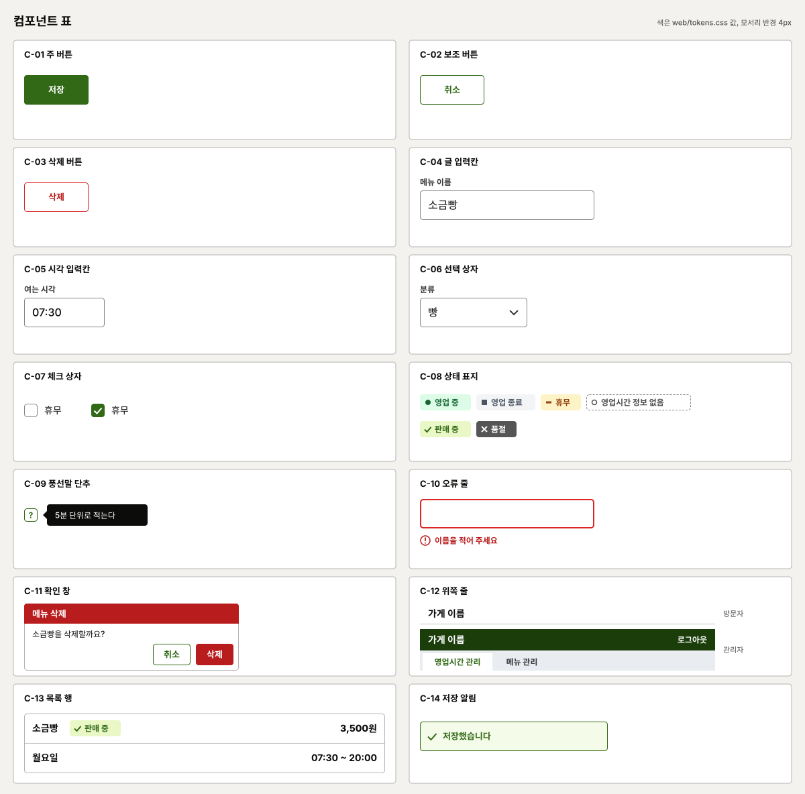

# 04 디자인

> 컴포넌트 C-01부터 C-14까지의 모양과 토큰의 최종 권위다. 이름과 번호는 `01_공통규칙.md`를 글자 그대로 쓴다.
> 토큰 파일은 `web/tokens.css`, 대비 검증 스크립트는 `docs/plan/design/contrast-check.js`다.

## 1. 디자인 방향

1. 날카롭고 촘촘하게 간다. 반경 4px, 1px 회색 테두리, 장식 그림자 없음, 숫자는 굵고 폭이 같은 숫자꼴. 출처: `kleinanzeigen-design-system` SKILL.md «What makes it this look» 1, 4, 5번.
2. 강조색은 일하는 초록 `#326916` 하나다. 빨강과 호박색은 상태에만 쓴다. 출처: 같은 문서 2, 3번과 «Do not».
3. 밝은 화면 하나만 만들고, 불러오는 중, 비어 있음, 실패를 서로 다르게 보인다. 출처: 같은 문서 6, 7번.

[결정필요] 가게 고유 색. 이유: 운영자 지시에 색이 없고 색을 지어내지 않는다(O-10). 기본값: 스킬의 초록을 그대로 쓰고, 운영자가 색을 주면 스킬 «Rebranding» 표대로 `--color-accent` 계열 다섯 값만 바꾼 뒤 대비 스크립트를 다시 돌린다.

## 2. 스킬과 다르게 정한 것

| 항목 | 스킬 값 | 이 사이트 값 | 이유 |
|---|---|---|---|
| 모서리 반경 | 4px 기본, 곳에 따라 6px, 8px, 10px, 16px, 알약 | 4px 하나 (`--radius`) | 기획서 표준 §2-3 «모서리 반경은 하나만 쓴다». 스킬의 기본값을 골랐다 |
| 입력 테두리 | `#9c9c9c` | `#858585` (`--color-border-control`) | [실측] `#9c9c9c`는 흰 면에서 2.75, 관리자 바탕에서 2.38이라 3에 못 미친다 (2026-11-17 `node -e` 계산). 같은 회색 계열에서 어둡게 했다 |
| 삭제 버튼 색 | 테두리 `#fb7185`, 글자 `#e11d48` | 테두리 `#dc2626`, 글자 `#b91c1c` | [실측] `#fb7185` 테두리는 흰 면에서 2.69다 (2026-11-17 `node -e` 계산). 스킬의 고정 상태색 danger 두 값으로 바꿨다 |
| 풍선말 단추 | 지름 15px 원, 설명 쪽으로 가는 링크 | 한 변 20px 네모(반경 4px), 누르면 풍선말 한 줄 | 반경 하나 규칙과 O-12(설명은 풍선 한 줄). 색과 테두리는 스킬 `.kz-help` 그대로다 |
| 라임 `#b5e941` 채움 | 방문자 화면의 주 행동 하나 | 쓰지 않는다 | S-01에는 누르는 행동이 없고 스킬이 관리자에서 라임을 금지한다. 쓰지 않는 토큰은 두지 않는다 |
| 관리자 위쪽 줄 | 세 줄 (막대, 묶음 탭, 하위 메뉴, 작업 수 표시) | 두 줄 (막대, 탭) | 관리 화면이 S-03, S-04 둘뿐이고 작업 대기열이 없다 |
| 좁은 화면 관리자 조작 높이 | 40px | 44px (`--target-min`) | 방문자와 관리자가 같은 값을 쓰게 했다. 스킬 값보다 크다 |
| 그림자 | 카드 올림, 대시보드, 확인 창 | 확인 창 하나 (`--shadow-dialog`) | 매물 카드와 대시보드가 이 사이트에 없다 |
| 폭 | 방문자 1240px, 관리자 1680px | 방문자 960px, 관리자 1240px | 1240px은 네 단 매물 격자용이고 이 사이트는 목록 한두 단이다. 줄이 길어지지 않게 줄였다 |
| 상태 표지 모양 | 알약 배지, 관리자는 색 글자 | 반경 4px 표지에 글자와 도형 | 반경 하나 규칙. 스킬 `.kz-pill--todo`(4px)에서 가져왔다 |

스킬에 없어서 스킬 토큰에서 끌어온 값: `unset` 표지(흰 면, `--color-border-control` 점선), `sold_out` 표지(스킬 표 머리 색 `#555555` 채움), 풍선말 면(`--color-text`와 같은 `#0c0c0b`), 어두운 면 위 초점 고리(흰색).

## 3. 토큰

`web/tokens.css`에는 `:root` 사용자 속성만 있다. `color-scheme: only light`, `:focus-visible` 고리, `font-variant-numeric: tabular-nums`, 제목의 `word-break: keep-all` 같은 규칙은 컴포넌트 CSS가 이 토큰을 읽어 정한다.

| 토큰 | 값 | 용도 |
|---|---|---|
| `--color-page` | `#f4f2ef` | S-01 바탕 |
| `--color-page-admin` | `#eceff4` | S-03, S-04 바탕 |
| `--color-page-login` | `#0f172a` | S-02 바탕. C-12의 S-02 쓰임도 이 바탕 위에 놓인다 |
| `--color-surface` | `#ffffff` | 구역 상자, 입력칸, 버튼, 확인 창의 면 |
| `--color-surface-muted` | `#f0f0f0` | 비활성 입력칸의 면 |
| `--color-surface-hover` | `#f7f7f7` | C-13 올림 (관리자, 넓은 화면) |
| `--color-tab-strip` | `#e9edf2` | C-12 관리자 탭 줄 |
| `--color-bar-admin` | `#1a3d0a` | C-12 관리자 막대 |
| `--color-tooltip-surface` | `#0c0c0b` | C-09 풍선말 면 |
| `--color-overlay` | `rgba(0, 0, 0, 0.4)` | C-11 뒤 가림막 |
| `--color-text` | `#0c0c0b` | 본문, 제목, 값 |
| `--color-text-2` | `#383838` | 라벨, 고르지 않은 탭, C-06 꺾쇠 |
| `--color-text-3` | `#4d4d4d` | 보조 글, 입력 예시 글. 이보다 옅은 글자는 쓰지 않는다 |
| `--color-text-on-dark` | `#ffffff` | 어두운 면 위 글자와 링크 (관리자 막대, S-02 바탕, 풍선말, 확인 창 제목 줄) |
| `--color-border` | `#b3b3b3` | 구역 상자 테두리 (장식, 조작 경계가 아니다) |
| `--color-border-soft` | `#c2c2c2` | 목록 행 사이 줄 (장식) |
| `--color-border-control` | `#858585` | 입력칸, 선택 상자, 체크 상자의 테두리 |
| `--color-accent` | `#326916` | 주 버튼 면, 보조 버튼 테두리와 글자, 고른 탭, 오늘 행의 글자 «오늘», 밝은 면 위 링크 |
| `--color-accent-hover` | `#1d4b00` | 주 버튼 올림과 누름 |
| `--color-accent-tint` | `#e9f8c6` | 보조 버튼 올림 |
| `--color-accent-soft` | `#f4fbe8` | C-13 오늘 행, C-14 면 |
| `--color-on-accent` | `#ffffff` | 초록 면 위 글자, C-07 체크 |
| `--color-status-open-text` | `#166534` | C-08 open 글자와 도형 |
| `--color-status-open-surface` | `#dcfce7` | C-08 open 면 |
| `--color-status-closed-text` | `#4b5563` | C-08 closed 글자와 도형 |
| `--color-status-closed-surface` | `#f3f4f6` | C-08 closed 면 |
| `--color-status-dayoff-text` | `#92400e` | C-08 dayoff 글자와 도형 |
| `--color-status-dayoff-surface` | `#fef3c7` | C-08 dayoff 면 |
| `--color-status-unset-text` | `#4d4d4d` | C-08 unset 글자와 도형 |
| `--color-status-unset-surface` | `#ffffff` | C-08 unset 면 |
| `--color-status-unset-border` | `#858585` | C-08 unset 점선 테두리 |
| `--color-sale-on-text` | `#326916` | C-08 on_sale 글자와 도형 |
| `--color-sale-on-surface` | `#e9f8c6` | C-08 on_sale 면 |
| `--color-sale-soldout-text` | `#ffffff` | C-08 sold_out 글자와 도형 |
| `--color-sale-soldout-surface` | `#555555` | C-08 sold_out 면 |
| `--color-danger-text` | `#b91c1c` | 오류 글자, 삭제 버튼 글자, 확인 창 제목 줄 면 |
| `--color-danger-border` | `#dc2626` | 오류 입력칸 테두리, 삭제 버튼 테두리, 오류 띠 테두리 |
| `--color-danger-surface` | `#fef2f2` | 오류 띠 면, 삭제 버튼 올림 |
| `--color-focus` | `#326916` | 밝은 면 위 초점 고리 |
| `--color-focus-on-dark` | `#ffffff` | 관리자 막대와 S-02 바탕 위 초점 고리 |
| `--font-family` | Pretendard Variable, Pretendard, 기기 기본 한글 글꼴 순서 | 모든 글자. 글꼴 파일을 내려받지 않는다 |
| `--font-size-label` | `12px` | 라벨, 상태 표지, 오류 줄, 풍선말, 오늘 행의 글자 «오늘» |
| `--font-size-body-admin` | `13px` | 관리자 본문, 버튼, 위쪽 줄의 링크와 로그아웃, 넓은 화면 입력 글자 |
| `--font-size-body` | `14px` | 방문자 본문, 목록 행 |
| `--font-size-input` | `16px` | 좁은 화면 입력 글자 (iOS 확대 방지) |
| `--font-size-title` | `17px` | 방문자 구역 제목, 가게 이름 |
| `--font-size-screen-title` | `18px` | 관리자 화면 제목 |
| `--font-size-figure` | `24px` | S-01 맨 위 큰 상태 표지 |
| `--font-weight-regular` | `500` | 본문 |
| `--font-weight-label` | `600` | 라벨, 탭 |
| `--font-weight-bold` | `700` | 버튼, 상태 표지, 화면 제목 |
| `--font-weight-heavy` | `800` | 구역 제목, 메뉴 이름, 가격, 큰 상태 표지 |
| `--line-height-tight` | `1.25` | 제목, 버튼 |
| `--line-height-body` | `1.5` | 본문 |
| `--letter-spacing-heading` | `-0.01em` | 제목 |
| `--space-1` | `2px` | 도형과 글자 사이 미세 조정 |
| `--space-2` | `4px` | 라벨과 입력칸 사이, 오류 줄 위 |
| `--space-3` | `6px` | 상태 표지 안 도형과 글자 사이, C-07 체크의 폭 |
| `--space-4` | `8px` | 버튼 사이, 상태 표지 좌우 안쪽, S-03 좁은 화면의 두 시각 입력칸 사이와 두 줄 사이, C-06 꺾쇠의 한 변 |
| `--space-5` | `12px` | 입력칸 좌우 안쪽, 목록 행 위아래, C-07 체크의 높이 |
| `--space-6` | `16px` | 구역 사이, 좁은 화면 구역 안쪽, 버튼 좌우 안쪽 |
| `--space-7` | `20px` | 넓은 화면 구역 안쪽 |
| `--space-8` | `24px` | 넓은 화면 단 사이, 바깥 여백 |
| `--space-9` | `32px` | 방문자 화면 위아래 끝 여백 |
| `--radius` | `4px` | 모든 모서리 |
| `--border-width` | `1px` | 기본 테두리 |
| `--border-width-strong` | `2px` | 오류 입력칸 테두리, C-06 꺾쇠와 C-07 체크의 선 |
| `--focus-width` | `2px` | 초점 고리 굵기 |
| `--focus-offset` | `2px` | 초점 고리와 요소 사이 |
| `--shadow-dialog` | `0 12px 40px rgba(0, 0, 0, 0.25)` | C-11 |
| `--target-min` | `44px` | 좁은 화면 최소 누름 크기 |
| `--target-min-pointer` | `24px` | 넓은 화면 최소 누름 크기 (WCAG 2.2 2.5.8) |
| `--control-height` | `44px` | 좁은 화면 버튼과 입력칸 높이 |
| `--control-height-compact` | `36px` | 넓은 화면 버튼과 입력칸 높이 |
| `--header-height` | `56px` | C-12 넓은 화면 |
| `--header-height-narrow` | `52px` | C-12 좁은 화면 |
| `--badge-height` | `24px` | C-08 기본 |
| `--badge-height-large` | `40px` | C-08 큰 것 |
| `--help-size` | `20px` | C-09 보이는 네모 |
| `--checkbox-size` | `20px` | C-07 네모 |
| `--container-visitor` | `960px` | S-01 내용 최대 폭 |
| `--container-admin` | `1240px` | S-03, S-04 내용 최대 폭 |
| `--container-login` | `448px` | S-02 카드 최대 폭 |
| `--container-dialog` | `384px` | C-11 최대 폭 |
| `--gutter` | `16px` | 화면 좌우 여백 |
| `--opacity-disabled` | `0.5` | 비활성 |
| `--transition-fast` | `0.15s` | 색 바뀜. `prefers-reduced-motion: reduce`에서는 0으로 한다 |

중단점은 토큰 파일 머리 주석에 있다: 좁은 화면 639px 이하, 넓은 화면 640px 이상, 방문자 두 단 960px 이상.

## 4. 컴포넌트



그림은 모양과 색을 보인다. 크기는 아래 표가 기준이다. 모든 초점 상태는 `:focus-visible`에 굵기 2px 고리, 바깥 간격 2px이고 색은 밝은 면에서 `--color-focus`, 어두운 면에서 `--color-focus-on-dark`다. 화면 문구는 `03_화면.md`의 문구 키를 쓴다.

| ID | 이름 | 쓰는 토큰 | 상태 | 크기 | 접근성 |
|---|---|---|---|---|---|
| C-01 | 주 버튼 | `--color-accent`, `--color-on-accent`, `--color-accent-hover`, `--radius`, `--font-size-body-admin`, `--font-weight-bold` | 기본: 초록 면에 흰 글자. 올림과 누름: `--color-accent-hover`. 초점: 고리. 비활성: 불투명도 0.5 | 높이 44px(좁은 화면) 36px(넓은 화면), 좌우 안쪽 16px, 최소 폭 64px, 최소 누름 44px(좁은 화면) | `button` 요소. 보이는 글자가 이름이다. Enter와 Space. 비활성은 `disabled` |
| C-02 | 보조 버튼 | `--color-surface`, `--color-accent`, `--color-accent-tint`, `--border-width`, `--radius` | 기본: 흰 면, 초록 테두리와 글자. 올림과 누름: `--color-accent-tint` 면. 초점: 고리. 비활성: 불투명도 0.5 | C-01과 같다 | `button` 요소. Enter와 Space. 순서 바꾸기처럼 글자가 없는 쓰임은 `aria-label`을 문구 사전에서 받는다 |
| C-03 | 삭제 버튼 | `--color-surface`, `--color-danger-border`, `--color-danger-text`, `--color-danger-surface`, `--radius` | 기본: 흰 면, 빨간 테두리와 글자. 올림과 누름: `--color-danger-surface` 면. 초점: 고리. 비활성: 불투명도 0.5 | C-01과 같다 | `button` 요소. 메뉴 행의 삭제는 누르면 바로 지우지 않고 C-11을 열고, 이름에 지울 대상을 넣는다(`aria-label`). C-11 안의 삭제는 누르면 지운다 |
| C-04 | 글 입력칸 | `--color-surface`, `--color-border-control`, `--color-text`, `--color-text-2`, `--color-accent`, `--color-danger-border`, `--color-surface-muted`, `--font-size-input`, `--radius` | 기본: 흰 면, 1px 회색 테두리. 초점: 테두리 `--color-accent`와 고리. 오류: 테두리 2px `--color-danger-border`와 아래 C-10. 비활성: `--color-surface-muted` 면, 불투명도 0.5 | 높이 44px(좁은 화면) 36px(넓은 화면), 좌우 안쪽 12px, 글자 16px(좁은 화면) 13px(넓은 화면), 라벨은 위에 12px 굵기 600, 사이 4px | `input`과 `label for`. 오류면 `aria-invalid="true"`와 `aria-describedby`. 비밀번호는 `type="password"`와 `autocomplete="current-password"`, 가격은 `inputmode="numeric"`과 오른쪽 맞춤 |
| C-05 | 시각 입력칸 | C-04와 같다 | C-04와 같다 | 높이와 글자는 C-04와 같다. 폭은 고정하지 않고 최소 120px이다. 좁은 화면에서는 한 줄을 두 칸이 반씩 나눠 채우고(사이 8px), 넓은 화면에서는 120px이다. 폭이 같은 숫자꼴 | `input type="time"`에 `step="300"`. `label for`. 기기 기본 시각 고르기와 화살표 키. 비어 있으면 값 없음으로 둔다 |
| C-06 | 선택 상자 | C-04와 같다. 꺾쇠에 `--color-text-2`, `--border-width-strong`, `--space-4` | 기본, 초점, 오류, 비활성이 C-04와 같다. 올림: 해당 없음 | 높이와 글자는 C-04와 같다. 최소 폭 120px, 오른쪽 안쪽 32px, 그 자리에 꺾쇠. 꺾쇠는 `select`를 감싼 틀의 `::after`에 한 변 8px 네모의 오른쪽과 아래 테두리 2px을 45도 돌려 그린다. `select`는 `appearance: none`이다 | `select`와 `label for`. 화살표 키와 글자 입력으로 고른다. 꺾쇠는 장식이고 `pointer-events: none`이라 누름을 가로채지 않는다 |
| C-07 | 체크 상자 | `--color-surface`, `--color-border-control`, `--color-accent`, `--color-on-accent`, `--checkbox-size`, `--border-width-strong`, `--space-3`, `--space-5`, `--radius` | 기본: 흰 네모, 회색 테두리. 고름: 초록 채움에 흰 체크. 초점: 고리. 비활성: 불투명도 0.5 | 네모 20px, 라벨 14px, 사이 8px, 라벨을 포함한 줄 높이 44px(좁은 화면). 라벨이 없는 쓰임(S-03)은 누르는 곳 44px(좁은 화면) 24px(넓은 화면). 체크는 `appearance: none`인 `input`의 `::before`에 폭 6px 높이 12px 네모의 오른쪽과 아래 테두리 2px(`--color-on-accent`)을 45도 돌려 그린다 | `input type="checkbox"`와 `label`. Space로 바꾼다. 라벨을 눌러도 바뀐다. 보이는 라벨이 없으면 `aria-label`을 문구 사전에서 받는다 |
| C-08 | 상태 표지 | `--color-status-*`, `--color-sale-*`, `--badge-height`, `--badge-height-large`, `--font-size-label`, `--font-size-figure`, `--radius` | 기본만 있다. 누르는 요소가 아니다 | 기본: 높이 24px, 좌우 안쪽 8px, 도형 8px, 글자 12px 굵기 700. 큰 것(S-01 맨 위): 높이 40px, 좌우 안쪽 12px, 도형 12px, 글자 24px 굵기 800 | `span`. 글자가 뜻을 전한다. 도형은 `aria-hidden="true"`. 색만으로 구분하지 않는다(5절) |
| C-09 | 풍선말 단추 | `--color-surface`, `--color-accent`, `--color-on-accent`, `--color-tooltip-surface`, `--color-text-on-dark`, `--help-size`, `--radius` | 기본: 흰 네모, 초록 테두리와 물음표. 올림, 누름, 열림: 초록 채움에 흰 물음표. 초점: 고리 | 보이는 네모 20px, 누름 범위 44px(좁은 화면) 24px(넓은 화면). 풍선말: 좌우 안쪽 12px, 위아래 8px, 최대 폭 240px, 글자 12px | `button type="button"`. `aria-label`은 문구 사전, `aria-expanded`, `aria-describedby`로 `role="tooltip"`에 잇는다. 올림, 초점, 누름으로 열리고 Esc로 닫힌다. 풍선말 위에 포인터를 올려도 닫히지 않는다 |
| C-10 | 오류 줄 | `--color-danger-text`, `--color-danger-border`, `--color-danger-surface`, `--font-size-label`, `--radius` | 기본만 있다. 모양 둘: 입력칸 아래 줄, 불러오기나 저장 실패 띠 | 아래 줄: 도형 14px, 글자 12px 굵기 600, 입력칸과 사이 4px. 띠: 1px 빨간 테두리, 옅은 빨간 면, 좌우 안쪽 12px, 위아래 8px, 글자 12px 굵기 700, 다시 시도는 밑줄 글자 단추(누름 범위 44px 또는 24px) | 아래 줄은 입력칸의 `aria-describedby`가 가리킨다. 띠는 `role="alert"`. 느낌표 도형은 `aria-hidden="true"`. 실패를 빈 목록으로 보이지 않는다 |
| C-11 | 확인 창 | `--color-surface`, `--color-danger-text`, `--color-text-on-dark`, `--color-overlay`, `--shadow-dialog`, `--container-dialog`, `--radius` | 기본만 있다. 메뉴 삭제 확인 하나에만 쓴다. 제목 줄은 `--color-danger-text` 면에 흰 글자다. 안의 단추는 취소가 C-02, 삭제가 C-03이고 각자 상태를 따른다 | 최대 폭 384px, 좁은 화면은 화면 폭에서 좌우 16px씩 뺀 폭. 제목 줄 안쪽 12px 16px 글자 14px 굵기 700, 본문 안쪽 16px 글자 13px, 단추는 오른쪽에 사이 8px | `dialog` 요소와 `showModal()`. `aria-labelledby`는 제목, `aria-describedby`는 본문. 열리면 초점은 취소 단추(C-02)에 둔다. Tab은 창 안에서 돌고 Esc는 취소다. 닫히면 연 단추로 초점이 돌아간다 |
| C-12 | 위쪽 줄 | `--color-surface`, `--color-border-soft`, `--color-bar-admin`, `--color-page-login`, `--color-text-on-dark`, `--color-focus-on-dark`, `--color-tab-strip`, `--color-accent`, `--color-text-2`, `--font-size-body-admin`, `--header-height`, `--header-height-narrow` | 방문자(S-01): 흰 면, 아래 1px 줄, 가게 이름 하나. 로그인(S-02): 면을 칠하지 않고 `--color-page-login` 바탕 위에 링크 «방문자 화면» 하나. 관리자(S-03, S-04): 진한 초록 막대의 왼쪽에 링크 «방문자 화면», 오른쪽에 로그아웃, 그 아래 탭 줄. 가게 이름은 S-01에만 있다. 어두운 면 위의 링크와 로그아웃은 흰 글자이고 링크는 늘 밑줄, 로그아웃은 올림에 밑줄이다. 고른 탭: 흰 면에 초록 글자 굵기 700. 탭 올림: 흰 면. 초점: 고리(어두운 면 위는 흰색) | 높이 56px(넓은 화면) 52px(좁은 화면), 탭 높이 44px(좁은 화면) 36px(넓은 화면), 좌우 안쪽 16px, 가게 이름 17px 굵기 800, 링크와 로그아웃 13px 굵기 600에 누름 높이 44px(좁은 화면) | `header` 요소. 탭 줄은 `nav`와 `aria-label`, 고른 탭은 `aria-current="page"`. «방문자 화면»은 `a`, 로그아웃은 `button`. Tab으로 차례로 간다 |
| C-13 | 목록 행 | `--color-surface`, `--color-border-soft`, `--color-surface-hover`, `--color-accent-soft`, `--color-accent`, `--color-text`, `--color-text-3`, `--font-size-body`, `--font-size-label` | 기본: 흰 면, 아래 1px 줄. 올림: `--color-surface-hover`(관리자, 넓은 화면). 오늘 행: `--color-accent-soft` 면, 왼쪽 3px 초록 막대, 굵기 700, 요일 이름 옆에 글자 «오늘»(12px 굵기 700, `--color-accent`, 요일 이름과 사이 8px). 품절 행: 이름 글자 `--color-text-3`과 C-08 sold_out. 초점: 행 안의 조작 요소가 받는다 | 최소 높이 44px, 위아래 안쪽 12px, 좌우 안쪽 12px(좁은 화면) 16px(넓은 화면). 이름은 왼쪽, 시각과 가격은 오른쪽 맞춤에 폭이 같은 숫자꼴. 좁은 화면에서 S-03의 요일 행(두 줄)과 S-04의 메뉴 행(네 줄)은 좌우 안쪽이 0이다(6절) | 영업시간은 `table`과 `th scope="row"`, 메뉴는 `ul`과 `li`. 오늘 행은 `aria-current="date"`이고 글자 «오늘»은 문구 키 `status.today`다. 순서는 끌기가 아니라 단추(C-02)로 바꾼다(WCAG 2.2 2.5.7) |
| C-14 | 저장 알림 | `--color-accent-soft`, `--color-accent`, `--font-size-body-admin`, `--radius` | 기본만 있다. 다음 수정이나 화면 이동 때까지 남는다. 시간으로 사라지지 않는다 | 최소 높이 44px, 좌우 안쪽 12px, 위아래 8px, 체크 도형 14px, 글자 13px 굵기 700. 화면 제목 아래, 구역 상자 위에 내용 폭 그대로 둔다 | `role="status"`와 `aria-live="polite"`. 체크 도형은 `aria-hidden="true"`. 실패는 이 알림이 아니라 C-10 띠로 알린다 |

구역 상자(목록과 입력 묶음을 담는 틀)는 번호가 없는 배치 규칙이다: 흰 면, 1px `--color-border`, 반경 4px, 안쪽 16px(좁은 화면) 20px(넓은 화면), 그림자 없음.

C-06의 꺾쇠와 C-07의 체크는 그림 파일, `data:` 주소, `style` 속성 없이 CSS 테두리로 그린다(`05_소스.md`의 CSP 규칙). 값은 모두 토큰이다: 선 굵기 `--border-width-strong`, 색 `--color-text-2`와 `--color-on-accent`, 크기 `--space-3`, `--space-4`, `--space-5`. `forced-colors: active`에서는 두 요소의 `appearance`를 `auto`로 되돌려 기기 기본 모양을 쓴다.

## 5. 색만으로 상태를 전하지 않는다

상태마다 글자, 도형, 면 색 세 가지가 함께 바뀐다. 글자는 `01_공통규칙.md` 5절의 화면 표시 그대로다.

| 대상 | 코드 | 글자 | 도형 | 면과 테두리 |
|---|---|---|---|---|
| 영업 상태 | open | 영업 중 | 채운 동그라미 | `--color-status-open-surface`, 테두리 없음 |
| 영업 상태 | closed | 영업 종료 | 채운 네모 | `--color-status-closed-surface`, 테두리 없음 |
| 영업 상태 | dayoff | 휴무 | 가로 막대 | `--color-status-dayoff-surface`, 테두리 없음 |
| 영업 상태 | unset | 영업시간 정보 없음 | 빈 동그라미 | `--color-status-unset-surface`, 1px 점선 `--color-status-unset-border` |
| 메뉴 판매 상태 | on_sale | 판매 중 | 체크 | `--color-sale-on-surface`, 테두리 없음 |
| 메뉴 판매 상태 | sold_out | 품절 | 엑스 | `--color-sale-soldout-surface`, 테두리 없음 |

그 밖의 구분도 색 하나에 기대지 않는다.

| 구분 | 색 말고 쓰는 것 |
|---|---|
| 오류 입력칸 | 테두리 굵기 2px, 아래 느낌표 도형과 오류 글 |
| 고른 탭 | 흰 탭 모양, 굵기 700, `aria-current="page"` |
| 오늘 행 | 글자 «오늘», 왼쪽 3px 막대, 굵기 700, `aria-current="date"` |
| 삭제 버튼 | 글자 «삭제»와 확인 창 |
| 체크 상자 고름 | 체크 도형 |
| 저장 알림과 오류 띠 | 체크 도형과 느낌표 도형, 서로 다른 글 |

## 6. 배치

화면 구성과 문구의 최종 권위는 `03_화면.md`다. 여기서는 폭, 단, 간격을 정한다.

| 항목 | 375px (좁은 화면, 639px 이하) | 넓은 화면 (640px 이상) |
|---|---|---|
| 좌우 여백 | 16px | 16px, 방문자는 960px부터 24px |
| S-01 내용 폭과 단 | 한 단. 차례: C-12(가게 이름), 큰 상태 표지, 영업시간, 메뉴(빵, 케이크, 쿠키, 음료 순) | 최대 960px 가운데. 960px부터 두 단: 왼쪽 320px(상태와 영업시간), 오른쪽 나머지(메뉴), 단 사이 24px |
| S-02 | 맨 위에 C-12(링크 «방문자 화면» 하나, 면을 칠하지 않는다), 그 아래 어두운 바탕 가운데 흰 카드 하나. 카드 폭은 화면에서 좌우 16px씩 뺀 폭, 안쪽 24px | C-12는 같다. 카드 최대 폭 448px, 안쪽 24px |
| S-03 내용 폭과 단 | 한 단. 표 하나를 요일마다 두 줄로 놓는다. 첫 줄은 요일 이름(왼쪽)과 휴무 체크 상자(오른쪽), 둘째 줄은 여는 시각과 닫는 시각 입력칸이 줄을 반씩 채운다(사이 8px, 칸마다 최소 120px). 두 줄 사이 8px. 열 이름은 같은 두 줄 배치로 맨 위에 한 번만 둔다. 요일 행의 좌우 안쪽은 0이다. 320px에서 칸마다 123px, 375px에서 150.5px이다(계산은 `03_화면.md` 7.1절) | 최대 1240px 가운데, 한 단. 표는 가운데 560px 폭이고 한 행이 한 줄이다. 열은 요일, 휴무, 여는 시각, 닫는 시각 순서이고 시각 입력칸은 120px이다 |
| S-04 내용 폭과 단 | 한 단. 추가 폼과 메뉴 목록은 각각 구역 상자 하나다. 메뉴 행은 구역 상자 안에서 좌우 안쪽 0으로 쌓이고(행 사이 1px 줄) 네 줄이다: 이름과 상태 표지, 가격과 품절 버튼, «위로»와 «아래로», «수정»과 «삭제». 뒤의 두 줄은 두 버튼이 줄을 반씩 채운다(사이 8px). 줄 사이 8px. 추가 폼과 수정 상태의 행은 칸마다 라벨이 위에 오고 가격과 분류가 한 줄을 반씩 채운다. 내용 폭은 화면 폭에서 66px을 뺀 값이라 320px에서 254px(버튼과 칸 하나 123px), 375px에서 309px(150.5px)이다. 버튼 넷을 한 줄에 두면 289px이 필요해 254px에 들어가지 않는다(계산은 `03_화면.md` 7.1절) | 최대 1240px 가운데, 한 단. 행은 한 줄에 칸을 나란히 둔다. 버튼은 품절 버튼, «위로», «아래로», «수정», «삭제» 순서다 |
| 구역 사이 | 16px | 16px |
| 구역 안쪽 | 16px | 20px |
| 버튼, 입력칸 높이 | 44px | 36px |
| 입력 글자 | 16px | 13px |
| 버튼 줄 | 주 버튼이 혼자 놓이는 줄(S-02 «로그인», S-03 «저장», S-04 «추가»)은 폭 가득. 두 버튼이 한 줄에 놓이는 곳(S-04 메뉴 행의 «위로»와 «아래로», «수정»과 «삭제», 수정 상태의 «저장»과 «취소»)은 줄을 반씩 나눠 채우고 사이 8px. C-11의 단추 둘은 4절 표대로 오른쪽에 나란히 둔다. 버튼을 세로로 쌓는 곳은 없다 | 오른쪽 맞춤, 사이 8px |
| C-11 | 화면 폭에서 좌우 16px씩 뺀 폭 | 최대 384px 가운데 |
| 가로 스크롤 | 없다 | 없다 |

- 제목: 방문자 구역 제목 17px 굵기 800, 관리자 화면 제목 18px 굵기 700. 제목 밑 부제와 설명 문장은 두지 않는다(O-12).
- 불러오는 중은 가운데 13px `--color-text-3` 한 줄, 비어 있음은 목록 자리에 무엇이 비었는지 말하는 한 행, 실패는 C-10 띠다. 셋을 같은 모양으로 보이지 않는다.
- 움직임은 색 바뀜 0.15초뿐이다. `prefers-reduced-motion: reduce`에서는 끈다.

## 7. 이 프로젝트에서 쓰지 않는 모양

| 금지 | 근거 |
|---|---|
| 알약 버튼, 4px이 아닌 모서리 반경 | 기획서 표준 §2-3, §2-4 |
| 글로우, 그라디언트, 유리 효과, 크고 부드러운 그림자 | 스킬 «Do not», 표준 §2-4 |
| 보라, 청록, 파랑 같은 둘째 강조색 | 스킬 «Do not» |
| 같은 카드 세 개를 나란히 놓는 배치 | 표준 §2-4, O-13 |
| 가짜 스크린샷, 자리 채움 그림, 지어낸 메뉴 사진 | 표준 §2-4, O-11 |
| 상태색(빨강, 호박색)을 장식으로 쓰기 | 스킬 «Do not» |
| 색만으로 상태 구분 | 스킬 «Do not», WCAG 1.4.1 |
| 화면의 설명 문단과 제목 밑 부제 | O-12 |
| 실패를 빈 목록처럼 보이기 | 스킬 «Honest states» |
| `--color-text-3`보다 옅은 글자 | 스킬 토큰 표 «never lighter» |
| 끌어서만 되는 순서 바꾸기 | WCAG 2.2 2.5.7 |
| 웹 글꼴 내려받기, 아이콘 글꼴, `data:` 주소의 그림 | 의존성 0과 CSP. 도형은 HTML 안의 `svg` 요소나 CSS 테두리로 그린다 |
| 토큰 파일 밖에 색 값 직접 쓰기 | 값은 `web/tokens.css` 한 곳에만 둔다 |

## 8. 그림 정책

이 사이트는 사진을 싣지 않는다. 운영자 지시에 사진이 없고, `menu_item` 컬럼에도 사진 칸이 없으며, 지어낸 사진이나 자리 채움 그림은 가짜 자료다(O-11). 로고도 없다. 가게 이름은 `SHOP_NAME` 글자로 보인다. 도형을 그리는 방법은 셋뿐이다. 상태 표지, 오류 줄, 저장 알림의 도형(동그라미, 네모, 막대, 체크, 엑스, 느낌표)은 HTML 안의 `svg` 요소이고 색은 `currentColor`로 받는다. 풍선말 단추의 물음표는 글자다. C-06의 꺾쇠와 C-07의 체크는 CSS 테두리다(4절).

[결정필요] 메뉴 사진과 가게 사진. 이유: 지시와 `menu_item` 컬럼에 사진이 없다. 기본값: 사진 없이 글자 목록으로 내고, 운영자가 사진을 주면 `02_DB.md`와 `03_화면.md`에 사진 칸을 먼저 더한 뒤 JPG(sRGB, 메타데이터 제거, 프로그레시브, 품질 80 안팎, 긴 변 1920px 이하, 목록용은 긴 변 480px)로 바꿔 싣고 대체 글은 메뉴 이름으로 한다.

## 9. 대비 검증 결과

[실측] 2026-11-17 `node docs/plan/design/contrast-check.js` 실행 결과(위쪽 줄, 확인 창, 오늘 행, 꺾쇠, 체크의 쌍 이름을 고친 뒤 다시 돌렸다): 51쌍 가운데 51쌍 통과, 종료 코드 0, 가장 낮은 대비 3.20(입력 테두리와 관리자 바탕, 최소 3). S-02 위쪽 줄의 링크는 있던 토큰 `--color-text-on-dark`를 `--color-page-login` 위에 쓰므로(17.85) 토큰을 더하지 않았다.

글자 쌍은 최소 4.5, 큰 글자(24px 굵기 800)와 조작 경계와 초점 고리는 최소 3이다. 구역 상자 테두리와 행 사이 줄은 장식이라 쌍에 넣지 않았다. 비활성 상태는 WCAG 1.4.3의 예외라 넣지 않았다. 쌍의 목록은 스크립트 안의 표가 원본이다.

```text
PASS 19.57 (최소 4.5) 글자 --color-text / --color-surface : 본문
PASS 17.51 (최소 4.5) 글자 --color-text / --color-page : 방문자 바탕 위 제목
PASS 16.98 (최소 4.5) 글자 --color-text / --color-page-admin : 관리자 바탕 위 화면 제목
PASS 18.27 (최소 4.5) 글자 --color-text / --color-surface-hover : C-13 올림
PASS 18.46 (최소 4.5) 글자 --color-text / --color-accent-soft : C-13 오늘 행
PASS 11.73 (최소 4.5) 글자 --color-text-2 / --color-surface : 라벨, C-06 꺾쇠
PASS  9.97 (최소 4.5) 글자 --color-text-2 / --color-tab-strip : C-12 고르지 않은 탭
PASS  8.45 (최소 4.5) 글자 --color-text-3 / --color-surface : 보조 글, 입력 예시 글
PASS  7.57 (최소 4.5) 글자 --color-text-3 / --color-page : 방문자 바탕 위 보조 글
PASS  7.33 (최소 4.5) 글자 --color-text-3 / --color-page-admin : 관리자 바탕 위 보조 글
PASS  7.42 (최소 4.5) 글자 --color-text-3 / --color-surface-muted : 비활성 면 위 보조 글
PASS  7.89 (최소 4.5) 글자 --color-text-3 / --color-surface-hover : C-13 올림 위 보조 글
PASS  6.63 (최소 4.5) 글자 --color-accent / --color-surface : C-02 글자, C-12 고른 탭, 링크
PASS  5.91 (최소 4.5) 글자 --color-accent / --color-accent-tint : C-02 올림
PASS  6.25 (최소 4.5) 글자 --color-accent / --color-accent-soft : C-14 글자, C-13 오늘 행의 글자 «오늘»
PASS  6.63 (최소 4.5) 글자 --color-on-accent / --color-accent : C-01 기본, C-07 체크
PASS 10.20 (최소 4.5) 글자 --color-on-accent / --color-accent-hover : C-01 올림과 누름
PASS 12.24 (최소 4.5) 글자 --color-text-on-dark / --color-bar-admin : C-12 관리자 막대의 링크와 로그아웃
PASS 19.57 (최소 4.5) 글자 --color-text-on-dark / --color-tooltip-surface : C-09 풍선말
PASS 17.85 (최소 4.5) 글자 --color-text-on-dark / --color-page-login : C-12 S-02 바탕 위 링크
PASS  6.47 (최소 4.5) 글자 --color-text-on-dark / --color-danger-text : C-11 제목 줄
PASS  6.49 (최소 4.5) 글자 --color-status-open-text / --color-status-open-surface : C-08 open
PASS  6.87 (최소 4.5) 글자 --color-status-closed-text / --color-status-closed-surface : C-08 closed
PASS  6.37 (최소 4.5) 글자 --color-status-dayoff-text / --color-status-dayoff-surface : C-08 dayoff
PASS  8.45 (최소 4.5) 글자 --color-status-unset-text / --color-status-unset-surface : C-08 unset
PASS  5.91 (최소 4.5) 글자 --color-sale-on-text / --color-sale-on-surface : C-08 on_sale
PASS  7.46 (최소 4.5) 글자 --color-sale-soldout-text / --color-sale-soldout-surface : C-08 sold_out
PASS  6.47 (최소 4.5) 글자 --color-danger-text / --color-surface : C-03 글자, C-10 입력칸 아래
PASS  5.91 (최소 4.5) 글자 --color-danger-text / --color-danger-surface : C-03 올림, C-10 띠
PASS  6.49 (최소 3) 큰글자 --color-status-open-text / --color-status-open-surface : C-08 큰 것 open
PASS  6.87 (최소 3) 큰글자 --color-status-closed-text / --color-status-closed-surface : C-08 큰 것 closed
PASS  6.37 (최소 3) 큰글자 --color-status-dayoff-text / --color-status-dayoff-surface : C-08 큰 것 dayoff
PASS  8.45 (최소 3) 큰글자 --color-status-unset-text / --color-status-unset-surface : C-08 큰 것 unset
PASS  3.69 (최소 3) 경계 --color-border-control / --color-surface : C-04 C-05 C-06 C-07 테두리
PASS  3.30 (최소 3) 경계 --color-border-control / --color-page : 방문자 바탕 위 입력 테두리
PASS  3.20 (최소 3) 경계 --color-border-control / --color-page-admin : 관리자 바탕 위 입력 테두리
PASS  3.24 (최소 3) 경계 --color-border-control / --color-surface-muted : 비활성 면 옆 입력 테두리
PASS  3.69 (최소 3) 경계 --color-status-unset-border / --color-status-unset-surface : C-08 unset 점선 테두리
PASS  6.63 (최소 3) 경계 --color-accent / --color-surface : C-02 C-09 테두리, C-07 채움
PASS  5.93 (최소 3) 경계 --color-accent / --color-page : C-01 면과 방문자 바탕
PASS  5.75 (최소 3) 경계 --color-accent / --color-page-admin : C-01 면과 관리자 바탕
PASS  4.83 (최소 3) 경계 --color-danger-border / --color-surface : C-03 테두리, 오류 입력칸 테두리
PASS  4.41 (최소 3) 경계 --color-danger-border / --color-danger-surface : C-10 띠 테두리
PASS 19.57 (최소 3) 경계 --color-tooltip-surface / --color-surface : C-09 풍선말 면
PASS  6.63 (최소 3) 경계 --color-focus / --color-surface : 초점 고리, 흰 면
PASS  5.93 (최소 3) 경계 --color-focus / --color-page : 초점 고리, 방문자 바탕
PASS  5.75 (최소 3) 경계 --color-focus / --color-page-admin : 초점 고리, 관리자 바탕
PASS  5.82 (최소 3) 경계 --color-focus / --color-surface-muted : 초점 고리, 비활성 면 옆
PASS  5.64 (최소 3) 경계 --color-focus / --color-tab-strip : 초점 고리, 탭 줄
PASS 12.24 (최소 3) 경계 --color-focus-on-dark / --color-bar-admin : 초점 고리, 관리자 막대
PASS 17.85 (최소 3) 경계 --color-focus-on-dark / --color-page-login : 초점 고리, S-02 바탕
가장 낮은 대비 3.20 (--color-border-control / --color-page-admin)
51/51
```

## 10. 확인한 것과 확인하지 못한 것

- [관찰] `diagrams/component-sheet.svg`를 고친 뒤 Chrome 헤드리스로 폭 1200px PNG로 그려 열네 칸의 글자 겹침과 잘림이 없음을 보았다 (2026-11-17, Chromium 계열 한 곳).
- [미검증] 실제 화면에서 375px과 넓은 화면의 가로 스크롤, 누름 크기, 초점 고리. 확인 방법: 구현 뒤 S-01부터 S-04까지 375px과 1280px로 열어 `document.documentElement.scrollWidth`와 조작 요소의 `getBoundingClientRect()` 높이를 잰다.
- [미검증] Pretendard가 없는 기기에서 대체 글꼴로 줄 높이와 버튼 폭이 깨지지 않는지. 확인 방법: Windows(맑은 고딕), iOS(Apple SD Gothic Neo), Android(Noto Sans KR) 세 곳에서 S-01과 S-04를 열어 글자 잘림을 본다.
- [미검증] C-07의 `::before` 체크와 C-06 틀의 `::after` 꺾쇠가 브라우저마다 같은 모양으로 그려지는지. 확인 방법: 구현 뒤 Chrome, Safari, Firefox에서 S-03과 S-04를 열어 보고, 체크가 안 보이는 곳이 있으면 그 요소의 `appearance`를 `auto`로 되돌리고 `accent-color`에 `--color-accent`를 준다.
- [미검증] `input type="time"`의 `step="300"`이 브라우저마다 5분 단위를 강제하는지. 확인 방법: Chrome, Safari, Firefox에서 07:32를 넣어 보고, 서버 검증(`05_소스.md`)이 5분 단위를 다시 확인하게 한다.
- [미검증] 대비 스크립트는 토큰 쌍만 계산한다. 구현이 표의 쌍대로 색을 썼는지는 보지 않는다. 확인 방법: 구현 뒤 화면별로 계산된 글자색과 바탕색을 읽어 같은 식으로 다시 잰다.
