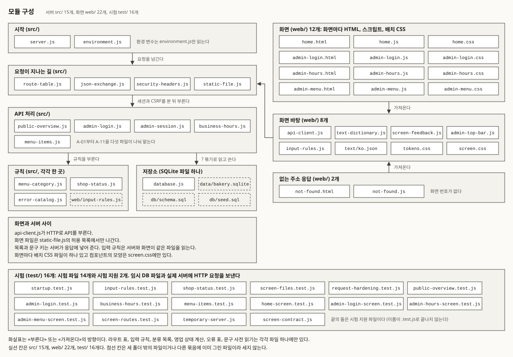
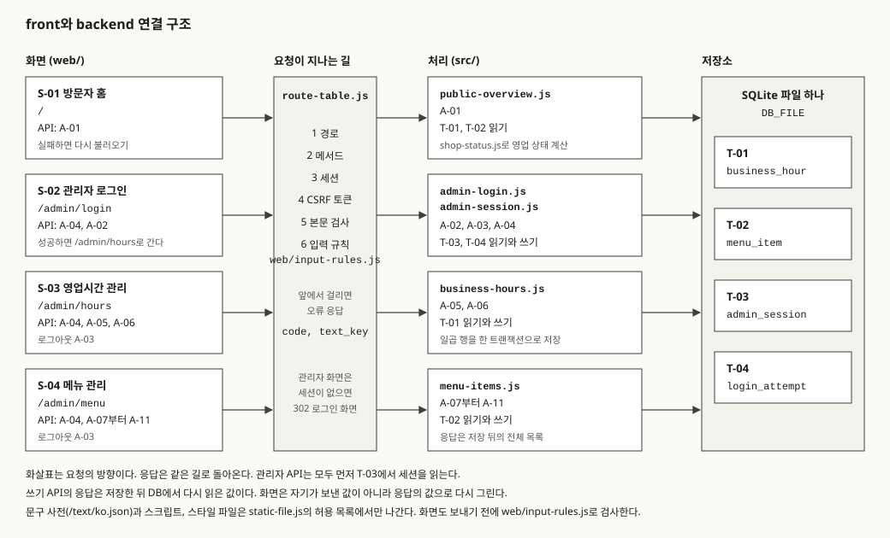

# 05 소스: 폴더, API 계약, 보안, 시험, 구현 단위

> 이름과 번호는 `01_공통규칙.md`를 글자 그대로 쓴다. 이 문서가 최종 권위인 것은 기능(FN), API의 요청과 응답 필드, 오류 코드, 구현 단위(U), `src/` `web/` `test/`의 파일 이름이다.
> 테이블의 타입과 제약은 `02_DB.md`, 화면 문구 키와 화면 동작은 `03_화면.md`, 모양과 토큰은 `04_디자인.md`가 정한다.
> 이 문서는 기획 산출물이다. 응용 코드는 들어 있지 않다.

## 0. 확정된 사실과 가정

| 구분 | 내용 | 근거 |
|---|---|---|
| [실측] | 이 기기의 Node는 24.15.0이다 | 2026-11-17 `node -v` 실행 결과 |
| [실측] | `node:sqlite`의 SQLite는 3.51.3이고 플래그와 경고 없이 열린다. `prepare(...).run(?)`은 `changes`와 `lastInsertRowid`를 돌려준다. `BEGIN IMMEDIATE` 뒤 `ROLLBACK`하면 넣은 행이 0건이다 | 2026-11-17 임시 폴더의 탐침 스크립트 실행 결과 |
| [실측] | `node --test test/`는 Node 24.15.0에서 실패한다. 폴더 이름을 모듈 경로로 읽어 «Cannot find module»로 끝난다. `node --test "test/*.test.js"`는 시험 파일만 골라 통과한다. 인자 없는 `node --test`는 `test/` 안의 지원 파일도 시험 파일로 세어 시험 수가 하나 늘어난다 | 2026-11-17 임시 폴더에서 세 명령을 실행한 결과 |
| [실측] | `crypto.scrypt`(기본 비용, 키 64바이트)는 이 기기에서 한 번에 약 110ms다 | 2026-11-17 탐침 스크립트 실행 결과 |
| [실측] | `Intl.DateTimeFormat`에 `timeZone: 'Asia/Seoul'`, `hourCycle: 'h23'`을 주면 UTC 2026-11-14 15:30이 일요일 00:30으로 나온다. 없는 시간대 이름은 `RangeError`다 | 2026-11-17 탐침 스크립트 실행 결과 |
| [실측] | `fetch`는 경로의 `..`을 보내기 전에 지운다(`/text/../../.env`가 `/.env`로 간다). `node:http`의 요청은 경로를 글자 그대로 보낸다. `node:http` 서버는 `Server`와 `X-Powered-By` 헤더를 붙이지 않는다 | 2026-11-17 포트 0에 띄운 탐침 서버의 실행 결과 |
| [실측] | `node --env-file-if-exists=.env`는 파일이 없어도 계속 실행한다 | 2026-11-17 실행 결과 |
| [관찰] | `db/schema.sql`은 같은 이름의 메뉴와 겹치는 `sort_order`를 막지 않는다. `sort_order`는 분류 안의 순서다. 휴무인 요일은 두 시각이 비어 있어야 한다(`ck_business_hour_day_off`). 저널 방식은 SQLite 기본값이다. 스키마 번호는 `PRAGMA user_version`이다 | `db/schema.sql`, `02_DB.md` 3절, 8절, 9절 |
| [관찰] | 오류 응답의 `text_key`는 `03_화면.md` 6.3절 표의 키만 쓴다. 화면은 보내기 전에 서버와 같은 검사를 한다. 방문자 화면은 열어 둔 채로 스스로 다시 읽지 않고 계산 기준 시각을 보인다. A-08은 이름, 가격, 분류 셋을 보낸다. 같은 이름의 메뉴를 막지 않는다. 문서 제목과 설명 메타는 `title.home`의 글자다 | `03_화면.md` 3.0절, 3.1절, 3.4절, 6.3절, 9.1절 |
| [실측] | 이 문서의 오류 표가 쓰는 문구 키 20개가 모두 `web/text/ko.json`에 있다 | 2026-11-17 두 파일을 스크립트로 대조한 결과 |
| [관찰] | 요청 본문 상한은 16KB, A-01 본문 목표는 메뉴 상한 개수에 이름 40자를 넣었을 때 64KB 이하, 관리자 화면은 검색 색인 금지다 | `00_기획서.md` 4-4 |
| [관찰] | 분류 목록 같은 값은 서버가 API로 내려 준다. 검증 규칙은 한 파일에 둔다 | `LESSON_PLAN.md` F-25 |
| [실측] | 메뉴 200개(상한)의 이름이 모두 한글 40자일 때 2-4절 A-01 모양의 본문은 45,046바이트다. 이름이 모두 4바이트 글자 40자면 53,046바이트다. 둘 다 65,536바이트보다 작다 | 2026-11-17 그 모양의 객체를 `JSON.stringify`한 뒤 `Buffer.byteLength`로 잰 결과. 서버가 아직 없으므로 실제 응답은 U-05의 시험이 다시 잰다 |
| [실측] | 풀어 쓴 한글(NFD) 40자는 코드 포인트 80개이고 `normalize('NFC')` 뒤에는 40개다. `trim()`은 탭과 줄바꿈을 떼고 U+0001은 떼지 않는다 | 2026-11-17 `node -e` 실행 결과 |
| [실측] | `package.json`이 없는 폴더에서도 `import` 문을 쓴 `test/*.test.js`가 Node 24.15.0의 `node --test`로 경고 없이 돈다 | 2026-11-17 임시 폴더에서 실행한 결과. U-02의 검증이 U-01의 `package.json`을 기다리지 않아도 된다 |
| [실측] | 뿌리 `package.json`에 `"type": "module"`을 두면 `require`를 쓰는 기존 스크립트가 «require is not defined in ES module scope»로 종료 코드 1이다. `type`을 빼면 그 스크립트는 종료 코드 0이지만 `import`를 쓴 `.js`가 돌 때마다 표준 오류 출력에 `MODULE_TYPELESS_PACKAGE_JSON` 경고가 나온다. 뿌리에는 `type`을 두지 않고 `src/`, `test/`, `web/`에 `{ "type": "module" }` 한 줄짜리 `package.json`을 두면 `require` 스크립트 종료 코드 0, `import` 시작 파일 경고 0줄, 자식 프로세스를 포함한 시험 4건 통과다 | 2026-11-17 임시 폴더에 세 가지 배치를 차례로 만들어 Node 24.15.0으로 실행한 결과 |
| [실측] | 지금 폴더에서 `node scripts/coolhan.js where`, `node db/check-schema.js`, `node docs/plan/design/contrast-check.js`는 모두 종료 코드 0이다. `.gitignore`는 이미 있고 `.env`, `data/`, `node_modules/` 줄이 들어 있다. `.gitattributes`는 없다 | 2026-11-17 세 명령을 실행하고 두 파일을 읽은 결과 |
| [관찰] | `ck_menu_item_name`은 저장된 값의 `length(name) <= 40`을 본다(SQLite의 `length`는 글자 수다). 시각 기록 컬럼의 기본값은 SQLite의 시계다. `db/seed.sql`은 일곱 행을 `weekday`만 넣어 만든다. `02_DB.md` 9절의 옛 파일 옮기기는 번호가 0보다 크고 가장 새 번호보다 작을 때의 일이다 | `db/schema.sql`, `db/seed.sql`, `02_DB.md` 9절 |

## 1. 폴더 구조

백엔드 하나(`src/`의 Node 서버), 관리자 표면 하나(`/admin`), 저장소 하나(SQLite 파일)다. 빌드 단계가 없다. 서버와 화면 스크립트는 모두 ES 모듈이다.

모듈 종류는 한 곳에서 이렇게 정한다. 뿌리 `package.json`에는 `type` 필드를 두지 않는다. 그래서 `scripts/`, `db/`, `docs/`의 기존 스크립트는 지금처럼 CommonJS로 돈다. `src/`, `test/`, `web/`에는 `{ "type": "module" }` 한 줄만 든 `package.json`을 하나씩 두고, 그 세 폴더의 `.js`는 모두 ES 모듈이다. 파일 이름은 `.js` 그대로다. 다른 길 둘은 고르지 않았다. 확장자를 `.mjs`로 바꾸면 파일 이름 41개(`src/` 15, `test/` 16, `web/`의 스크립트 10)와 화면의 스크립트 주소가 바뀐다. CommonJS로 쓰면 브라우저와 서버가 `web/input-rules.js` 한 파일을 같이 읽을 수 없다(0절의 실측).

### 1-1. 저장소 뿌리와 모듈 종류 표시

| 경로 | 하는 일 | 구현 단위 |
|---|---|---|
| `package.json` | 실행 명령 `start`와 `test`, `engines.node` 24 이상. `type` 필드가 없다. `dependencies`와 `devDependencies`는 비어 있다 | U-01 |
| `src/package.json`, `test/package.json` | `{ "type": "module" }` 한 줄. 그 폴더의 `.js`를 ES 모듈로 읽게 한다. 다른 필드가 없다 | U-01 |
| `web/package.json` | `{ "type": "module" }` 한 줄. Node가 `web/input-rules.js`와 시험이 부르는 `web/api-client.js`를 경고 없이 ES 모듈로 읽게 한다. 정적 파일 허용 목록에 넣지 않는다(2-7절) | U-02 |
| `.env.example` | 환경 변수 이름과 한 줄 설명. 비밀값 없음 | 기획 단계에 작성 |
| `.gitignore` | 이미 있고 `.env`와 `data/` 줄이 들어 있다(0절의 실측). U-01은 만들지 않는다. U-01의 시험이 두 줄이 있는지 보고, 줄이 빠져 있을 때만 그 줄을 더한다 | U-01(줄이 빠졌을 때만 고친다) |
| `.gitattributes` | 줄바꿈을 LF로 고정한다(`* text=auto eol=lf`). 지금은 없다 | U-01 |
| `db/schema.sql`, `db/seed.sql`, `db/check-schema.js` | `02_DB.md`의 산출물. 이 문서의 단위는 고치지 않고 읽기만 한다 | 해당 없음 |
| `data/bakery.sqlite` | 실행하면 생기는 DB 파일. 저장소에 올리지 않는다 | 해당 없음 |

### 1-2. `src/` (서버, 15개)

| 경로 | 하는 일 | 구현 단위 |
|---|---|---|
| `src/server.js` | 시작점. 환경 값을 읽고 DB를 열고 HTTP 서버를 띄운다. 시험이 부르는 `startServer(설정)`을 내보낸다(1-6절). 요청 한 줄 기록을 `writeLog`로 남긴다. `node src/server.js`로 직접 실행됐을 때만 `readEnvironmentOrExit()`의 결과로 `startServer`를 부르고, 다른 파일이 가져올 때는 부르지 않는다 | U-04, U-06 |
| `src/environment.js` | 환경 변수 여섯 개를 읽고 검사한다. 빠지거나 틀리면 이름만 알리고 멈춘다. Node 버전도 여기서 확인한다. 읽고, 틀리면 알리고 종료 코드 1로 끝내는 함수 `readEnvironmentOrExit()`를 내보낸다. `src/server.js`는 이 함수로 시작하고, U-01의 시험은 자식 프로세스에서 이 함수만 부른다 | U-01 |
| `src/database.js` | `DB_FILE`을 열고 `user_version`을 본다. 0이면 `db/schema.sql`과 `db/seed.sql`을 실행하고 1로 올린다. 1이면 그대로 연다. 그 밖의 번호면 열지 않고 파일의 번호와 코드가 아는 번호를 알린다. 스키마 번호가 1인 동안에는 옛 파일을 옮기는 코드를 만들지 않는다. 여는 함수는 `openDatabase({ dbFile, now })`이고 트랜잭션 함수가 달린 DB 손잡이를 돌려준다. 열 때 만료된 세션과 오래된 로그인 시도를 지우는데, 그 기준 시각은 인자로 받은 `now()`다. 이 파일은 스스로 시계를 읽지 않는다(1-6절) | U-01 |
| `src/error-catalog.js` | 오류 코드마다 상태 코드와 `text_key`를 적은 표. 입력 오류의 코드와 키는 `web/input-rules.js`의 것을 가져와 합친다. 오류 응답은 이 표에서만 만든다 | U-02 |
| `src/route-table.js` | 라우트 표. API 11행(메서드, 경로, 권한, CSRF, 본문 모양, 처리 함수)과 화면 4행(경로, 파일, 권한). 본문 모양은 받는 필드의 이름과 JSON 타입이다. 경로 찾기, 세션 확인, CSRF 확인의 순서도 이 파일이 정한다 | U-04, U-05, U-06, U-07, U-08 |
| `src/json-exchange.js` | JSON 본문 읽기(Content-Type, 16KB 상한, 구문 검사), 라우트 표 행의 본문 모양과 견주기(`bad_shape`), JSON 응답과 오류 응답 쓰기 | U-04 |
| `src/security-headers.js` | 모든 응답에 붙는 보안 헤더 한 벌 | U-04 |
| `src/static-file.js` | 시작할 때 `webRoot`를 한 번 훑어 만든 허용 목록에서만 파일을 내보낸다(`package.json`은 뺀다). HTML 머리말의 문구 자리를 사전 글자로 바꾼다. API가 아닌 없는 경로에는 허용 목록의 `not-found.html`을 404로 내보낸다 | U-04 |
| `src/menu-category.js` | 분류 목록(코드, 문구 키, 표시 순서) | U-02 |
| `src/shop-status.js` | 영업 상태 계산 규칙과 상태 코드별 문구 키. 요청 시각을 가게 시간대의 요일과 시각으로 바꾸는 일도 여기서 한다 | U-02 |
| `src/public-overview.js` | A-01. T-01과 T-02를 읽고 영업 상태를 계산해 한 응답으로 묶는다 | U-05 |
| `src/admin-login.js` | A-02. 로그인 횟수 제한(T-04)과 비밀번호 비교(scrypt) | U-06 |
| `src/admin-session.js` | A-03, A-04. 세션 만들기, 확인, 지우기(T-03), 쿠키 서명, CSRF 토큰 비교 | U-06 |
| `src/business-hours.js` | A-05, A-06. T-01 읽기와 일곱 행 한 번에 저장 | U-07 |
| `src/menu-items.js` | A-07, A-08, A-09, A-10, A-11. T-02 읽기, 추가, 수정, 삭제, 순서 저장 | U-08 |

API를 처리하는 파일이 5개(`public-overview`, `admin-login`, `admin-session`, `business-hours`, `menu-items`), 바탕 파일이 10개다. `src/route-table.js`와 `src/server.js`는 여러 단위가 차례로 고친다. 구현 단위 칸에 단위가 여럿이면 첫 단위가 만들고 뒤의 단위가 고친다. 서버 코드의 기록과 시작 실패 글은 영문 낱말과 변수 이름으로만 쓴다. 서버 코드에 한국어 문장을 쓰지 않는다(`03_화면.md` 6.1절).

### 1-3. `web/` (화면, 22개)

| 경로 | 하는 일 | 구현 단위 |
|---|---|---|
| `web/tokens.css` | 디자인 토큰. `04_디자인.md`의 산출물로 이미 있다. 이 문서의 단위는 고치지 않는다 | 해당 없음 |
| `web/text/ko.json` | 화면 문구 사전. `03_화면.md`의 산출물로 이미 있다. 이 문서의 단위는 고치지 않는다 | 해당 없음 |
| `web/input-rules.js` | 입력 검증 규칙. 시각, 한 주 영업시간, 메뉴 이름, 가격(가격 칸의 글자를 정수로 바꾸는 함수 포함), 분류, 판매 상태, 비밀번호. 입력 오류의 코드와 문구 키도 여기 있다. 다른 파일을 가져오지 않는 순수 함수다. 서버와 화면이 같은 파일을 읽는다 | U-02 |
| `web/screen.css` | 컴포넌트 C-01부터 C-14의 모양만 둔다. 화면별 배치는 두지 않는다. 색 값은 토큰만 읽는다 | U-03 |
| `web/text-dictionary.js` | 문구 사전 읽기. `/text/ko.json`을 받아 `data-text` 속성이 달린 요소에 글자를 넣는다. 값 자리(`{name}` 같은 것) 채우기와 가격 표시(`price.format`)도 여기서 한다 | U-03 |
| `web/api-client.js` | API 부르기. `X-CSRF-Token` 헤더 붙이기, 오류 응답에서 `code`와 `text_key` 꺼내기, 서버에 닿지 못하면 `error.network`. 오류 코드가 `auth_required`이고 지금 주소가 `/admin/login`이 아닐 때만 `/admin/login#expired`로 보낸다. 상태 코드 401만 보고 보내지 않는다(`login_failed`도 401이다) | U-03 |
| `web/screen-feedback.js` | 오류 줄(C-10), 저장 알림(C-14), 확인 창(C-11), 풍선말 단추(C-09)의 열기와 닫기 | U-03 |
| `web/home.html`, `web/home.js`, `web/home.css` | S-01 방문자 홈. `home.css`는 이 화면의 배치만 둔다 | U-09 |
| `web/admin-login.html`, `web/admin-login.js`, `web/admin-login.css` | S-02 관리자 로그인. `admin-login.css`는 이 화면의 배치만 둔다 | U-10 |
| `web/admin-top-bar.js` | 위쪽 줄(C-12). 세션 확인(A-04), 관리자 화면 사이 이동, 로그아웃(A-03) | U-10 |
| `web/admin-hours.html`, `web/admin-hours.js`, `web/admin-hours.css` | S-03 영업시간 관리. `admin-hours.css`는 이 화면의 배치만 둔다 | U-11 |
| `web/admin-menu.html`, `web/admin-menu.js`, `web/admin-menu.css` | S-04 메뉴 관리. `admin-menu.css`는 이 화면의 배치만 둔다 | U-12 |
| `web/not-found.html`, `web/not-found.js` | 없는 주소 응답의 본문. `error.page.missing` 하나를 `web/text-dictionary.js`로 넣는다. 화면 번호가 없고 라우트 표의 행이 아니다(2-7절) | U-13 |

화면 파일의 규칙:

- CSS 파일은 여섯 개다. HTML은 `tokens.css`, `screen.css`, 자기 화면의 배치 파일 셋만 건다(`not-found.html`은 앞의 둘만 건다). 화면 단위(U-09부터 U-12)는 자기 배치 파일만 쓰고 `web/screen.css`와 다른 화면의 배치 파일을 고치지 않는다. 컴포넌트의 모양이 모자라면 배치 파일에 덧쓰지 않고 `docs/PROGRESS.md`에 결함으로 올려 U-03의 파일을 고친다.
- 화면 스크립트는 글자를 `textContent`로만 넣는다. HTML 문자열을 만드는 호출(`innerHTML`, `outerHTML`, `insertAdjacentHTML`, `document.write`)을 쓰지 않는다.
- 되풀이되는 행(메뉴 한 줄)은 HTML 파일의 `template` 요소를 복제해 만든다. 도형은 `template` 안의 인라인 SVG다.
- HTML에 인라인 스크립트, `style` 속성, `on...` 속성을 쓰지 않는다. CSS에서 `data:` 주소를 쓰지 않는다. CSP가 막는다.
- 화면 파일에 한국어 문장을 직접 쓰지 않는다. 글자는 `data-text="영역.이름"` 속성이나 `text('영역.이름')` 호출로만 온다.
- 요일 일곱 행은 HTML에 고정으로 둔다(`data-weekday` 속성). 요일 이름은 행마다 `data-text` 키다. 보이는 순서는 `03_화면.md`를 따른다.
- 분류, 영업 상태, 오류의 문구 키는 서버 응답에 들어 있는 `text_key`를 쓴다. 판매 상태 표지는 `template`에 두 가지(`sale.onsale`, `sale.soldout`)를 다 두고 코드에 따라 하나만 보인다. 화면이 코드 글자를 이어 붙여 키를 만들지 않는다.
- 화면은 보내기 전에 `web/input-rules.js`의 함수로 검사하고, 서버는 같은 파일의 같은 함수로 다시 검사한다. 둘이 다르면 서버의 판정을 따른다.
- 입력칸의 `type`, `inputmode`, `step`은 2-8절의 표를 따른다. 그 표와 같은지, `step`이 `web/input-rules.js`의 분 단위와 맞는지는 정적 시험이 본다.
- `web/package.json`은 화면 파일이 아니다. 모듈 종류 표시 파일이고 1-1절에 적는다. 그래서 이 절의 파일 수(22개)에 넣지 않는다. `src/`와 `test/`의 것도 같다.

### 1-4. `test/` (시험, 16개)

시험 파일이 14개, 시험 지원 파일이 2개다. 지원 파일은 이름이 `.test.js`로 끝나지 않아 시험으로 세지 않는다.

| 경로 | 하는 일 | 구현 단위 |
|---|---|---|
| `test/temporary-server.js` | 시험 지원. 임시 폴더에 DB 파일과 웹 폴더(화면 네 경로의 최소 HTML 포함)를 만들고 스스로 만든 환경 값으로 실제 서버를 포트 0에 띄운다. `startServer`에 `webRoot`, `now`, 줄을 배열에 모으는 `writeLog`와 `writeError`를 넘긴다. 로그인과 요청 함수, 모은 기록 줄, 임시 DB 파일에 `?` 묶기로 행을 직접 넣고 읽는 함수를 준다. 끝나면 `close()`를 부르고 임시 폴더를 지운다 | U-04 |
| `test/screen-contract.js` | 시험 지원. 화면 하나의 파일(HTML과 그 화면의 스크립트, 스크립트가 가져오는 `web/`의 파일)을 글자로 읽어 계약을 견주는 함수. API 경로, 문구 키, 인라인 금지, 라벨, 버튼 이름, `lang`과 `h1`. 읽을 파일이 없으면 실패한다 | U-03 |
| `test/startup.test.js` | 환경 값 검사와 DB 열기, 필수 값 없이 `src/environment.js`의 시작 검사 함수를 부른 자식 프로세스의 종료 코드 | U-01 |
| `test/input-rules.test.js` | 입력 검증 규칙의 단위 시험 | U-02 |
| `test/shop-status.test.js` | 영업 상태 계산 규칙의 단위 시험 | U-02 |
| `test/screen-files.test.js` | 화면 바탕의 정적 검사(스크립트, CSS, 사전: 서버가 내려 주는 문구 키, 금지 호출, 한글 직접 쓰기, 색 값)와 `web/api-client.js`의 이동 규칙 | U-03 |
| `test/request-hardening.test.js` | 보안 헤더, 본문 상한, 경로 벗어나기, 오류 모양, 기록 줄. 라우트가 필요 없는 시험은 U-04가 쓰고, API 응답이 필요한 시험은 U-05가, 본문을 받는 라우트와 로그인이 필요한 시험은 U-06이 더한다 | U-04, U-05, U-06 |
| `test/public-overview.test.js` | A-01 통합 시험 | U-05 |
| `test/admin-login.test.js` | A-02, A-03, A-04 통합 시험 | U-06 |
| `test/business-hours.test.js` | A-05, A-06 통합 시험과 A-01 되읽기 | U-07 |
| `test/menu-items.test.js` | A-07, A-08, A-09, A-10, A-11 통합 시험과 A-01 되읽기 | U-08 |
| `test/home-screen.test.js` | S-01의 정적 계약 시험 | U-09 |
| `test/admin-login-screen.test.js` | S-02와 위쪽 줄 스크립트의 정적 계약 시험 | U-10 |
| `test/admin-hours-screen.test.js` | S-03의 정적 계약 시험 | U-11 |
| `test/admin-menu-screen.test.js` | S-04의 정적 계약 시험 | U-12 |
| `test/screen-routes.test.js` | 실제 `web/` 폴더로 띄운 서버에서 화면 네 경로, 없는 주소 응답, 라우트 표의 행 수를 확인한다. 네 화면이 모두 있어야 볼 수 있는 정적 검사(쓰이지 않는 키, 입력칸의 속성)도 여기 있다 | U-13 |

### 1-5. 한 곳에만 두는 것

| 대상 | 파일 | 다른 곳이 쓰는 법 |
|---|---|---|
| 라우트 표 | `src/route-table.js` | 서버는 이 표로만 요청을 보낸다. 시험은 이 표의 행 수를 센다 |
| 입력 검증 규칙 | `web/input-rules.js` | 서버의 처리 파일과 화면 스크립트가 같은 함수를 부른다. 규칙을 다른 파일에 다시 쓰지 않는다 |
| 영업 상태 계산 규칙 | `src/shop-status.js` | A-01만 부른다. 화면은 계산하지 않는다 |
| 분류 목록 | `src/menu-category.js` | A-01과 A-07 응답의 `category_list`로 화면에 내려간다 |
| 문구 사전 읽기 | `web/text-dictionary.js` | 네 화면이 모두 이 파일로 글자를 넣는다 |
| 오류 코드와 문구 키 | `src/error-catalog.js`(입력 오류의 것은 `web/input-rules.js`) | 오류 응답은 이 표의 코드로만 만든다. 한 코드는 두 파일 가운데 한 곳에만 있다. `bad_shape`는 `src/error-catalog.js`에만 있고 규칙 파일은 돌려주지 않는다 |
| 보안 헤더 | `src/security-headers.js` | 모든 응답이 지난다 |
| 환경 변수 읽기 | `src/environment.js` | 다른 파일은 `process.env`를 읽지 않는다 |
| 지금 시각 | `startServer(설정)`의 `now` 함수 | 시각을 쓰거나 견주는 모든 곳이 이 함수의 값을 `?`로 넘긴다. SQL 안에서 SQLite의 시계를 부르지 않는다(2-3절) |
| 컴포넌트의 모양 | `web/screen.css` | 화면별 배치 파일은 컴포넌트의 모양을 다시 쓰지 않는다 |



### 1-6. 서버를 띄우는 함수와 DB를 여는 함수

`startServer(설정)`이 받는 것(`src/server.js`):

| 필드 | 타입 | 주지 않으면 | 쓰는 곳 |
|---|---|---|---|
| `environment` | `src/environment.js`의 읽기 함수가 돌려준 객체. 필드는 `adminPassword`, `sessionSecret`, `shopName`, `shopTimeZone`, `port`, `dbFile` | 필수다. 없으면 던진다 | 서버 전체. 이 객체 밖에서 환경 값을 읽지 않는다 |
| `webRoot` | 폴더 경로 문자열 | 저장소의 `web/` | `src/static-file.js`의 허용 목록 |
| `now` | `Date`를 돌려주는 함수 | `() => new Date()` | 시각을 쓰거나 견주는 모든 곳과 `openDatabase` |
| `writeLog` | 글자 한 줄을 받는 함수 | `process.stdout`에 그 줄과 줄바꿈을 쓴다 | 요청 한 줄 기록 |
| `writeError` | 글자 한 줄을 받는 함수 | `process.stderr`에 그 줄과 줄바꿈을 쓴다 | 예상하지 못한 오류의 자세한 내용(스택, 제약 이름) |

- 돌려주는 것은 `{ port, close }`로 풀리는 Promise다. `port`는 실제로 연 포트다(`environment.port`가 0이면 운영체제가 준 번호). `close()`는 HTTP 서버를 닫고 DB를 닫은 뒤 풀리는 Promise다.
- 듣는 주소는 `127.0.0.1` 하나이고 설정으로 바꾸지 못한다. 포트가 쓰이고 있으면 Promise가 거절된다.
- `startServer`는 받은 `environment.dbFile`과 `now`로 `openDatabase({ dbFile, now })`를 부른다. `src/database.js`는 `startServer`를 모르고 `now`를 인자로만 받는다. 그래서 `src/server.js`가 없는 U-01의 시험도 `openDatabase`에 자기 `now`를 넘겨 시작할 때의 정리를 볼 수 있다.
- 요청 기록은 요청 하나에 한 줄이고 `writeLog`로만 나간다. 줄의 내용은 5-1절의 다섯 가지다. 시험은 `writeLog`에 줄을 배열에 넣는 함수를 넘기고 그 배열을 본다. 표준 출력을 가로채지 않는다.

## 2. API 계약

### 2-1. 요청이 지나는 순서

모든 요청은 `src/route-table.js`를 아래 순서로 지난다. 앞에서 걸리면 뒤는 보지 않는다.

| 순서 | 확인 | 걸리면 |
|---|---|---|
| 1 | 경로가 라우트 표의 행이거나 정적 파일 허용 목록의 주소다. 화면 행은 그 파일이 허용 목록에 있을 때만 있는 행으로 친다. 허용 목록의 주소(`/tokens.css` 같은 것)는 메서드가 GET 하나이고 권한이 없는 행처럼 다룬다 | 404 `not_found`. `/api/`로 시작하는 경로는 JSON 오류 모양, 그 밖의 경로는 2-7절의 HTML 본문 |
| 2 | 그 경로에 이 메서드가 있다. 정적 파일 주소와 화면 경로는 GET만 있다 | 405 `method_not_allowed` |
| 3 | 권한이 admin인 행: 쿠키의 서명이 맞고 T-03에 만료되지 않은 세션이 있다 | API는 401 `auth_required`, 화면 경로는 302 `/admin/login` |
| 4 | CSRF가 필요한 행: `X-CSRF-Token` 헤더가 세션의 `csrf_token`과 같다. `Origin` 헤더가 있으면 호스트가 `Host` 헤더와 같다 | 403 `csrf_rejected` |
| 5 | 본문이 있는 행: `Content-Type`이 `application/json`이다 | 415 `unsupported_media_type` |
| 6 | 본문이 16,384바이트 이하다 | 413 `body_too_large` |
| 7 | 본문이 JSON 객체로 읽힌다 | 400 `bad_json` |
| 8 | 본문이 라우트 표 행의 본문 모양과 같다(`src/json-exchange.js`가 본다). 모르는 필드가 없다. 들어 있는 필드의 JSON 타입이 같다. 전용 코드가 없는 필수 필드가 빠지지 않았다. 값의 범위와 형식은 보지 않는다 | 400 `bad_shape` |
| 9 | 입력 검증 규칙(`web/input-rules.js`)을 지킨다. 값의 범위, 형식, 길이와 전용 코드가 있는 필수 필드를 본다 | 400의 규칙별 코드 |
| 10 | 처리 함수가 실행된다 | 404, 409의 코드. 예상하지 못한 오류는 500 |

경로는 물음표 뒤를 뺀 글자로 정확히 맞춘다. 끝에 빗금을 더 붙인 경로는 다른 경로다.

찾는 순서는 라우트 표가 먼저, 정적 파일 허용 목록이 다음이다. 둘 다 1번 안에서 본다. 정적 파일 주소가 GET으로 오면 2번을 지나 바로 파일을 200으로 내보내고 3번부터 10번은 보지 않는다(권한, CSRF, 본문이 없는 행이다). 그래서 `/tokens.css`는 404가 아니라 200이다. 라우트 표의 경로와 허용 목록의 주소는 겹치지 않는다. HTML 파일과 `package.json`은 허용 목록의 주소가 아니기 때문이다(2-7절).

파일이 없는 화면 경로는 1번에서 404다. 3번까지 가지 않으므로 관리자 화면 경로도 세션이 있든 없든 404이고 302가 아니다. 파일이 있는 관리자 화면 경로만 세션이 없을 때 302다. 허용 목록은 시작할 때 한 번 만들므로 이 판정은 서버가 떠 있는 동안 바뀌지 않는다.

8번과 9번이 나누는 법: `bad_shape`는 8번만 낸다. 8번은 필드의 이름과 JSON 타입(문자열, 정수, null, 배열, 객체), A-11의 `id` 배열의 구조(원소가 200개를 넘는다, 같은 번호가 두 번 있다)만 본다. 예외는 둘이다. `price_krw`는 타입도 9번이 본다(2-3절). `is_day_off`는 0과 1만 받는 것까지 8번이 본다. 빠진 필드는 전용 코드가 있으면 9번이 그 코드로(`password_required`, `menu_name_required`, `menu_price_required`, `menu_category_invalid`, `menu_sale_status_unknown`), 없으면 8번이 `bad_shape`로 거절한다.

null은 빠진 필드와 똑같이 다룬다. `password`, `name`, `price_krw`, `category`, `sale_status`가 null이면 `bad_shape`가 아니라 그 필드의 전용 코드다(`category`가 null이면 `menu_category_invalid`, `sale_status`가 null이면 `menu_sale_status_unknown`). 전용 코드가 없는 필드(`weekday`, `is_day_off`, `business_hour`, `id`)가 null이면 `bad_shape`다. null이 값인 필드는 `opens_at`과 `closes_at` 둘뿐이다.

### 2-2. 요약

| ID | 이름 | 메서드와 경로 | 권한 | CSRF 토큰 | 읽는 테이블 | 쓰는 테이블 | 성공 | R 번호 |
|---|---|---|---|---|---|---|---|---|
| A-01 | 방문자 화면 자료 | GET `/api/public/overview` | 없음 | 필요 없음 | T-01, T-02 | 해당 없음 | 200 | R-01, R-02, R-03 |
| A-02 | 로그인 | POST `/api/admin/login` | 없음 | 필요 없음 | T-04 | T-04, T-03 | 200 | R-04 |
| A-03 | 로그아웃 | POST `/api/admin/logout` | admin | 필요 | T-03 | T-03 | 204 | R-04 |
| A-04 | 세션 확인 | GET `/api/admin/session` | admin | 필요 없음 | T-03 | 해당 없음 | 200 | R-04 |
| A-05 | 영업시간 읽기 | GET `/api/admin/hours` | admin | 필요 없음 | T-03, T-01 | 해당 없음 | 200 | R-05 |
| A-06 | 영업시간 저장 | PUT `/api/admin/hours` | admin | 필요 | T-03, T-01 | T-01 | 200 | R-05 |
| A-07 | 메뉴 읽기 | GET `/api/admin/menu` | admin | 필요 없음 | T-03, T-02 | 해당 없음 | 200 | R-06 |
| A-08 | 메뉴 추가 | POST `/api/admin/menu` | admin | 필요 | T-03, T-02 | T-02 | 201 | R-06 |
| A-09 | 메뉴 수정 | PUT `/api/admin/menu/{id}` | admin | 필요 | T-03, T-02 | T-02 | 200 | R-06 |
| A-10 | 메뉴 삭제 | DELETE `/api/admin/menu/{id}` | admin | 필요 | T-03, T-02 | T-02 | 200 | R-06 |
| A-11 | 메뉴 순서 저장 | PUT `/api/admin/menu-order` | admin | 필요 | T-03, T-02 | T-02 | 200 | R-06 |

모든 API 응답은 `Content-Type: application/json; charset=utf-8`과 `Cache-Control: no-store`다. 204 응답은 본문이 없다.

### 2-3. 필드 (JSON 필드 이름은 컬럼 이름과 같다)

영업시간 한 행:

| 필드 | 타입 | 제약 | 요청에 넣는가 |
|---|---|---|---|
| weekday | 정수 | 0(일요일)부터 6(토요일) | 넣는다 |
| opens_at | 문자열 또는 null | 24시간 `HH:MM`, 00:00부터 23:55, 분은 5의 배수 | 넣는다 |
| closes_at | 문자열 또는 null | `opens_at`과 같은 형식. `opens_at`보다 늦다. 둘은 같이 있거나 같이 null이다 | 넣는다 |
| is_day_off | 정수 | 0 또는 1. 1이면 두 시각은 null이어야 한다 | 넣는다 |

컬럼 `updated_at`은 요청에도 응답에도 없다. 서버가 저장할 때 쓰기만 한다.

메뉴 한 행:

| 필드 | 타입 | 제약 | 요청에 넣는가 |
|---|---|---|---|
| id | 정수 | 1 이상. DB가 준다 | 본문에 넣지 않는다. A-09와 A-10은 경로에, A-11은 `id` 배열에 넣는다 |
| name | 문자열 | 저장하는 값은 `name.normalize('NFC').trim()`이다. 그 값이 코드 포인트로 1자 이상 40자 이하이고 제어 문자(U+0000부터 U+001F, U+007F)가 없다. 아래 «메뉴 이름을 다루는 순서»를 따른다 | A-08, A-09 |
| price_krw | 정수 | JSON 정수 0 이상 1,000,000 이하. 소수, 문자열, 불리언은 받지 않는다. 아래 «가격 글자를 수로 바꾸는 곳»을 따른다 | A-08, A-09 |
| category | 문자열 | bread, cake, cookie, drink 가운데 하나 | A-08, A-09, A-11 |
| sale_status | 문자열 | on_sale 또는 sold_out | A-09. A-08은 받지 않고 on_sale로 넣는다 |
| sort_order | 정수 | 0 이상. 분류 안의 순서. 서버가 정한다 | 넣지 않는다 |

컬럼 `created_at`과 `updated_at`은 요청에도 응답에도 없다. 메뉴 한 행의 응답 필드는 어느 API에서나 위 여섯 개다.

그 밖의 필드:

| 필드 | 타입 | 뜻 | 나오는 곳 |
|---|---|---|---|
| password | 문자열 | 1자 이상. 컬럼이 아니다. 어디에도 저장하지 않는다 | A-02 요청 |
| csrf_token | 문자열 | 43자. T-03의 `csrf_token`과 같은 값 | A-02, A-04 응답 |
| shop_name | 문자열 | 환경 변수 `SHOP_NAME`의 값 | A-01 응답 |
| shop_status | 객체 | `code`(open, closed, dayoff, unset), `text_key`(그 상태의 문구 키), `weekday`(가게 시간대의 오늘 요일), `local_time`(계산 기준 시각, 가게 시간대의 `HH:MM`) | A-01 응답 |
| category_list | 배열 | 분류 목록. 원소는 `code`와 `text_key`. 표시 순서대로 온다 | A-01, A-07 응답 |
| business_hour | 배열 | 영업시간 일곱 행. 요일 0부터 6의 순서 | A-01, A-05, A-06 |
| menu_item | 배열 | 메뉴 행. 분류 목록의 순서, 그 안에서 `sort_order`, 같으면 `id` 순서 | A-01, A-07, A-08, A-09, A-10, A-11 응답 |

응답에는 화면이 읽는 필드만 둔다. 이 규칙으로 뺀 것과 남긴 것은 아래와 같다.

| 값 | 응답에 | 근거 |
|---|---|---|
| 세션이 끝나는 시각, 가게 시간대 이름, 영업 상태를 계산한 UTC 시각 | 없다 | `03_화면.md`의 어느 화면도 읽지 않는다. 세션의 끝은 서버가 `auth_required`로 알린다 |
| `business_hour.updated_at`, `menu_item.created_at`, `menu_item.updated_at` | 없다 | `03_화면.md` 5절: 화면에 보이지 않는다. 읽는 것은 시험뿐이고 시험은 임시 DB를 직접 읽는다(10-2절) |
| A-08 응답의 새 행 번호 | 없다 | 화면은 응답의 `menu_item` 목록으로 다시 그린다. 새 행의 번호를 따로 읽는 곳이 없다 |
| `menu_item`의 `id` | 있다 | 보이지는 않지만 S-04가 A-09와 A-10의 경로, A-11의 `id` 배열에 넣어 행을 가리킨다(`03_화면.md` 5절) |
| `menu_item`의 `sort_order` | 있다 | `03_화면.md` 3.1절의 표가 S-01이 받는 값으로 적었다 |
| `csrf_token` | 있다 | 보이지 않지만 관리 화면이 쓰기 요청의 헤더에 싣는다 |

메뉴 이름을 다루는 순서(`web/input-rules.js`의 한 함수. 화면과 서버가 같은 함수를 부르고 서버는 이 함수가 돌려준 값을 저장한다):

| 순서 | 하는 일 | 걸리는 값 | 결과 |
|---|---|---|---|
| 1 | 필드가 있고 null이 아닌지 본다 | 필드가 없다, null이다 | 400 `menu_name_required` |
| 2 | 문자열인지 본다(2-1절 8번) | 수, 배열, 객체, 불리언 | 400 `bad_shape` |
| 3 | `normalize('NFC')`로 맞춘다 | 풀어 쓴 한글(NFD)처럼 합칠 수 있는 글자 | 거절하지 않는다. 합친 글자로 바꾼다 |
| 4 | `trim()`으로 앞뒤 공백을 뗀다 | 앞뒤의 빈칸, 탭, 줄바꿈 | 거절하지 않는다. 뗀 값으로 이어 간다 |
| 5 | 남은 값이 0자인지 본다 | 빈 문자열, 공백뿐인 값 | 400 `menu_name_required` |
| 6 | 제어 문자가 남았는지 본다 | 가운데에 든 탭과 줄바꿈, 어디에든 든 U+0000부터 U+001F와 U+007F 가운데 공백이 아닌 것 | 400 `menu_name_invalid` |
| 7 | 코드 포인트 수를 센다(`[...값].length`) | 40을 넘는 값 | 400 `menu_name_too_long` |
| 8 | 통과 | 해당 없음 | 3번과 4번을 거친 값을 `?`로 넣는다 |

이 순서를 지난 값은 `ck_menu_item_name`(`length(name) <= 40`, `length(trim(name)) >= 1`)을 지킨다. SQLite의 `length`도 코드 포인트를 세고, 값에 U+0000이 없기 때문이다. 이름 칸에는 `maxlength`를 두지 않는다(2-8절). 화면은 같은 함수의 결과로 오류 줄을 보인다. 응답의 `name`은 저장된 값이므로 화면은 뗀 뒤의 글자로 다시 그린다.

가격 글자를 수로 바꾸는 곳:

| 곳 | 받는 것 | 하는 일 |
|---|---|---|
| 화면(가격 칸의 글자) | 숫자 0부터 9만으로 된 1자 이상의 글자 | `web/input-rules.js`의 함수가 정수로 바꾸고 범위를 본다. 화면은 그 정수를 JSON 수로 보낸다 |
| 화면(가격 칸의 글자) | 빈 칸 | 보내지 않는다. 칸 아래에 `menu_price_required`의 `error.menu.price.required`를 보인다 |
| 화면(가격 칸의 글자) | 숫자가 아닌 글자가 든 값(쉼표, 소수점, 빼기표, 빈칸, 한글) | 보내지 않는다. 칸 아래에 `menu_price_range`의 `error.menu.price.range`를 보인다 |
| 서버(`price_krw`) | JSON 정수 | 0 이상 1,000,000 이하인지 본다. 밖이면 400 `menu_price_range` |
| 서버(`price_krw`) | 문자열(숫자만 든 문자열 포함), 소수, 불리언, 배열, 객체 | 수로 바꾸지 않는다. 400 `menu_price_range`다. `bad_shape`가 아니다 |
| 서버(`price_krw`) | 필드가 없다, null이다 | 400 `menu_price_required` |

글자를 수로 바꾸는 곳은 화면 하나다. 서버는 바꾸지 않는다.

시각 기록 컬럼을 쓰는 법:

- `created_at`, `updated_at`, `expires_at`, `attempted_at`은 모두 서버의 `now()`가 준 시각을 `toISOString()`으로 만든 글자이고 `?`로 넣는다. `now`는 `startServer(설정)`이 받는 함수이고 주지 않으면 기기의 시계다.
- 컬럼 기본값(SQLite의 시계)에 기대는 INSERT와 UPDATE가 `src/`에 없다. 행을 넣거나 고치는 모든 문장이 시각 컬럼을 이름으로 적는다: A-02(`login_attempt.attempted_at`, `admin_session.created_at`과 `expires_at`), A-06(일곱 행의 `updated_at`), A-08(`created_at`과 `updated_at`), A-09(`updated_at`), A-11(`sort_order`를 고친 행의 `updated_at`).
- 견주는 시각도 같다. 세션이 만료됐는지, 15분 창이 어디부터인지, 24시간이 지난 시도가 어느 것인지는 `now()`에서 계산한 글자를 `?`로 넘겨 견준다. `src/`의 SQL 문자열에 `'now'`와 `CURRENT_TIMESTAMP`를 쓰지 않는다.
- 예외는 `db/seed.sql`이 처음 넣는 일곱 행의 `updated_at` 하나다. DB 산출물의 문장이고 SQLite의 시계로 들어간다. A-01은 그 컬럼을 내보내지 않고, 시험은 A-06으로 저장하기 전의 그 값을 견주지 않는다.

### 2-4. API별 계약

#### A-01 방문자 화면 자료

| 구분 | 내용 |
|---|---|
| 경로 변수와 본문 | 해당 없음 |
| 성공 200 | `shop_name`, `shop_status`, `category_list`, `business_hour`(행마다 weekday, opens_at, closes_at, is_day_off), `menu_item`(행마다 id, name, price_krw, category, sale_status, sort_order). 품절인 메뉴도 들어 있다 |
| 오류 | 500 `read_failed` |
| 그 밖 | 쿠키를 읽지도 심지도 않는다. 시각 기록 컬럼은 내보내지 않는다 |

#### A-02 로그인

| 구분 | 내용 |
|---|---|
| 본문 | `password` |
| 성공 200 | `csrf_token`. `Set-Cookie`로 세션 쿠키를 심는다 |
| 오류 | 415 `unsupported_media_type`, 413 `body_too_large`, 400 `bad_json`, 400 `bad_shape`(모르는 필드, 문자열이 아닌 `password`), 400 `password_required`(없거나 null이거나 0자), 429 `login_throttled`(`Retry-After` 헤더에 남은 초), 401 `login_failed`, 500 `server_error` |
| 처리 순서 | 1. 만료된 세션과 24시간이 지난 시도를 지운다. 2. 실패 수 둘(이 접속 키의 것, 모든 접속의 것)을 센다. 하나라도 제한에 닿았으면 429이고 여기서 끝난다. 3. 시도 한 행을 `succeeded` 0으로 넣는다. 4. 비밀번호를 비교한다. 틀리면 401이다. 5. 맞으면 그 행을 1로 고치고 세션 한 행을 넣는다 |
| 429와 시도 기록 | 429로 끝난 요청은 T-04에 행을 넣지 않는다. 그래서 15분 창 안의 실패 수는 제한 수를 넘지 않고, 막힌 동안 되풀이한 요청이 막힌 시간을 늘리지 않는다 |
| 성공과 앞선 실패 | 성공해도 앞선 실패 행을 지우거나 고치지 않는다. 실패를 빼는 것은 15분 창뿐이다. 네 번 틀리고 한 번 맞은 뒤 한 번 더 틀리면 창 안의 실패가 다섯이므로 다음 요청은 429다 |
| 세지 않는 요청 | 400으로 끝난 요청(`password_required`, `bad_shape`, `bad_json`)과 415, 413은 처리 순서에 닿지 않으므로 시도로 세지 않는다 |
| 긴 값 | `password`가 200자를 넘으면 scrypt를 돌리지 않고 401 `login_failed`다. 실패 한 번으로 센다 |
| 화면과의 약속 | 화면은 빈 비밀번호를 보내지 않고 같은 규칙 함수로 `error.password.required`를 먼저 보인다. 429의 문구에는 남은 시간을 숫자로 넣지 않는다(`03_화면.md` 9.1절) |

#### A-03 로그아웃

| 구분 | 내용 |
|---|---|
| 본문 | 없다. 본문이 없으므로 `Content-Type`을 보지 않는다 |
| 성공 204 | 자기 세션 행을 지우고 쿠키를 `Max-Age=0`으로 지운다 |
| 오류 | 401 `auth_required`, 403 `csrf_rejected`, 500 `server_error` |
| 되풀이 | 같은 쿠키로 다시 부르면 세션이 없으므로 401 `auth_required`다 |

#### A-04 세션 확인

| 구분 | 내용 |
|---|---|
| 경로 변수와 본문 | 해당 없음 |
| 성공 200 | `csrf_token` |
| 오류 | 401 `auth_required`, 500 `read_failed` |
| 그 밖 | 세션을 늘리지 않는다. 만료 시각은 로그인한 때 정해진 값 그대로이고 응답에 싣지 않는다 |

#### A-05 영업시간 읽기

| 구분 | 내용 |
|---|---|
| 경로 변수와 본문 | 해당 없음 |
| 성공 200 | `business_hour`(행마다 weekday, opens_at, closes_at, is_day_off) 일곱 행 |
| 오류 | 401 `auth_required`, 500 `read_failed` |

#### A-06 영업시간 저장

| 구분 | 내용 |
|---|---|
| 본문 | `business_hour`: 원소가 정확히 일곱 개인 배열. 원소마다 weekday, opens_at, closes_at, is_day_off. 요일 0부터 6이 한 번씩 있다. 휴무(`is_day_off` 1)인 원소는 두 시각이 null이다 |
| 성공 200 | `business_hour` 일곱 행(A-05와 같은 네 필드). 저장한 뒤 DB에서 다시 읽은 값이다 |
| 오류 | 401 `auth_required`, 403 `csrf_rejected`, 415 `unsupported_media_type`, 413 `body_too_large`, 400 `bad_json`, 400 `bad_shape`(모르는 필드, 배열이 아닌 `business_hour`, 필드가 빠진 원소, 0과 1이 아닌 `is_day_off`), 400 `hours_week_incomplete`, 400 `hours_day_off_has_time`(휴무인데 시각이 있는 원소), 400 `hours_time_format`, 400 `hours_opens_required`, 400 `hours_closes_required`, 400 `hours_close_not_after_open`, 500 `server_error` |
| 전부 아니면 전무 | 일곱 원소를 모두 검사한 뒤 `BEGIN IMMEDIATE` 한 트랜잭션으로 일곱 행을 고친다. 한 원소라도 틀리면 한 행도 바뀌지 않는다. 고친 행 수가 7이 아니면 되돌리고 500이다 |
| 되풀이 | 같은 본문을 다시 보내면 같은 값이 저장되고 응답이 같다. DB의 `updated_at`만 새 시각이다 |
| 틀린 행 가리키기 | 오류 응답의 모양은 `code`와 `text_key`뿐이라 요일을 싣지 않는다. 화면은 보내기 전에 같은 `web/input-rules.js` 함수가 돌려주는 `weekday`로 틀린 행을 찾는다. 화면 검사는 통과했는데 서버가 거절하면 폼 위 오류 줄(C-10)에 `text_key`의 글자를 보인다 |

#### A-07 메뉴 읽기

| 구분 | 내용 |
|---|---|
| 경로 변수와 본문 | 해당 없음 |
| 성공 200 | `category_list`, `menu_item`(행마다 id, name, price_krw, category, sale_status, sort_order. A-01의 `menu_item`과 같은 모양) |
| 오류 | 401 `auth_required`, 500 `read_failed` |

#### A-08 메뉴 추가

| 구분 | 내용 |
|---|---|
| 본문 | name, price_krw, category. 셋 다 있어야 한다. `sale_status`를 보내면 모르는 필드로 본다 |
| 성공 201 | `menu_item`(추가한 뒤의 전체 목록, A-07의 `menu_item`과 같은 모양). 새 행의 `sale_status`는 on_sale이다. 새 행의 `name`은 2-3절의 순서를 거친 값이다 |
| 오류 | 401 `auth_required`, 403 `csrf_rejected`, 415 `unsupported_media_type`, 413 `body_too_large`, 400 `bad_json`, 400 `bad_shape`(모르는 필드, 문자열이 아닌 `name`과 `category`), 400 `menu_name_required`, 400 `menu_name_invalid`, 400 `menu_name_too_long`, 400 `menu_price_required`, 400 `menu_price_range`, 400 `menu_category_invalid`, 409 `menu_limit_reached`, 500 `server_error` |
| 순서 | 새 행의 `sort_order`는 같은 분류의 가장 큰 값에 1을 더한 값이다. 그 분류가 비어 있으면 0이다 |
| 되풀이 | 같은 본문을 다시 보내면 번호가 다른 행이 하나 더 생긴다. 같은 이름을 막는 규칙이 없다(`02_DB.md` 3절). 화면은 요청이 가는 동안 버튼을 비활성으로 둔다 |

#### A-09 메뉴 수정

| 구분 | 내용 |
|---|---|
| 경로 변수 | `id`: 1 이상의 정수. 숫자가 아니면 404 `menu_not_found`다 |
| 본문 | name, price_krw, category, sale_status. 넷 다 있어야 한다(한 행 전체를 바꾼다). 품절 표시도 이 API다. 빠진 필드의 코드는 `menu_name_required`, `menu_price_required`, `menu_category_invalid`, `menu_sale_status_unknown`이다 |
| 성공 200 | `menu_item`(수정한 뒤의 전체 목록) |
| 오류 | 401 `auth_required`, 403 `csrf_rejected`, 415 `unsupported_media_type`, 413 `body_too_large`, 400 `bad_json`, 400 `bad_shape`(모르는 필드, 문자열이 아닌 `name`, `category`, `sale_status`), 400 `menu_name_required`, 400 `menu_name_invalid`, 400 `menu_name_too_long`, 400 `menu_price_required`, 400 `menu_price_range`, 400 `menu_category_invalid`, 400 `menu_sale_status_unknown`, 404 `menu_not_found`, 500 `server_error` |
| 순서 | 분류가 그대로면 `sort_order`는 그대로다. 분류가 바뀌면 새 분류의 맨 끝으로 간다 |
| 되풀이 | 같은 본문을 다시 보내면 같은 값이 저장되고 200이다 |

#### A-10 메뉴 삭제

| 구분 | 내용 |
|---|---|
| 경로 변수 | `id`: 1 이상의 정수. 숫자가 아니면 404 `menu_not_found`다 |
| 본문 | 없다 |
| 성공 200 | `menu_item`(지운 뒤의 전체 목록) |
| 오류 | 401 `auth_required`, 403 `csrf_rejected`, 404 `menu_not_found`, 500 `server_error` |
| 되풀이 | 같은 삭제를 다시 보내면 404 `menu_not_found`다 |

#### A-11 메뉴 순서 저장

| 구분 | 내용 |
|---|---|
| 본문 | `category`(분류 코드 하나), `id`(그 분류에 있는 메뉴 번호 전부를 새 순서대로 적은 정수 배열, 0개 이상 200개 이하, 같은 번호가 두 번 없다) |
| 성공 200 | `menu_item`(순서를 저장한 뒤의 전체 목록) |
| 오류 | 401 `auth_required`, 403 `csrf_rejected`, 415 `unsupported_media_type`, 413 `body_too_large`, 400 `bad_json`, 400 `bad_shape`(모르는 필드, `id`가 없거나 배열이 아니다, 정수가 아닌 원소, 200개를 넘는 원소, 같은 번호가 두 번), 400 `menu_category_invalid`(없거나 분류 목록 밖), 409 `menu_order_mismatch`(보낸 번호 집합이 그 분류의 지금 번호 집합과 다르다), 500 `server_error` |
| 전부 아니면 전무 | `BEGIN IMMEDIATE` 한 트랜잭션으로 배열의 자리 번호(0부터)를 `sort_order`에 넣는다. 번호 하나라도 맞지 않으면 한 행도 바뀌지 않는다 |
| 되풀이 | 같은 본문을 다시 보내면 같은 순서가 저장되고 200이다 |

### 2-5. 오류 표

오류 응답의 모양은 `{"error":{"code":"...","text_key":"..."}}` 하나다. 요청에 들어온 글자를 오류 응답에 되돌려 넣지 않는다. `text_key`는 `03_화면.md` 6.3절 표에 있는 키만 쓴다. 화면이 스스로 판단하는 `error.network`는 서버가 싣지 않는다.

요청과 처리의 오류(`src/error-catalog.js`):

| code | 상태 코드 | text_key | 뜻 |
|---|---|---|---|
| not_found | 404 | error.page.missing | 라우트 표에 없는 경로, 또는 화면 행의 파일이 없다. `/api/`로 시작하지 않는 경로의 본문은 이 키를 보이는 HTML이다(2-7절) |
| method_not_allowed | 405 | error.page.missing | 경로는 있고 메서드가 다르다 |
| unsupported_media_type | 415 | error.server | `Content-Type`이 `application/json`이 아니다 |
| body_too_large | 413 | error.server | 본문이 16,384바이트를 넘는다 |
| bad_json | 400 | error.server | 본문이 JSON 객체로 읽히지 않는다 |
| bad_shape | 400 | error.server | 본문이 라우트 표 행의 본문 모양과 다르다(2-1절 8번). 모르는 필드, 다른 JSON 타입, 전용 코드가 없는 필수 필드의 빠짐, 0과 1이 아닌 `is_day_off`, A-11 `id` 배열의 구조. 값의 범위와 형식은 이 코드가 아니다 |
| read_failed | 500 | error.load | 읽기 API(GET)에서 난 예상하지 못한 오류 |
| server_error | 500 | error.server | 쓰기 API에서 난 예상하지 못한 오류. 자세한 내용은 서버의 표준 오류 출력에만 남는다 |
| auth_required | 401 | error.session.expired | 세션 쿠키가 없거나, 서명이 틀리거나, 세션이 만료됐다 |
| csrf_rejected | 403 | error.form.expired | CSRF 토큰이 없거나 다르다. 또는 `Origin`의 호스트가 다르다 |
| login_failed | 401 | error.login.failed | 비밀번호가 다르다 |
| login_throttled | 429 | error.login.locked | 로그인 실패가 제한 횟수에 닿았다 |
| menu_not_found | 404 | error.menu.missing | 그 번호의 메뉴가 없다 |
| menu_order_mismatch | 409 | error.menu.order | 보낸 번호들이 그 분류의 지금 메뉴와 다르다 |
| menu_limit_reached | 409 | error.menu.limit | 메뉴가 200개다 |

입력 오류(`web/input-rules.js`, 상태 코드는 모두 400). 화면도 보내기 전에 같은 함수로 같은 코드와 키를 얻는다:

| code | 상태 코드 | text_key | 뜻 |
|---|---|---|---|
| password_required | 400 | error.password.required | 비밀번호가 없거나 null이거나 0자다 |
| hours_week_incomplete | 400 | error.server | 일곱 요일이 한 번씩 있지 않다 |
| hours_day_off_has_time | 400 | error.server | 휴무(`is_day_off` 1)인 요일에 시각이 들어 있다 |
| hours_time_format | 400 | error.hours.format | 시각이 `HH:MM` 5분 단위가 아니다 |
| hours_opens_required | 400 | error.hours.opens.required | 닫는 시각만 있고 여는 시각이 없다 |
| hours_closes_required | 400 | error.hours.closes.required | 여는 시각만 있고 닫는 시각이 없다 |
| hours_close_not_after_open | 400 | error.hours.order | 닫는 시각이 여는 시각과 같거나 이르다 |
| menu_name_required | 400 | error.menu.name.required | 이름이 없거나 null이거나, 앞뒤 공백을 떼면 0자다 |
| menu_name_invalid | 400 | error.menu.name.length | 앞뒤 공백을 뗀 이름에 제어 문자가 남아 있다 |
| menu_name_too_long | 400 | error.menu.name.length | NFC로 맞추고 앞뒤 공백을 뗀 이름이 코드 포인트 40개를 넘는다 |
| menu_price_required | 400 | error.menu.price.required | 가격이 없거나 null이다 |
| menu_price_range | 400 | error.menu.price.range | 가격이 0 이상 1,000,000 이하의 JSON 정수가 아니다. 문자열, 소수, 불리언도 이 코드다 |
| menu_category_invalid | 400 | error.menu.category.required | 분류가 없거나 null이거나 분류 목록에 없는 값이다 |
| menu_sale_status_unknown | 400 | error.server | 판매 상태가 없거나 null이거나 두 값 밖이다 |

코드는 29개(요청과 처리 15개, 입력 14개), 쓰는 문구 키는 20개다. 한 코드는 두 표 가운데 한 곳에만 있다. `bad_shape`를 내는 곳은 `src/json-exchange.js`의 본문 모양 검사 하나이고, `web/input-rules.js`의 함수는 위 14개 코드만 돌려준다. 화면이 정상이면 보내지 않는 요청(깨진 본문, 모르는 필드, 일곱 요일이 아닌 한 주, 없거나 두 값 밖인 판매 상태, 휴무인데 시각이 든 행)은 따로 키를 두지 않고 `error.server`를 쓴다. 제어 문자가 든 이름은 화면에서도 붙여 넣기로 생길 수 있으므로 이름 칸 아래에 보이는 입력 오류다. 전용 문구 키가 없어 이름 길이의 키를 쓴다(12절). DB 제약에 걸린 쓰기는 입력 검증이 먼저 걸러야 하므로 정상 흐름에서는 나오지 않는다. 그래도 나오면 500이고 제약 이름은 서버 기록에만 남는다.

### 2-6. 영업 상태 계산 규칙 (`src/shop-status.js`)

`02_DB.md` 5.2절의 순서를 그대로 옮긴다. 입력은 일곱 행, 지금 시각(UTC), 가게 시간대다.

| 순서 | 조건 | code | text_key |
|---|---|---|---|
| 1 | 그 요일의 `is_day_off`가 1이다 | dayoff | status.dayoff |
| 2 | 그 요일의 `opens_at`이 null이다 | unset | status.unset |
| 3 | 가게 시간대의 지금 시각이 `opens_at` 이상이고 `closes_at` 미만이다 | open | status.open |
| 4 | 위 셋이 아니다 | closed | status.closed |

시각 비교는 `HH:MM` 문자열 비교다. 여는 시각 정각은 open, 닫는 시각 정각은 closed다. 분류 목록의 문구 키는 `category.bread`, `category.cake`, `category.cookie`, `category.drink`다(`03_화면.md` 6.2절).

### 2-7. 화면 경로와 정적 파일

| 화면 | 경로 | 파일 | 권한 | 세션이 없을 때 |
|---|---|---|---|---|
| S-01 | `/` | `web/home.html` | 없음 | 해당 없음 |
| S-02 | `/admin/login` | `web/admin-login.html` | 없음 | 해당 없음 |
| S-03 | `/admin/hours` | `web/admin-hours.html` | admin | 302 `/admin/login` |
| S-04 | `/admin/menu` | `web/admin-menu.html` | admin | 302 `/admin/login` |

- HTML 파일은 위 네 경로로만 나간다. `/home.html` 같은 파일 이름 경로는 404다.
- 그 밖의 파일(`.css`, `.js`, `.json`)은 `web/` 기준 경로 그대로 나간다. 예: `/tokens.css`, `/home.js`, `/input-rules.js`, `/text/ko.json`. 로그인 없이 받을 수 있다. GET만 받는다(2-1절). `Content-Type`은 확장자로 정한다(`text/css`, `text/javascript`, `application/json`, 모두 `charset=utf-8`).
- 이름이 `package.json`인 파일은 허용 목록에 넣지 않는다. `web/package.json`은 모듈 종류 표시 파일이고 화면이 받는 파일이 아니다(1-1절). `/package.json`은 없는 주소다.
- 서버는 시작할 때 `web/`을 한 번 훑어 «주소 → 파일 내용» 목록을 만든다. 요청 경로는 이 목록의 키와 글자가 같을 때만 응답한다. 요청 글자로 파일 경로를 만들지 않으므로 `web/` 밖의 파일에 닿는 길이 없다.
- HTML의 `title`과 `meta` 안에 있는 `{{text:영역.이름}}`은 시작할 때 한 번 사전 글자로 바꾼다. 그 글자의 `{shop}` 자리는 `SHOP_NAME` 값으로 채운다. S-01의 제목과 설명 메타는 둘 다 `title.home`의 글자다(`03_화면.md` 3.0절). 넣는 글자는 `&`, `<`, `>`, 큰따옴표, 작은따옴표를 HTML 문자 참조로 바꾼다. 본문의 글자는 화면 스크립트가 넣는다.
- 화면 행의 파일이 `web/`에 없으면 그 경로는 404 `not_found`다. 이 판정은 세션 확인보다 먼저다(2-1절 1번). 그래서 파일이 없는 `/admin/hours`와 `/admin/menu`는 세션이 없어도 302가 아니라 404다.

없는 주소의 응답:

| 요청 | 상태 코드 | 본문 | Content-Type |
|---|---|---|---|
| `/api/`로 시작하는 없는 경로 | 404 | JSON 오류 모양(`not_found`, `error.page.missing`) | `application/json; charset=utf-8` |
| 그 밖의 없는 경로(없는 화면 주소, 없는 정적 파일, `/home.html` 같은 파일 이름 경로, 파일이 없는 화면 행) | 404 | `web/not-found.html`의 내용 | `text/html; charset=utf-8` |
| 그 밖의 없는 경로인데 허용 목록에 `not-found.html`이 없다 | 404 | JSON 오류 모양 | `application/json; charset=utf-8` |
| 있는 경로에 다른 메서드 | 405 | JSON 오류 모양(`method_not_allowed`) | `application/json; charset=utf-8` |

- `web/not-found.html`은 `lang`, 제목(`{{text:error.page.missing}}`), `h1` 하나(`data-text="error.page.missing"`), `tokens.css`와 `screen.css`, 모듈 스크립트 `not-found.js`만 둔다. `web/not-found.js`는 `web/text-dictionary.js`를 가져와 그 한 줄을 넣는다. 네 화면과 같은 사전 읽기 파일을 쓰고 서버가 본문에 글자를 끼워 넣지 않는다.
- 이 파일은 화면 번호가 없고 라우트 표의 행이 아니다. 경로가 없다. `/not-found.html`을 직접 요청해도 파일 이름 경로이므로 404와 같은 본문이다. 버튼, 입력칸, API 호출이 없다.
- 셋째 행은 `not-found.html`이 생기기 전(U-13 전)의 서버와, 그 파일을 넣지 않은 시험용 웹 폴더에서만 나온다. U-13 뒤의 실제 `web/` 폴더에서는 둘째 행이다.
- 보안 헤더는 다른 응답과 같다. 404 응답은 HTML이든 JSON이든 `Cache-Control: no-store`와 `X-Robots-Tag: noindex, nofollow`가 붙는다(5-5절). 요청의 글자를 본문에 넣지 않는다.

### 2-8. 입력칸의 속성

`03_화면.md`는 입력칸의 HTML 속성을 정하지 않았다. 화면 파일의 최종 권위인 이 문서가 정한다. 입력칸은 아래 일곱 가지가 전부다.

| 화면 | 입력칸 | 요소와 `type` | `inputmode` | `step` | `maxlength` | 그 밖의 속성 |
|---|---|---|---|---|---|---|
| S-02 | 비밀번호 | `input type="password"` | 두지 않는다 | 두지 않는다 | 두지 않는다 | `autocomplete="current-password"` (`03_화면.md` 3.2절) |
| S-03 | 여는 시각 (요일마다) | `input type="time"` | 두지 않는다 | `step="300"` (5분을 초로 적은 값) | 두지 않는다 | 해당 없음 |
| S-03 | 닫는 시각 (요일마다) | `input type="time"` | 두지 않는다 | `step="300"` | 두지 않는다 | 해당 없음 |
| S-03 | 휴무 (요일마다) | `input type="checkbox"` | 두지 않는다 | 두지 않는다 | 두지 않는다 | 해당 없음 |
| S-04 | 이름 (추가 폼과 수정 폼) | `input type="text"` | 두지 않는다 | 두지 않는다 | 두지 않는다 | 해당 없음 |
| S-04 | 가격 (추가 폼과 수정 폼) | `input type="text"` | `inputmode="numeric"` | 두지 않는다 | 두지 않는다 | 해당 없음 |
| S-04 | 분류 (추가 폼과 수정 폼) | `select` | 두지 않는다 | 두지 않는다 | 두지 않는다 | 첫 `option`은 값이 빈 `menu.choose`이고 나머지는 응답의 `category_list`로 만든다 |

- 가격 칸은 `type="number"`가 아니라 `type="text"`와 `inputmode="numeric"`이다. `type="number"`는 숫자가 아닌 글자를 넣었을 때 스크립트에 빈 값을 주어 «빈 칸»과 «틀린 값»을 가를 수 없고, 화살표 키로 값이 바뀐다. 글자를 그대로 받아 `web/input-rules.js`의 함수가 정수로 바꾼다(2-3절).
- `maxlength`, `min`, `max`, `pattern`, `required`는 어느 입력칸에도 두지 않는다. 브라우저가 붙여 넣은 값을 말없이 자르면 틀린 값이 그대로 저장된다(8자리 가격이 7자리로 잘린다, 41자 이름이 40자로 잘린다). `maxlength`는 UTF-16 단위를 세어 코드 포인트로 세는 서버와도 다르다. 길이와 범위는 규칙 함수가 보고 그 문구 키의 오류 줄을 보인다.
- 폼에는 `novalidate`를 둔다. 브라우저의 기본 검증 풍선은 사전 밖의 글자이기 때문이다. 시각 칸의 `step`은 브라우저의 시각 고르기를 5분 단위로 맞추는 데만 쓰고 검증은 규칙 함수가 한다. 5분 단위가 아닌 값이 들어오면 `hours_time_format`이다.
- `step`의 300은 `web/input-rules.js`가 내보내는 분 단위(5)에 60을 곱한 값과 같아야 한다. 정적 시험이 본다.
- 필수 표시와 읽는 이름(`aria-label`, `aria-invalid`, `mark.required`)은 `03_화면.md` 3.0절과 7.4절을 따른다. 이 표는 그것을 바꾸지 않는다.

## 3. 기능 정의

| ID | 이름 | 사용 화면 | 트리거 | API | 읽는 테이블 | 쓰는 테이블 | 권한 | 성공 결과 | 오류 | 수락 기준 |
|---|---|---|---|---|---|---|---|---|---|---|
| FN-01 | 지금 영업 상태 보이기 | S-01 | 화면을 연다. 실패한 화면에서 오류 줄(C-10) 안의 다시 불러오기 단추를 누른다 | A-01 | T-01 | 해당 없음 | visitor | 상태 표지(C-08)에 `shop_status.text_key`의 글자와 계산 기준 시각이 보인다 | `read_failed`: 오류 줄(C-10)과 그 안의 다시 불러오기 단추 | 경계 시각 네 가지와 휴무, 시각 없음에서 A-01의 `code`가 2-6절 표와 같다 |
| FN-02 | 요일별 영업시간 보이기 | S-01 | 화면을 연다 | A-01 | T-01 | 해당 없음 | visitor | 일곱 요일의 여는 시각과 닫는 시각, 휴무가 보인다. 오늘 요일은 `shop_status.weekday`로 표시한다 | `read_failed` | A-06으로 저장한 한 주가 A-01에서 같은 값으로 읽힌다 |
| FN-03 | 메뉴 보이기 | S-01 | 화면을 연다 | A-01 | T-02 | 해당 없음 | visitor | `category_list`의 순서대로 이름, 가격, 품절 표지가 보인다. 메뉴가 0개면 빈 상태 문구가 보인다 | `read_failed` | 관리자 API로 바꾼 내용이 A-01에서 같은 순서와 값으로 읽힌다 |
| FN-04 | 관리자 로그인 | S-02 | 주 버튼(C-01)을 누르거나 Enter | A-02 | T-04 | T-04, T-03 | 없음 | 세션 쿠키가 생기고 `/admin/hours`로 간다 | `password_required`(화면이 먼저 걸러 보내지 않는다), `login_failed`, `login_throttled` | 맞는 비밀번호만 200이다. 다섯 번 틀리면 여섯 번째는 429다 |
| FN-05 | 세션 확인과 관리자 화면 지키기 | S-02, S-03, S-04 | 화면을 연다 | A-04 | T-03 | 해당 없음 | admin | S-03과 S-04는 CSRF 토큰을 받아 메모리에 둔다. S-02는 세션이 있으면 `/admin/hours`로 간다 | `auth_required`: S-02는 이동하지 않고 문구 없이 로그인 폼을 보인다. S-03과 S-04는 `/admin/login#expired`로 간다. 세션 없이 연 S-03과 S-04의 주소는 화면이 뜨기 전에 서버가 사유 없이 302로 보낸다 | 세션 없이 S-03과 S-04의 경로는 302, 관리자 API 아홉 개는 401이다. `web/api-client.js`는 `login_failed`(401)에는 이동하지 않는다 |
| FN-06 | 로그아웃 | S-03, S-04 | 위쪽 줄(C-12)의 로그아웃 버튼 | A-03 | T-03 | T-03 | admin | 세션 행과 쿠키가 지워지고 `/admin/login#loggedout`으로 간다 | `auth_required`, `csrf_rejected` | 로그아웃 뒤 같은 쿠키로 A-04가 401이다 |
| FN-07 | 영업시간 읽기 | S-03 | 화면을 연다 | A-05 | T-03, T-01 | 해당 없음 | admin | 일곱 행의 입력칸에 저장된 값이 들어간다 | `auth_required`, `read_failed` | A-05의 값이 DB의 일곱 행과 같다 |
| FN-08 | 영업시간 저장 | S-03 | 주 버튼(C-01) | A-06 | T-03, T-01 | T-01 | admin | 응답의 일곱 행으로 입력칸을 다시 채우고 저장 알림(C-14)을 보인다 | `hours_time_format`, `hours_opens_required`, `hours_closes_required`, `hours_close_not_after_open`, `csrf_rejected`, `auth_required` | 한 요일이 틀리면 일곱 행이 그대로다. 저장하면 A-01이 같은 값을 준다 |
| FN-09 | 메뉴 목록 읽기 | S-04 | 화면을 연다 | A-07 | T-03, T-02 | 해당 없음 | admin | 분류별 목록 행(C-13)과 분류 선택지가 보인다 | `auth_required`, `read_failed` | A-07의 목록이 DB의 행과 같다 |
| FN-10 | 메뉴 추가 | S-04 | 추가 폼의 주 버튼(C-01) | A-08 | T-03, T-02 | T-02 | admin | 응답의 목록으로 다시 그린다. 폼을 비우고 초점을 이름 칸에 둔다 | `menu_name_required`, `menu_name_invalid`, `menu_name_too_long`, `menu_price_required`, `menu_price_range`, `menu_category_invalid`, `menu_limit_reached` | 추가한 메뉴가 판매 중으로, 그 분류의 맨 끝에, A-01에 나온다. 이름은 앞뒤 공백을 뗀 값이다 |
| FN-11 | 메뉴 수정 | S-04 | 수정 상태 행의 주 버튼(C-01) | A-09 | T-03, T-02 | T-02 | admin | 응답의 목록으로 다시 그리고 저장 알림을 보인다 | FN-10의 입력 오류 여섯, `menu_not_found` | 수정한 네 필드가 A-01에서 같은 값이다 |
| FN-12 | 품절 표시 | S-04 | 목록 행의 보조 버튼(C-02) | A-09 | T-03, T-02 | T-02 | admin | 그 행의 상태 표지와 버튼 문구가 응답 값으로 바뀐다 | `menu_sale_status_unknown`, `menu_not_found` | 품절로 바꾸면 A-01의 그 행이 sold_out이고 목록에 남아 있다 |
| FN-13 | 메뉴 삭제 | S-04 | 삭제 버튼(C-03)을 누르고 확인 창(C-11)에서 확인 | A-10 | T-03, T-02 | T-02 | admin | 응답의 목록으로 다시 그린다 | `menu_not_found`: 오류 줄을 보이고 A-07로 목록을 다시 맞춘다 | 지운 메뉴가 A-01에 없다. 같은 삭제 두 번째는 404다 |
| FN-14 | 메뉴 순서 변경 | S-04 | 목록 행의 위로, 아래로 보조 버튼(C-02) | A-11 | T-03, T-02 | T-02 | admin | 응답의 목록 순서로 다시 그린다 | `menu_order_mismatch`: 오류 줄을 보이고 A-07로 목록을 다시 맞춘다. `menu_category_invalid` | 저장한 순서가 A-01의 순서와 같다. 번호가 빠진 요청은 순서를 바꾸지 않는다 |

기능이 충족하는 요구:

- FN-01은 R-01을 충족한다.
- FN-02는 R-02를 충족한다.
- FN-03은 R-03을 충족한다.
- FN-04, FN-05, FN-06은 R-04를 충족한다.
- FN-07, FN-08은 R-05를 충족한다.
- FN-09, FN-10, FN-11, FN-12, FN-13, FN-14는 R-06을 충족한다.

버튼 문구, 비활성 조건, 초점이 가는 곳은 `03_화면.md`가 정한다. 이 표는 어느 컴포넌트가 어느 API를 부르는지만 정한다.

## 4. 타입

코드가 쓰는 JSDoc 타입이다. 한 파일(`web/input-rules.js`)에 두고 다른 파일은 `import('../web/input-rules.js').MenuItem`처럼 가리킨다.

```js
/**
 * T-01 한 행이 요청과 응답에서 갖는 모양. 컬럼 updated_at은 싣지 않는다.
 * @typedef {object} BusinessHour
 * @property {0|1|2|3|4|5|6} weekday      0 일요일부터 6 토요일
 * @property {string|null} opens_at       'HH:MM' 5분 단위 또는 null
 * @property {string|null} closes_at      'HH:MM' 5분 단위 또는 null. opens_at보다 늦다
 * @property {0|1} is_day_off             1이면 휴무
 */

/**
 * T-02 한 행이 응답에서 갖는 모양. 컬럼 created_at과 updated_at은 싣지 않는다.
 * @typedef {object} MenuItem
 * @property {number} id
 * @property {string} name                NFC로 맞추고 앞뒤 공백을 뗀 값. 코드 포인트 1개 이상 40개 이하
 * @property {number} price_krw           0 이상 1000000 이하의 정수. 문자열이 아니다
 * @property {'bread'|'cake'|'cookie'|'drink'} category
 * @property {'on_sale'|'sold_out'} sale_status
 * @property {number} sort_order          분류 안의 순서, 0부터
 */

/**
 * 저장하지 않고 요청마다 계산하는 값.
 * @typedef {object} ShopStatus
 * @property {'open'|'closed'|'dayoff'|'unset'} code
 * @property {string} text_key            그 상태의 화면 문구 키
 * @property {0|1|2|3|4|5|6} weekday      가게 시간대의 오늘 요일
 * @property {string} local_time          계산 기준 시각, 가게 시간대의 'HH:MM'
 */

/**
 * 분류 목록의 한 원소.
 * @typedef {object} CodeText
 * @property {string} code
 * @property {string} text_key
 */

/**
 * A-01의 응답.
 * @typedef {object} Overview
 * @property {string} shop_name
 * @property {ShopStatus} shop_status
 * @property {CodeText[]} category_list
 * @property {BusinessHour[]} business_hour
 * @property {MenuItem[]} menu_item
 */

/**
 * 모든 오류 응답의 본문.
 * @typedef {object} ApiError
 * @property {{ code: string, text_key: string }} error
 */

/**
 * 입력 검증 함수의 결과. 화면은 weekday와 field로 틀린 칸을 찾는다.
 * @typedef {{ ok: true } | { ok: false, code: string, text_key: string, weekday?: number, field?: string }} RuleResult
 */

/**
 * 관리자 응답의 모양들.
 * @typedef {{ csrf_token: string }} SessionInfo
 * @typedef {{ business_hour: BusinessHour[] }} HoursPayload
 * @typedef {{ menu_item: MenuItem[] }} MenuPayload
 * @typedef {MenuPayload & { category_list: CodeText[] }} MenuScreenPayload
 */
```

## 5. 보안

«취약점 없음»은 약속하지 않는다. 아래 통제마다 검증 시험이 있고, 그 시험이 통과하면 이 절이 완료다. 점검 항목은 쿨한의 `00_SECURITY_STANDARDS.md` 1절을 따른다.

### 5-1. 위협 모델

들어오는 길은 API 11개, 화면 경로 4개, 정적 파일 주소다. 지킬 것은 영업시간과 메뉴(T-01, T-02), 관리자 세션(T-03), 관리자 비밀번호와 세션 비밀값(환경 변수)이다. 믿지 않는 것은 브라우저에서 오는 모든 글자다.

| 자산 | 위협 | 통제 | 검증 방법 |
|---|---|---|---|
| 관리자 비밀번호 | 비밀번호 추측 | 접속 키 하나에 15분 동안 실패 5회, 모든 접속을 합쳐 15분 동안 실패 20회에서 429. 비교 한 번에 scrypt 한 번(약 110ms). 12자보다 짧은 비밀번호로는 서버가 시작하지 않는다. 429는 시도 행을 넣지 않고, 성공은 앞선 실패를 지우지 않는다 | `test/admin-login.test.js`의 «다섯 번 틀리면 여섯 번째는 맞는 비밀번호도 429다», «서로 다른 접속 키의 실패가 모두 20번이면 맞는 비밀번호도 429다», «429로 거절된 요청은 login_attempt에 행을 넣지 않는다», «성공한 로그인은 앞선 실패를 지우지 않는다», `test/startup.test.js`의 «12자보다 짧은 비밀번호로는 시작하지 않는다» |
| 관리자 비밀번호 | 응답 시간으로 비밀번호 알아내기 | 낸 값과 환경 값을 같은 솔트의 scrypt 키로 만든 뒤 `crypto.timingSafeEqual`로 비교한다. 길이가 달라도 키 길이는 64바이트로 같다 | 코드 검토(리뷰 점검표)와 «틀린 비밀번호는 401 login_failed다» |
| 관리자 세션 | 세션 훔치기 | 쿠키는 `HttpOnly`, `SameSite=Strict`. `Secure`는 붙이지 않는다(5-2절, 12절). 토큰은 무작위 32바이트. DB에는 SHA-256만 둔다. 수명 24시간, 늘리지 않는다. 로그아웃하면 행을 지운다 | «세션 쿠키에 HttpOnly, SameSite=Strict, Path=/, Max-Age=86400이 있다», «admin_session에 토큰 원문이 없다», «24시간이 지난 세션은 401이다» |
| 관리자 세션 | 쿠키 지어내기 | 쿠키 값은 `토큰.서명`이다. 서명은 `SESSION_SECRET`과 `ADMIN_PASSWORD`에서 만든 키의 HMAC-SHA-256이고 `timingSafeEqual`로 비교한다. 둘 가운데 하나를 바꾸면 이전 쿠키는 모두 무효다 | «서명이 틀린 쿠키는 401이다», «비밀번호를 바꿔 다시 띄우면 이전 쿠키는 401이다» |
| 영업시간과 메뉴 | 로그인 없이 고치기 | 라우트 표의 권한이 admin인 행은 세션 확인을 지나야 처리 함수에 닿는다. 권한이 적히지 않은 행은 만들 수 없다(표에 권한 칸이 필수다) | 관리자 API 아홉 개의 «쿠키 없이 … 401이다» 시험 9건 |
| 영업시간과 메뉴 | CSRF | 쓰기 API 여섯 개는 `X-CSRF-Token`이 세션의 값과 같아야 한다. 쿠키는 `SameSite=Strict`다. `Origin`이 있으면 호스트가 같아야 한다. 본문은 `application/json`만 받는다 | «CSRF 토큰 없이 A-06은 403이다», «틀린 CSRF 토큰으로 A-06은 403이다», «다른 출처의 Origin으로 온 쓰기 요청은 403이다» |
| 방문자의 브라우저 | 메뉴 이름을 통한 저장형 XSS | 화면은 글자를 `textContent`로만 넣는다. HTML 문자열 호출을 쓰지 않는다. CSP가 인라인 스크립트를 막는다. API는 JSON만 내보내고 `nosniff`다 | «꺾쇠가 든 이름은 글자 그대로 저장되고 JSON으로만 나온다», `test/screen-files.test.js`의 «화면 스크립트에 HTML 문자열을 넣는 호출이 없다», 브라우저 확인 3번과 8번 |
| 방문자의 브라우저 | 반사형 XSS | 서버는 요청의 글자를 HTML이나 오류 응답에 넣지 않는다. 오류 응답은 표의 코드와 키뿐이다. HTML에 들어가는 서버 값은 `SHOP_NAME`과 사전 글자뿐이고 문자 참조로 바꾼다. S-02가 주소의 `#` 뒤 글자를 읽을 때는 정해진 두 낱말만 받는다 | «표에 없는 API 경로는 404 오류 모양이다», «가게 이름의 꺾쇠가 제목에서 풀려 나오지 않는다» |
| DB | SQL 주입 | 모든 SQL은 `prepare`와 `?` 묶기만 쓴다. SQL 문자열에 값을 끼워 넣지 않는다. 정렬과 분류는 값이 아니라 고정 문장이다 | «이름의 SQL 문자열은 글자 그대로 저장되고 표가 그대로다», «비밀번호 칸의 SQL 문자열은 401이고 표가 그대로다», «src의 SQL 문자열에 값 끼워 넣기와 SQLite 시계 호출이 없다» |
| 서버 | 너무 크거나 깨진 본문 | 본문 16,384바이트 상한(넘으면 읽기를 멈추고 413). JSON 객체가 아니면 400. 모르는 필드는 400. 요청 전체 10초, 헤더 5초 제한 | «본문 읽기 함수는 16384바이트를 받고 16385바이트에서 body_too_large다», «A-02에 보낸 16384바이트 본문은 크기 검사를 지나고 16385바이트는 413이다», «A-02에 보낸 깨진 JSON은 400 bad_json이다», «모르는 필드는 거절한다» |
| 서버 파일 | 정적 파일 경로 벗어나기 | 허용 목록의 키와 글자가 같은 경로만 응답한다. `web/` 밖의 파일(`.env`, `data/`, `src/`)은 목록에 없다 | «웹 폴더 밖 파일은 날 경로로도 받을 수 없다»(`node:http`로 `..`, `%2e%2e`, 역빗금 경로를 보낸다) |
| 비밀값 | 기록에 비밀값 남기기 | 요청 기록은 시각, 메서드, 경로(물음표 뒤 제외), 상태 코드, 걸린 시간뿐이다. 본문, 쿠키, 헤더를 적지 않는다. 시작 실패 글은 변수 이름만 적는다 | «요청 기록 줄은 시각, 메서드, 경로, 상태 코드, 걸린 시간뿐이고 물음표 뒤가 없다», «로그인 요청의 기록 줄에 본문, 쿠키, 비밀번호가 없다», «시작 실패 글에 환경 값이 들어 있지 않다» |
| 비밀값 | 저장소에 비밀값 올리기 | 비밀값은 환경 변수로만 받는다. `.env`와 `data/`는 `.gitignore`에 있다. `.env.example`은 이름만 있다. 시험은 실행할 때 만든 무작위 값을 쓴다 | 고정 검증 C6(비밀값 스캔), `test/startup.test.js`의 «.env.example의 필수 값 칸이 비어 있다» |
| 관리자 화면 | 클릭재킹 | `Content-Security-Policy`의 `frame-ancestors 'none'`과 `X-Frame-Options: DENY` | «정적 파일, 화면 경로, 404 응답에 보안 헤더가 있다», «API 응답에 보안 헤더와 X-Robots-Tag noindex, Cache-Control no-store가 있다» |
| 서버 내부 정보 | 오류 응답으로 내부 구조 새기 | 예상하지 못한 오류는 500의 코드와 키만 내보낸다. 스택과 제약 이름은 표준 오류 출력에만 남는다 | «서버 오류 응답에 스택과 파일 경로가 없다» |
| 접속 주소 | 로그인 기록에 주소 원문 남기기 | `client_key`는 접속 주소를 `SESSION_SECRET`으로 HMAC-SHA-256 한 16진수 64자다. 원문은 저장하지 않는다. 24시간 뒤 지운다 | «login_attempt에 접속 주소 원문이 없다» |

### 5-2. 쿠키

| 속성 | 값 | 이유 |
|---|---|---|
| 이름 | `bakery_admin` | 쿠키는 이것 하나다. 방문자에게는 쿠키를 심지 않는다 |
| 값 | `토큰.서명` (둘 다 base64url) | 토큰은 무작위 32바이트. 서명이 틀리면 DB를 읽기 전에 거절한다 |
| `HttpOnly` | 항상 | 화면 스크립트가 읽지 못한다 |
| `SameSite` | `Strict` | 다른 사이트에서 온 요청에 쿠키가 붙지 않는다 |
| `Secure` | 붙이지 않는다 | 서버는 `127.0.0.1`에서 HTTP로만 듣고 HTTPS로 온 요청이 없다. 켜는 값을 줄 환경 변수가 공통 규칙에 없다. 요청 헤더를 보고 켜지 않는다(12절의 결정) |
| `Path` | `/` | 관리자 화면 경로(`/admin/...`)의 302 판단에도 쿠키가 필요하다 |
| `Max-Age` | 86400 (24시간) | 세션 수명과 같다 |
| `Domain` | 쓰지 않는다 | 하위 도메인에 쿠키가 가지 않는다 |

### 5-3. 비밀번호 비교

1. 서버가 시작할 때 무작위 솔트 16바이트를 만들고 `crypto.scrypt(ADMIN_PASSWORD, 솔트, 64)`의 결과를 메모리에 둔다. 비용 값은 Node 기본값(N 16384, r 8, p 1)이다.
2. 로그인 요청이 오면 `crypto.scrypt(password, 같은 솔트, 64)`를 계산한다. 비동기 함수를 써서 다른 요청을 막지 않는다.
3. 두 64바이트 값을 `crypto.timingSafeEqual`로 비교한다.
4. 비밀번호와 계산한 키는 DB, 기록, 응답 어디에도 쓰지 않는다. 솔트는 서버를 다시 띄울 때마다 새로 만든다.

### 5-4. 숫자

| 항목 | 값 | 세는 법 |
|---|---|---|
| 접속 키 하나의 로그인 실패 | 15분에 5회 | T-04에서 그 `client_key`의 `succeeded` 0인 행 가운데 최근 15분 것 |
| 모든 접속의 로그인 실패 | 15분에 20회 | T-04에서 `succeeded` 0인 행 가운데 최근 15분 것 |
| 제한에 닿은 뒤 | 429와 `Retry-After`(닿은 제한 쪽의 창에서 가장 오래된 실패가 15분을 지날 때까지의 초) | 맞는 비밀번호도 429다. 비밀번호 비교를 하지 않는다 |
| 429로 끝난 요청 | 시도 행을 넣지 않는다 | 창 안의 실패 수가 제한 수를 넘지 않는다. 그래서 가장 오래된 실패가 창을 벗어나는 때가 풀리는 때다 |
| 성공한 로그인 | 앞선 실패를 지우지 않는다 | 실패를 빼는 것은 15분 창뿐이다 |
| 로그인 시도 보관 | 24시간 | A-02를 처리할 때와 서버가 시작할 때 지운다 (`02_DB.md` 7절) |
| 세션 수명 | 24시간, 로그인한 때부터 | 요청이 와도 늘어나지 않는다. 20시간보다 길어서 WCAG 2.2의 2.2.1(시간 조절)의 예외에 든다 |
| 세션 정리 | 만료된 행 | A-02를 처리할 때와 서버가 시작할 때 지운다 |
| CSRF 토큰 | 무작위 32바이트(base64url 43자), 세션마다 하나 | 세션이 끝날 때까지 같다. 화면은 메모리에만 둔다 |
| 요청 본문 | 16,384바이트 | 넘는 순간 읽기를 멈춘다 |
| 요청 시간 | 헤더 5초, 요청 전체 10초 | `server.headersTimeout`, `server.requestTimeout` |
| 비밀번호 필드 | 200자까지 비교한다 | 넘으면 scrypt를 돌리지 않고 401이다. 실패 한 번으로 센다 |
| 메뉴 수 | 200개 | A-08이 넣기 전에 센다 |

로그인 제한이 T-04에 보내는 질의(`src/admin-login.js`). 값은 모두 `?`로 묶고, 시각은 서버의 `now()`에서 계산한 글자다:

| 하는 일 | 질의 | 쓰는 인덱스 |
|---|---|---|
| 이 접속 키의 실패 세기 | `SELECT count(*) FROM login_attempt WHERE client_key = ? AND attempted_at >= ? AND succeeded = 0` | `idx_login_attempt_client_key_attempted_at` |
| 모든 접속의 실패 세기 | `SELECT count(*) FROM login_attempt WHERE attempted_at >= ? AND succeeded = 0` | `idx_login_attempt_attempted_at` |
| 풀리는 때 찾기 | 닿은 제한 쪽의 세기 질의에서 `count(*)`를 `min(attempted_at)`으로 바꾼 것 | 세기 질의와 같다 |
| 시도 넣기 | `INSERT INTO login_attempt (client_key, attempted_at, succeeded) VALUES (?, ?, 0)` | 해당 없음 |
| 성공으로 고치기 | `UPDATE login_attempt SET succeeded = 1 WHERE id = ?` | 기본 키 |
| 오래된 시도 지우기 | `DELETE FROM login_attempt WHERE attempted_at < ?` | `idx_login_attempt_attempted_at` |

두 세기 질의와 지우기 질의는 `02_DB.md` 4절의 인덱스 표에도 같은 인덱스로 적혀 있다.

### 5-5. 응답 헤더 (`src/security-headers.js`)

| 헤더 | 값 | 붙는 응답 |
|---|---|---|
| `Content-Security-Policy` | `default-src 'none'; script-src 'self'; style-src 'self'; img-src 'self'; connect-src 'self'; form-action 'self'; base-uri 'none'; frame-ancestors 'none'` | 모든 응답 |
| `X-Content-Type-Options` | `nosniff` | 모든 응답 |
| `X-Frame-Options` | `DENY` | 모든 응답 |
| `Referrer-Policy` | `no-referrer` | 모든 응답 |
| `Cross-Origin-Opener-Policy` | `same-origin` | 모든 응답 |
| `Cross-Origin-Resource-Policy` | `same-origin` | 모든 응답 |
| `Permissions-Policy` | `geolocation=(), camera=(), microphone=()` | 모든 응답 |
| `Cache-Control` | `no-store` | 모든 JSON 응답(API의 성공과 오류), 화면 S-02, S-03, S-04, 모든 302, 404, 405 응답(본문이 HTML인 404 포함) |
| `Cache-Control` | `no-cache` | S-01의 200 응답과 정적 파일의 200 응답 |
| `X-Robots-Tag` | `noindex, nofollow` | `Cache-Control`이 `no-store`인 응답 모두. S-02도 든다 |

`Cache-Control`은 응답마다 위 둘 가운데 하나가 꼭 붙는다. `X-Robots-Tag`가 붙지 않는 응답은 S-01의 200과 정적 파일의 200뿐이다. S-02는 로그인이 없어도 열리지만 관리자 화면이므로 `no-store`와 `noindex`다. 없는 주소의 응답은 본문이 HTML이든 JSON이든 `no-store`와 `noindex`다. 204 응답(A-03)도 `no-store`다.

`Strict-Transport-Security`는 붙이지 않는다. 서버가 HTTPS로 받는 요청이 없기 때문이다(12절의 결정). 서버는 `X-Forwarded-Proto`와 `X-Forwarded-For`를 읽지 않는다.

CSP에 `'unsafe-inline'`과 `'unsafe-eval'`이 없다. 스크립트와 스타일은 같은 출처의 파일만 쓴다. 글꼴 파일과 그림 파일을 내려받지 않으므로 `font-src`는 `default-src 'none'`을 따른다. 다른 출처에 허용하는 CORS 헤더는 붙이지 않는다.

### 5-6. 점검 항목의 답

| 점검 항목 | 답 | 검증 |
|---|---|---|
| A1 접근 통제 | 라우트 표의 권한 칸이 필수이고 admin 행은 세션 확인 뒤에만 처리한다. 소유자 개념이 없다(관리자 한 명) | 거절 시험 9건, 302 시험 |
| A2 인증 | 비밀번호를 저장하지 않는다(환경 변수). 비교는 scrypt와 `timingSafeEqual`. 세션은 24시간에 끝난다 | `test/admin-login.test.js` |
| A3 권한 | 브라우저가 보낸 역할 값을 믿는 곳이 없다. 역할은 세션이 있느냐뿐이다 | 코드 검토 |
| B1 SQL 주입 | `?` 묶기만 쓴다 | 주입 문자열 시험 3건과 정적 검사 |
| B2 명령과 경로 주입 | 셸을 부르지 않는다. 정적 파일은 허용 목록이다 | 경로 벗어나기 시험 |
| B3 XSS | `textContent`, CSP, JSON 응답, 문자 참조 | 저장형, 반사형 시험과 정적 검사 |
| B4 입력 검증 | 서버가 `web/input-rules.js`로 타입, 범위, 길이, 형식을 모두 다시 본다. 화면의 검사를 믿지 않는다 | `test/input-rules.test.js`와 통합 시험의 거절 시험 |
| B5 역직렬화와 SSRF | `JSON.parse`만 쓴다. 서버가 밖으로 요청을 보내는 곳이 없다 | 해당 없음: 밖으로 나가는 요청 0건 |
| C1 소스 안의 비밀값 | 없다. `.env`는 올리지 않는다 | 고정 검증 C6 |
| C2 암호 | scrypt, HMAC-SHA-256, SHA-256, `crypto.randomBytes`. 전송 구간 암호화는 앞단 프록시의 몫이다 | 코드 검토. 프록시는 약속하지 않는 것에 적었다 |
| C3 민감한 자료 | 방문자 정보를 받지 않는다. 접속 주소는 해시만 둔다. 기록에 비밀값이 없다 | 기록 줄 시험 |
| D1 보안 헤더 | 5-5절 | «정적 파일, 화면 경로, 404 응답에 보안 헤더가 있다», «API 응답에 보안 헤더와 X-Robots-Tag noindex, Cache-Control no-store가 있다» |
| D2 횟수 제한 | 로그인만 제한한다. A-01은 제한하지 않는다 | 로그인 제한 시험. A-01은 약속하지 않는 것에 적었다 |
| D3 오류 처리 | 스택을 내보내지 않는다 | «서버 오류 응답에 스택과 파일 경로가 없다» |
| D4 의존성 | 런타임 의존성 0개 | «package.json의 dependencies가 비어 있다» |
| D5 CSRF | 토큰과 `SameSite=Strict`와 `Origin` 확인 | CSRF 시험 3건 |

### 5-7. 약속하지 않는 것

- 취약점이 없다는 것. 위 시험이 통과했다는 것만 말한다. 검토 범위 밖의 위협은 남아 있다.
- 전송 구간 암호화. 서버는 HTTP로 듣는다. HTTPS는 운영자가 앞단에 두는 프록시의 몫이고 배포 허가 값이 `none`이라 이 프로젝트에는 프록시가 없다.
- 쿠키의 `Secure`와 HSTS. 둘 다 붙이지 않는다. 켜는 방법은 배포를 허가할 때 운영자가 정한다(12절).
- 옛 스키마 번호의 DB 파일 옮기기. 스키마 번호가 1인 동안에는 그 코드가 없다. 서버는 번호가 0도 1도 아닌 파일을 열지 않는다.
- 대량 요청 막기. A-01과 정적 파일에는 횟수 제한이 없다.
- 로그인 막힘 방지. 누군가 일부러 20번 틀리면 관리자도 15분 동안 로그인하지 못한다.
- 여러 관리자의 동시 수정 충돌. 관리자는 한 명이고 뒤에 온 저장이 이긴다.
- 누가 무엇을 고쳤는지의 기록. 감사 기록 테이블이 없다.
- 2단계 인증과 비밀번호 찾기. 비밀번호를 잊으면 환경 변수를 바꾸고 서버를 다시 띄운다.
- 같은 추가 요청이 두 번 왔을 때 하나만 넣기. 같은 이름을 막는 규칙이 없다.

## 6. 복사 방지

| 층 | 보호 대상 | 방법 | 비용 | 부작용 | 남는 위험 |
|---|---|---|---|---|---|
| 서버 로직과 DB | `src/`, `db/`, `data/bakery.sqlite`, `.env` | 정적 파일 허용 목록이 `web/`만 내보낸다. DB 파일과 `.env`는 `web/` 밖에 있고 저장소에 올리지 않는다 | 추가 코드 0줄(허용 목록은 경로 보안에 이미 있다) | 없다 | 서버에 들어올 수 있는 사람과 저장소를 볼 수 있는 사람은 복사할 수 있다 |
| 정적 화면 소스 | `web/`의 HTML, CSS, 스크립트. 입력 검증 규칙(`web/input-rules.js`)도 여기 든다 | 막지 않는다. 브라우저가 받은 파일은 막을 수 없다. 난독화하지 않는다 | 난독화를 하면 빌드 단계와 도구 의존성이 생긴다 | 난독화는 오류 추적을 어렵게 하고 보호 효과가 작다. 우클릭 막기는 접근성을 해친다 | 누구나 화면 소스와 입력 규칙을 볼 수 있다. 규칙이 알려져도 서버가 다시 검사하므로 틀린 값은 들어가지 않는다. 화면 소스에 비밀값을 두지 않는다 |
| 공개 자료 | A-01의 영업시간과 메뉴 | 막지 않는다. 보여 주는 것이 목적이다 | 0 | 없다 | 다른 사이트가 긁어 갈 수 있다 |

## 7. front와 backend 연결



모든 화면은 먼저 `/text/ko.json`(정적 파일)을 받아 글자를 넣는다. 그 뒤의 API 순서는 아래와 같다.

| 화면 | 순서 | 부르는 것 | 그 뒤 화면이 하는 일 |
|---|---|---|---|
| S-01 | 1 | A-01 | 영업 상태와 계산 기준 시각, 일곱 요일, 분류별 메뉴를 그린다. 실패하면 오류 줄과 그 안의 다시 불러오기 단추를 보인다 |
| S-02 | 1 | A-04 | 200이면 `/admin/hours`로 간다. `auth_required`면 이동하지 않고 로그인 폼을 보인다 |
| S-02 | 2 | A-02 | 200이면 `/admin/hours`로 간다. 오류면(401 `login_failed` 포함) 이동하지 않고 오류 줄(C-10)에 `text_key`의 글자를 보인다 |
| S-03 | 0 | 서버가 세션을 본다 | 세션이 없으면 302로 `/admin/login`에 간다 |
| S-03 | 1 | A-04 | `csrf_token`을 메모리에 둔다 |
| S-03 | 2 | A-05 | 일곱 행의 입력칸을 채운다 |
| S-03 | 3 | A-06 (`X-CSRF-Token` 헤더) | 응답의 일곱 행으로 입력칸을 다시 채우고 저장 알림(C-14)을 보인다 |
| S-04 | 0 | 서버가 세션을 본다 | 세션이 없으면 302로 `/admin/login`에 간다 |
| S-04 | 1 | A-04 | `csrf_token`을 메모리에 둔다 |
| S-04 | 2 | A-07 | 분류 선택지와 목록 행을 그린다 |
| S-04 | 3 | A-08, A-09, A-10, A-11 가운데 하나 (`X-CSRF-Token` 헤더) | 응답의 `menu_item`으로 목록 전체를 다시 그린다 |
| S-03, S-04 | 끝 | A-03 (위쪽 줄의 로그아웃) | `/admin/login#loggedout`으로 간다 |

연결 규칙:

- 쓰기 API의 응답은 저장한 뒤 DB에서 다시 읽은 값이다. 화면은 자기가 보낸 값이 아니라 응답의 값으로 다시 그린다. 화면이 서버에 없는 값을 들고 있지 않는다.
- 요청이 가는 동안 그 버튼은 비활성이다(같은 요청이 두 번 가지 않게).
- 방문자 화면은 영업 상태를 스스로 계산하지 않고, 열어 둔 채로 스스로 다시 읽지도 않는다. A-01이 준 코드, 문구 키, 계산 기준 시각(`shop_status.local_time`)을 보인다(`03_화면.md` 9.1절의 기본값).
- S-02로 보낼 때의 사유는 주소의 `#` 뒤 낱말로 넘긴다. `#loggedout`이면 `notice.loggedout`, `#expired`면 `error.session.expired`를 보인다. 이 두 낱말이 아니면 아무것도 보이지 않는다. `#` 뒤 글자는 서버와 기록에 가지 않는다. 서버의 302에는 사유가 없다.
- S-03과 S-04에서 오류 코드 `auth_required`를 받으면 `/admin/login#expired`로 간다. 이동을 정하는 것은 상태 코드 401이 아니라 이 코드다. S-02에서는 오류 응답을 받아도 이동하지 않는다(A-04와 A-02가 200일 때만 `/admin/hours`로 간다). 이 규칙은 `web/api-client.js` 한 곳에 있다. 403 `csrf_rejected`를 받으면 오류 줄을 보이고 스스로 다시 보내지 않는다.
- 가격 칸의 글자는 화면이 `web/input-rules.js`의 함수로 정수로 바꿔 보낸다. 바꾸지 못하는 값은 보내지 않는다(2-3절).
- `menu_not_found`와 `menu_order_mismatch`를 받으면 오류 줄을 보이고 A-07로 목록을 다시 맞춘다.
- CSRF 토큰과 세션 정보를 `localStorage`나 `sessionStorage`에 두지 않는다.
- 방문자 화면과 관리자 화면은 같은 서버, 같은 테이블(T-01, T-02)을 읽는다. 방문자용 사본이 없다.

## 8. 환경 명세

### 8-1. 기계의 전제

| 항목 | 값 | 근거 | 없을 때의 대안 |
|---|---|---|---|
| Node.js | 24 이상. 개발 기기는 24.15.0 | [실측] 0절 | 23 이하에서는 서버가 시작하지 않고 필요한 버전을 알린다. Node 24를 설치한다 |
| DB | SQLite 3.51.3 (`node:sqlite`에 들어 있다) | [실측] 0절 | 따로 설치할 것이 없다 |
| DB 서버 | 없음 | 파일 하나다 | 필요 없다 |
| 캐시 서버 | 없음 | 쓰는 곳이 없다 | 필요 없다 |
| 메일, 문자, 결제, 외부 API | 없음 | 요구에 없다 | 필요 없다 |
| 패키지 설치 | 없음. `npm install`을 하지 않는다 | 의존성 0개 | 필요 없다 |
| 빌드 도구 | 없음 | 화면 파일을 그대로 내보낸다 | 필요 없다 |
| 운영체제 | 개발 기기는 Windows 11. 경로는 `node:path`로만 만든다 | [관찰] 이 세션의 환경 | 해당 없음 |
| 셸 | 명령은 `node`만 쓴다. 셸에 묶인 문법을 `package.json`에 쓰지 않는다 | Windows의 PowerShell과 Git Bash에서 같은 명령이 돌아야 한다 | 해당 없음 |
| 줄바꿈 | LF. `.gitattributes`로 고정한다 | 교훈 F-33 | 해당 없음 |
| 듣는 주소와 포트 | `127.0.0.1`, 포트는 `PORT`(기본 4173). 시험은 포트 0(빈 포트)을 쓴다 | `01_공통규칙.md` 11절 | 포트가 쓰이고 있으면 서버가 시작하지 않고 `PORT` 이름을 알린다 |
| HTTPS | 없음 | 배포 허가 값이 `none`이다 | 배포를 허가할 때 운영자가 앞단 프록시를 정한다 |
| 프로세스 관리 도구 | 없음 | 배포하지 않는다 | `npm start`로 직접 띄운다 |
| 브라우저 확인 도구 | 프로젝트 안에는 없음 | 의존성 0개 | 쿨한 세션의 브라우저 창 도구로 375px과 1280px을 본다 |
| 시간대 자료 | Node에 들어 있는 ICU | [실측] 0절 | 해당 없음 |

실행 명령:

| 하는 일 | 명령 |
|---|---|
| 서버 띄우기 | `node --env-file-if-exists=.env src/server.js` (`npm start`) |
| 자동 시험 전부 | `node --test "test/*.test.js"` (`npm test`) |
| DB 스키마 검증 | `node db/check-schema.js` (`02_DB.md`) |
| 백업 | `02_DB.md` 8절의 한 줄 명령. 백업 실행 파일을 따로 두지 않는다 |

### 8-2. 환경 변수

| 이름 | 읽는 곳 | 형식 검사 | 없을 때 |
|---|---|---|---|
| `ADMIN_PASSWORD` | `src/environment.js` | 12자 이상 200자 이하 | 서버가 시작하지 않고 이름을 알려 준다. 종료 코드 1 |
| `SESSION_SECRET` | `src/environment.js` | 32자 이상 | 서버가 시작하지 않고 이름을 알려 준다. 종료 코드 1 |
| `SHOP_NAME` | `src/environment.js` | 앞뒤 공백을 뗀 뒤 1자 이상 60자 이하 | 서버가 시작하지 않고 이름을 알려 준다. 종료 코드 1 |
| `SHOP_TIME_ZONE` | `src/environment.js` | `Intl.DateTimeFormat`이 받는 IANA 이름 | `Asia/Seoul`. 틀린 이름이면 시작하지 않고 이름을 알려 준다 |
| `PORT` | `src/environment.js` | 1 이상 65535 이하의 정수 | 4173. 틀린 값이면 시작하지 않고 이름을 알려 준다 |
| `DB_FILE` | `src/environment.js` | 파일 경로. 폴더가 없으면 만든다 | `data/bakery.sqlite` |

빈 문자열은 없는 것으로 친다. 시작 실패 글에는 변수 이름과 이유(없음, 너무 짧음, 형식 틀림을 뜻하는 영문 낱말)만 있고 값은 없다. 빠진 것이 여러 개면 한 번에 모두 알린다.

## 9. 의존성 정책

런타임 의존성은 0개다. `node:http`, `node:sqlite`, `node:crypto`, `node:fs`, `node:path`, `node:url`, `node:test`, `node:assert`만 쓴다. 개발 의존성도 0개다.

추가하는 기준(모두 맞아야 한다):

1. Node 내장 모듈로 할 수 없거나, 직접 쓰면 보안에 닿는 코드가 150줄을 넘는다.
2. 라이선스가 MIT, ISC, BSD, Apache-2.0 가운데 하나다.
3. 그 패키지가 끌고 오는 다른 패키지가 5개 이하다.
4. 최근 12개월 안에 배포판이 나왔고 알려진 취약점이 0건이다(`npm audit`).
5. 쓰는 곳이 한 파일이다. 그 파일의 이름이 하는 일을 말한다.

승인 절차:

1. 아래 도구 표에 한 행을 쓴다(용도, 라이선스, 설치 방법, 대안).
2. `docs/DECISIONS.md`에 이유와 대안을 적는다.
3. 기획 검토(Plan Reviewer)가 기준 다섯 가지를 확인한다.
4. 비용이 들거나 라이선스가 위 넷이 아니면 운영자 승인을 받는다. 그 전에는 넣지 않는다.
5. 정확한 버전을 고정하고 잠금 파일을 저장소에 올린다. 그 패키지 없이는 실패하는 시험을 하나 둔다.

도구 표:

| 용도 | 직접 구현 또는 도입 | 라이선스 | 설치 방법 | 검증 상태 | 대안 |
|---|---|---|---|---|---|
| HTTP 서버와 라우팅 | 직접 구현(`node:http`와 라우트 표) | Node.js: MIT | Node에 들어 있다 | [실측] 포트 0에 띄워 요청을 주고받았다(2026-11-17) | 프레임워크 도입은 승인 절차를 따른다 |
| DB | 내장 `node:sqlite` | Node.js: MIT, SQLite: 공개 도메인 | Node에 들어 있다 | [실측] 0절 | `better-sqlite3`(MIT). 승인 절차를 따른다 |
| 비밀번호 비교와 서명 | 내장 `node:crypto`(scrypt, HMAC, `timingSafeEqual`, `randomBytes`) | Node.js: MIT | Node에 들어 있다 | [실측] scrypt 약 110ms | 없다. 직접 만든 암호 함수는 쓰지 않는다 |
| 시험 | 내장 `node:test`, `node:assert` | Node.js: MIT | Node에 들어 있다 | [실측] 0절 | 없다 |
| 환경 파일 읽기 | Node의 `--env-file-if-exists` | Node.js: MIT | Node에 들어 있다 | [실측] 0절 | 환경 변수를 셸에서 직접 준다 |
| 시간대 계산 | 내장 `Intl.DateTimeFormat` | Node.js: MIT, ICU: Unicode 라이선스 | Node에 들어 있다 | [실측] 0절 | 없다 |
| 화면 | 직접 구현(HTML, CSS, ES 모듈, `fetch`, `dialog`, `template`) | 해당 없음 | 해당 없음 | [미검증] 최신 Chrome, Edge, Safari, Firefox에서 네 화면이 도는지. 확인 방법: U-13의 브라우저 확인을 마친 뒤 10-5절의 목록을 네 브라우저에서 한 번씩 실행한다. 단위마다 하는 브라우저 확인은 세션의 브라우저 창 도구 하나로 한다 | 프레임워크 도입은 승인 절차를 따른다 |
| 글꼴과 도형 | 기기 글꼴과 인라인 SVG (`04_디자인.md`) | 해당 없음 | 해당 없음 | `04_디자인.md`의 검증을 따른다 | 해당 없음 |
| 브라우저 확인 | 쿨한 세션의 브라우저 창 도구. 프로젝트에 넣지 않는다 | 해당 없음 | 해당 없음 | [미검증] 이 기기의 세션에서 `http://127.0.0.1:4173`을 375px 폭으로 열 수 있는지. 확인 방법: U-09의 브라우저 확인(10-5절 1번)에서 S-01을 375px 폭으로 열어 본다 | 사람이 브라우저의 기기 모드로 본다 |

## 10. 시험 계획

### 10-1. 계층

| 계층 | 대상 | 파일 | 도는 법 |
|---|---|---|---|
| 단위 | 입력 검증 규칙, 영업 상태 계산 규칙 | `test/input-rules.test.js`, `test/shop-status.test.js` | 함수를 직접 부른다. 서버와 DB가 없다 |
| 시작 | 환경 값 검사, DB 열기, 필수 값 없이 띄우기 | `test/startup.test.js` | 임시 폴더의 DB 파일. 자식 프로세스는 `node --input-type=module -e`로 `src/environment.js`의 `readEnvironmentOrExit()`만 불러 종료 코드와 표준 오류 출력을 본다. `src/server.js`가 없어도 돈다. 실제 시작점 `src/server.js`를 띄우는 시험 하나는 U-04가 `test/request-hardening.test.js`에 둔다 |
| API 통합 | A-01부터 A-11, 보안 통제 | `test/public-overview.test.js`, `test/admin-login.test.js`, `test/business-hours.test.js`, `test/menu-items.test.js`, `test/request-hardening.test.js` | 임시 DB 파일과 포트 0에 띄운 실제 서버에 HTTP 요청을 보낸다. 본문 읽기 함수처럼 라우트가 없어도 볼 수 있는 것은 함수를 직접 부른다 |
| 화면 바탕 정적 검사 | 문구 키, 금지 호출, 한글 직접 쓰기, 색 값, `api-client`의 이동 규칙 | `test/screen-files.test.js` | `web/`과 `src/`의 파일을 글자로 읽는다. 훑은 파일이 0개면 실패한다. 이동 규칙은 가짜 `fetch`와 `location`을 넘겨 함수를 직접 부른다 |
| 화면별 정적 계약 | 화면마다 불러야 하는 API 경로, 버튼과 문구 키, 라벨, 인라인 금지, `lang`과 `h1` | `test/home-screen.test.js`, `test/admin-login-screen.test.js`, `test/admin-hours-screen.test.js`, `test/admin-menu-screen.test.js` | `test/screen-contract.js`의 함수로 그 화면의 파일만 글자로 읽는다. 파일이 없으면 실패한다 |
| 화면 경로 통합 | 화면 네 경로, 없는 주소 응답, 라우트 표의 행 수, 쓰이지 않는 키, 입력칸의 속성 | `test/screen-routes.test.js` | 실제 `web/` 폴더로 띄운 서버 |
| 브라우저 확인 | 375px과 1280px에서 그 단위의 화면 | 자동 시험 밖. 10-5절의 목록. 화면 단위마다 완료 증거에 든다 | 띄운 서버를 브라우저 창 도구로 연다 |
| 접근성 확인 | 라벨, 초점, 키보드, 대비 | 정적 검사 일부와 10-5절의 목록, `04_디자인.md`의 대비 스크립트, `03_화면.md`의 WCAG 점검표 | 정적 검사는 자동, 나머지는 브라우저 확인 |

자동 시험을 전부 돌리는 명령은 하나다: `node --test "test/*.test.js"`. `package.json`의 `test`도 같은 명령이다. 건너뛴 시험이 0건이어야 한다(`skip`과 `todo`를 쓰지 않는다).

### 10-2. 시험의 규칙

- 시험은 환경 값을 스스로 만든다. `test/temporary-server.js`가 실행할 때마다 `crypto.randomBytes`로 관리자 비밀번호와 세션 비밀값을 만들어 `startServer(설정)`에 넘긴다. `process.env`와 `.env`를 읽지 않는다. 시험 파일에 비밀번호 글자를 적지 않는다.
- DB 파일과 웹 폴더(보안 시험용)는 `os.tmpdir()` 아래의 임시 폴더에 만들고 끝나면 지운다. `DB_FILE`이 임시 폴더 밖이면 지원 파일이 서버를 띄우지 않고 실패한다. 실제 `data/` 폴더를 건드리지 않는다.
- 시각은 시험이 정한다. `startServer(설정)`의 `now` 함수로 지금 시각을 넘긴다. 15분과 24시간을 실제로 기다리지 않는다. 서버가 쓰는 시각 컬럼은 모두 이 함수의 값이므로(2-3절) 시험은 `created_at`, `updated_at`, `attempted_at`, `expires_at`이 넘긴 시각과 글자까지 같은지 본다. 이 컬럼들은 응답에 없으므로 `test/temporary-server.js`의 읽기 함수로 임시 DB 파일을 직접 읽는다. 직접 읽는 것은 응답에 없는 컬럼뿐이다(시각 컬럼, `token_hash`, `client_key`). 응답에 있는 값은 API로 되읽는다.
- 요청 기록은 `startServer`에 넘긴 `writeLog`가 배열에 모은 줄로 본다. 예상하지 못한 오류의 자세한 내용은 `writeError`가 모은 줄로 본다. 표준 출력과 표준 오류 출력을 가로채지 않는다. 자식 프로세스를 띄우는 시험(시작 실패)만 그 프로세스의 종료 코드와 표준 오류 출력을 읽는다.
- 쓰기를 증명하는 법: 관리자 API로 쓴 뒤 쿠키 없이 A-01을 불러 그 값이 있는지 본다. 거절된 쓰기는 A-01의 응답이 요청 전과 글자까지 같은지 본다(시험이 시각을 고정하므로 `shop_status`도 같다). 쓰기 API의 응답만 보고 통과시키지 않는다.
- SQL로 직접 넣는 곳은 셋뿐이다. 쓰기 API가 아직 없는 U-05의 시험(영업시간과 메뉴 행), 서로 다른 접속 키의 실패 행이 필요한 전체 로그인 제한 시험, 서버 오류처럼 API로 만들 수 없는 상태(임시 DB의 `menu_item` 표 이름을 바꾼다). 모두 `test/temporary-server.js`의 함수가 그 시험의 임시 DB 파일을 따로 열어 `?` 묶기로 넣고, 시각 컬럼에는 시험이 정한 시각을 적는다. U-07과 U-08의 시험부터는 관리자 API로 쓴다. `test/startup.test.js`는 지원 파일보다 앞선 U-01의 것이므로 자기 임시 폴더의 DB 파일을 `node:sqlite`로 직접 만든다(모르는 스키마 번호의 파일 포함).
- 화면 경로를 보는 시험은 지원 파일이 임시 웹 폴더에 만든 최소 HTML 네 개를 쓴다. 실제 `web/`의 화면 파일은 U-09부터 생기므로 그 전 단위의 시험이 실제 `web/`의 화면에 기대지 않는다.
- 시험은 화면 문구 글자가 아니라 오류 `code`와 `text_key`를 비교한다. 개수 기대값은 분류 목록과 라우트 표에서 계산한다(교훈 F-24).
- 경로 벗어나기 시험은 `fetch`가 아니라 `node:http`로 날 경로를 보낸다(0절의 실측).
- 주입 문자열은 세 가지다: 작은따옴표로 SQL을 닫고 문장을 잇는 글자, 꺾쇠로 스크립트 요소를 여는 글자, `onerror` 속성이 든 그림 요소 글자.
- 시험용 자료(영업시간, 메뉴)는 시험 파일 안에만 있다. `db/seed.sql`에 넣지 않는다.

### 10-3. 수락 기준 (요구마다 묶인 시험)

종류는 정상, 되읽기, 경계 값, 거절 입력, 거절 권한, 거절 상태 변경, 반복 요청, 주입 문자열 여덟 가지다.

| ID | 이름 | API | 시험 파일 | 시험 | 종류 |
|---|---|---|---|---|---|
| R-01 | 지금 영업 상태 보기 | 해당 없음 | `test/shop-status.test.js` | 여는 시각과 같은 분은 open이다 | 경계 값 |
| R-01 | 지금 영업 상태 보기 | 해당 없음 | `test/shop-status.test.js` | 닫는 시각과 같은 분은 closed다 | 경계 값 |
| R-01 | 지금 영업 상태 보기 | 해당 없음 | `test/shop-status.test.js` | 여는 시각 1분 전은 closed다 | 경계 값 |
| R-01 | 지금 영업 상태 보기 | 해당 없음 | `test/shop-status.test.js` | 닫는 시각 1분 전은 open이다 | 경계 값 |
| R-01 | 지금 영업 상태 보기 | 해당 없음 | `test/shop-status.test.js` | 휴무 요일은 어느 시각에도 dayoff다 | 정상 |
| R-01 | 지금 영업 상태 보기 | 해당 없음 | `test/shop-status.test.js` | 여는 시각이 비어 있으면 unset이다 | 정상 |
| R-01 | 지금 영업 상태 보기 | 해당 없음 | `test/shop-status.test.js` | 가게 시간대의 요일과 시각으로 계산한다 | 경계 값 |
| R-01 | 지금 영업 상태 보기 | A-01 | `test/public-overview.test.js` | 처음 상태의 영업 상태는 unset이다 | 정상 |
| R-01 | 지금 영업 상태 보기 | A-01 | `test/public-overview.test.js` | 영업 중인 시각의 응답은 open이고 문구 키, 오늘 요일, 계산 기준 시각이 있다 | 정상 |
| R-01 | 지금 영업 상태 보기 | A-01 | `test/public-overview.test.js` | shop_name이 환경 값과 같다 | 정상 |
| R-01 | 지금 영업 상태 보기 | A-01 | `test/public-overview.test.js` | POST로 부르면 405다 | 거절 입력 |
| R-01 | 지금 영업 상태 보기 | A-01, A-06 | `test/business-hours.test.js` | 휴무로 저장하면 A-01 영업 상태가 dayoff다 | 되읽기 |
| R-01 | 지금 영업 상태 보기 | A-01, A-06 | `test/business-hours.test.js` | 시각을 비워 저장하면 A-01 영업 상태가 unset이다 | 되읽기 |
| R-02 | 요일별 영업시간 보기 | A-01 | `test/public-overview.test.js` | 처음 상태의 일곱 요일은 시각이 비어 있다 | 정상 |
| R-02 | 요일별 영업시간 보기 | A-01 | `test/public-overview.test.js` | 일곱 요일이 0부터 6까지 차례로 온다 | 정상 |
| R-02 | 요일별 영업시간 보기 | A-01 | `test/public-overview.test.js` | 응답에 쿠키와 시각 기록 컬럼이 없다 | 거절 권한 |
| R-02 | 요일별 영업시간 보기 | A-01 | `test/public-overview.test.js` | PUT과 DELETE로 부르면 405이고 영업시간이 그대로다 | 거절 상태 변경 |
| R-02 | 요일별 영업시간 보기 | A-01 | `test/public-overview.test.js` | A-01을 두 번 불러도 영업시간과 메뉴가 같다 | 반복 요청 |
| R-02 | 요일별 영업시간 보기 | A-01, A-06 | `test/business-hours.test.js` | 저장한 한 주가 A-01에서 같은 값으로 읽힌다 | 되읽기 |
| R-03 | 메뉴 보기 | A-01 | `test/public-overview.test.js` | 처음 상태의 메뉴는 빈 목록이다 | 정상 |
| R-03 | 메뉴 보기 | A-01 | `test/public-overview.test.js` | 메뉴는 분류 목록의 순서와 sort_order 순서로 온다 | 정상 |
| R-03 | 메뉴 보기 | A-01 | `test/public-overview.test.js` | 품절 메뉴도 sale_status와 함께 온다 | 정상 |
| R-03 | 메뉴 보기 | A-01 | `test/public-overview.test.js` | 분류 목록이 표시 순서대로 문구 키와 함께 온다 | 정상 |
| R-03 | 메뉴 보기 | A-01 | `test/public-overview.test.js` | 메뉴 200개의 이름이 모두 40자일 때 본문이 65536바이트 이하다 | 경계 값 |
| R-03 | 메뉴 보기 | A-01 | `test/public-overview.test.js` | sort_order가 같은 메뉴는 번호 순서로 온다 | 경계 값 |
| R-03 | 메뉴 보기 | A-01 | `test/public-overview.test.js` | 물음표 뒤에 주입 문자열을 붙여도 응답이 같다 | 주입 문자열 |
| R-03 | 메뉴 보기 | A-01, A-08 | `test/menu-items.test.js` | 쿠키 없는 메뉴 추가가 거절된 뒤 A-01의 메뉴가 그대로다 | 거절 권한 |
| R-03 | 메뉴 보기 | A-01, A-08 | `test/menu-items.test.js` | 추가한 메뉴가 A-01에서 읽힌다 | 되읽기 |
| R-04 | 관리자 로그인과 로그아웃 | 해당 없음 | `test/startup.test.js` | 필수 값 셋이 없으면 이름 셋을 알리고 종료 코드 1로 끝난다 | 거절 입력 |
| R-04 | 관리자 로그인과 로그아웃 | 해당 없음 | `test/startup.test.js` | 시작 실패 글에 환경 값이 들어 있지 않다 | 거절 입력 |
| R-04 | 관리자 로그인과 로그아웃 | 해당 없음 | `test/startup.test.js` | 12자보다 짧은 비밀번호로는 시작하지 않는다 | 경계 값 |
| R-04 | 관리자 로그인과 로그아웃 | 해당 없음 | `test/input-rules.test.js` | 없는 비밀번호와 0자 비밀번호는 password_required다 | 거절 입력 |
| R-04 | 관리자 로그인과 로그아웃 | A-02 | `test/admin-login.test.js` | 맞는 비밀번호로 로그인하면 200과 csrf_token이 온다 | 정상 |
| R-04 | 관리자 로그인과 로그아웃 | A-02 | `test/admin-login.test.js` | 세션 쿠키에 HttpOnly, SameSite=Strict, Path=/, Max-Age=86400이 있다 | 정상 |
| R-04 | 관리자 로그인과 로그아웃 | A-02 | `test/admin-login.test.js` | X-Forwarded-Proto가 https인 요청에도 쿠키에 Secure가 없고 응답에 HSTS가 없다 | 정상 |
| R-04 | 관리자 로그인과 로그아웃 | A-02 | `test/admin-login.test.js` | 시험이 정한 시각이 attempted_at과 세션의 created_at에 들어가고 expires_at은 24시간 뒤다 | 정상 |
| R-04 | 관리자 로그인과 로그아웃 | A-02 | `test/admin-login.test.js` | 틀린 비밀번호는 401 login_failed다 | 거절 입력 |
| R-04 | 관리자 로그인과 로그아웃 | A-02 | `test/admin-login.test.js` | 0자 비밀번호는 400이고 201자 비밀번호는 401이다 | 경계 값 |
| R-04 | 관리자 로그인과 로그아웃 | A-02 | `test/admin-login.test.js` | 다섯 번 틀리면 여섯 번째는 맞는 비밀번호도 429다 | 반복 요청 |
| R-04 | 관리자 로그인과 로그아웃 | A-02 | `test/admin-login.test.js` | 서로 다른 접속 키의 실패가 모두 20번이면 맞는 비밀번호도 429다 | 반복 요청 |
| R-04 | 관리자 로그인과 로그아웃 | A-02 | `test/admin-login.test.js` | 429로 거절된 요청은 login_attempt에 행을 넣지 않는다 | 거절 상태 변경 |
| R-04 | 관리자 로그인과 로그아웃 | A-02 | `test/admin-login.test.js` | 성공한 로그인은 앞선 실패를 지우지 않는다 | 경계 값 |
| R-04 | 관리자 로그인과 로그아웃 | A-02 | `test/admin-login.test.js` | 429 응답에 Retry-After가 있고 15분이 지나면 다시 로그인된다 | 경계 값 |
| R-04 | 관리자 로그인과 로그아웃 | A-02 | `test/admin-login.test.js` | 비밀번호 칸의 SQL 문자열은 401이고 표가 그대로다 | 주입 문자열 |
| R-04 | 관리자 로그인과 로그아웃 | A-02 | `test/admin-login.test.js` | admin_session에 토큰 원문이 없다 | 정상 |
| R-04 | 관리자 로그인과 로그아웃 | A-02 | `test/admin-login.test.js` | login_attempt에 접속 주소 원문이 없다 | 정상 |
| R-04 | 관리자 로그인과 로그아웃 | A-04 | `test/admin-login.test.js` | 쿠키 없이 A-04는 401이다 | 거절 권한 |
| R-04 | 관리자 로그인과 로그아웃 | A-04 | `test/admin-login.test.js` | 서명이 틀린 쿠키는 401이다 | 거절 권한 |
| R-04 | 관리자 로그인과 로그아웃 | A-04 | `test/admin-login.test.js` | 24시간이 지난 세션은 401이다 | 경계 값 |
| R-04 | 관리자 로그인과 로그아웃 | A-04 | `test/admin-login.test.js` | 비밀번호를 바꿔 다시 띄우면 이전 쿠키는 401이다 | 거절 상태 변경 |
| R-04 | 관리자 로그인과 로그아웃 | A-03 | `test/admin-login.test.js` | 쿠키 없이 A-03은 401이다 | 거절 권한 |
| R-04 | 관리자 로그인과 로그아웃 | A-03 | `test/admin-login.test.js` | CSRF 토큰 없이 A-03은 403이다 | 거절 권한 |
| R-04 | 관리자 로그인과 로그아웃 | A-03, A-04 | `test/admin-login.test.js` | 로그아웃 뒤 같은 쿠키로 A-04는 401이다 | 거절 상태 변경 |
| R-04 | 관리자 로그인과 로그아웃 | A-03 | `test/admin-login.test.js` | 로그아웃을 두 번 하면 두 번째는 401이다 | 반복 요청 |
| R-04 | 관리자 로그인과 로그아웃 | 해당 없음 | `test/request-hardening.test.js` | 세션 없이 관리자 화면 경로는 /admin/login으로 302다 | 거절 권한 |
| R-04 | 관리자 로그인과 로그아웃 | A-02, A-04 | `test/screen-files.test.js` | api-client는 401 login_failed에는 이동하지 않고 auth_required에만 로그인 화면으로 보낸다 | 거절 상태 변경 |
| R-05 | 영업시간 수정 | 해당 없음 | `test/input-rules.test.js` | 00:00, 07:30, 23:55는 통과한다 | 경계 값 |
| R-05 | 영업시간 수정 | 해당 없음 | `test/input-rules.test.js` | 07:31, 24:00, 7:30, 숫자 730은 거절한다 | 거절 입력 |
| R-05 | 영업시간 수정 | 해당 없음 | `test/input-rules.test.js` | 닫는 시각이 여는 시각과 같으면 거절하고 5분 늦으면 통과한다 | 경계 값 |
| R-05 | 영업시간 수정 | 해당 없음 | `test/input-rules.test.js` | 한쪽 시각만 있으면 빠진 쪽의 코드와 그 요일을 돌려준다 | 거절 입력 |
| R-05 | 영업시간 수정 | 해당 없음 | `test/input-rules.test.js` | 휴무인데 시각이 있는 요일은 hours_day_off_has_time이다 | 거절 입력 |
| R-05 | 영업시간 수정 | 해당 없음 | `test/input-rules.test.js` | 여섯 요일이나 같은 요일 두 번은 거절한다 | 거절 입력 |
| R-05 | 영업시간 수정 | A-06 | `test/business-hours.test.js` | 모르는 필드는 거절한다 | 거절 입력 |
| R-05 | 영업시간 수정 | A-05 | `test/business-hours.test.js` | 쿠키 없이 A-05는 401이다 | 거절 권한 |
| R-05 | 영업시간 수정 | A-06 | `test/business-hours.test.js` | 쿠키 없이 A-06은 401이다 | 거절 권한 |
| R-05 | 영업시간 수정 | A-06 | `test/business-hours.test.js` | CSRF 토큰 없이 A-06은 403이다 | 거절 권한 |
| R-05 | 영업시간 수정 | A-06 | `test/business-hours.test.js` | 틀린 CSRF 토큰으로 A-06은 403이다 | 거절 권한 |
| R-05 | 영업시간 수정 | A-06 | `test/business-hours.test.js` | 다른 출처의 Origin으로 온 쓰기 요청은 403이다 | 거절 권한 |
| R-05 | 영업시간 수정 | A-05, A-06 | `test/business-hours.test.js` | 저장 응답이 A-05로 읽은 값과 같다 | 되읽기 |
| R-05 | 영업시간 수정 | A-01, A-06 | `test/business-hours.test.js` | 하루가 틀리면 400이고 A-01의 일곱 행이 그대로다 | 거절 상태 변경 |
| R-05 | 영업시간 수정 | A-06 | `test/business-hours.test.js` | 같은 저장을 두 번 보내면 결과가 같다 | 반복 요청 |
| R-05 | 영업시간 수정 | A-01, A-06 | `test/business-hours.test.js` | 휴무인데 시각이 있는 저장은 400 hours_day_off_has_time이고 A-01의 일곱 행이 그대로다 | 거절 상태 변경 |
| R-05 | 영업시간 수정 | A-06 | `test/business-hours.test.js` | 저장한 일곱 행의 updated_at은 시험이 정한 시각이다 | 정상 |
| R-05 | 영업시간 수정 | A-05, A-06 | `test/business-hours.test.js` | 휴무로 저장한 요일은 A-05에서 두 시각이 비어 있다 | 되읽기 |
| R-05 | 영업시간 수정 | A-01, A-06 | `test/business-hours.test.js` | 시각 칸의 SQL 문자열은 400이고 A-01의 일곱 행이 그대로다 | 주입 문자열 |
| R-06 | 메뉴 추가, 수정, 삭제, 품절 표시, 순서 변경 | 해당 없음 | `test/input-rules.test.js` | 이름 1자와 40자는 통과하고 공백뿐인 이름과 41자는 거절한다 | 경계 값 |
| R-06 | 메뉴 추가, 수정, 삭제, 품절 표시, 순서 변경 | 해당 없음 | `test/input-rules.test.js` | 없는 이름은 menu_name_required이고 41자 이름은 menu_name_too_long이다 | 거절 입력 |
| R-06 | 메뉴 추가, 수정, 삭제, 품절 표시, 순서 변경 | 해당 없음 | `test/input-rules.test.js` | 가격 0과 1000000은 통과하고 -1과 1000001은 거절한다 | 경계 값 |
| R-06 | 메뉴 추가, 수정, 삭제, 품절 표시, 순서 변경 | 해당 없음 | `test/input-rules.test.js` | 앞뒤 공백과 탭은 떼어 통과하고 풀어 쓴 한글 40자는 NFC 40자로 통과한다 | 경계 값 |
| R-06 | 메뉴 추가, 수정, 삭제, 품절 표시, 순서 변경 | 해당 없음 | `test/input-rules.test.js` | 가운데에 제어 문자가 든 이름은 menu_name_invalid다 | 거절 입력 |
| R-06 | 메뉴 추가, 수정, 삭제, 품절 표시, 순서 변경 | 해당 없음 | `test/input-rules.test.js` | 소수 가격과 문자열 가격은 menu_price_range이고 없는 가격은 menu_price_required다 | 거절 입력 |
| R-06 | 메뉴 추가, 수정, 삭제, 품절 표시, 순서 변경 | 해당 없음 | `test/input-rules.test.js` | 가격 칸의 숫자 글자는 정수가 되고 쉼표, 소수점, 빼기표, 한글이 든 글자는 menu_price_range다 | 거절 입력 |
| R-06 | 메뉴 추가, 수정, 삭제, 품절 표시, 순서 변경 | 해당 없음 | `test/input-rules.test.js` | 분류 목록 밖의 값과, 없거나 두 값 밖인 판매 상태는 거절한다 | 거절 입력 |
| R-06 | 메뉴 추가, 수정, 삭제, 품절 표시, 순서 변경 | A-07 | `test/menu-items.test.js` | 쿠키 없이 A-07은 401이다 | 거절 권한 |
| R-06 | 메뉴 추가, 수정, 삭제, 품절 표시, 순서 변경 | A-08 | `test/menu-items.test.js` | 쿠키 없이 A-08은 401이다 | 거절 권한 |
| R-06 | 메뉴 추가, 수정, 삭제, 품절 표시, 순서 변경 | A-09 | `test/menu-items.test.js` | 쿠키 없이 A-09는 401이다 | 거절 권한 |
| R-06 | 메뉴 추가, 수정, 삭제, 품절 표시, 순서 변경 | A-10 | `test/menu-items.test.js` | 쿠키 없이 A-10은 401이다 | 거절 권한 |
| R-06 | 메뉴 추가, 수정, 삭제, 품절 표시, 순서 변경 | A-11 | `test/menu-items.test.js` | 쿠키 없이 A-11은 401이다 | 거절 권한 |
| R-06 | 메뉴 추가, 수정, 삭제, 품절 표시, 순서 변경 | A-08, A-09, A-10, A-11 | `test/menu-items.test.js` | CSRF 토큰 없이 쓰기 API 넷은 403이고 목록이 그대로다 | 거절 권한 |
| R-06 | 메뉴 추가, 수정, 삭제, 품절 표시, 순서 변경 | A-08 | `test/menu-items.test.js` | 추가 응답은 201이고 새 메뉴가 판매 중으로 그 분류의 맨 끝에 있다 | 정상 |
| R-06 | 메뉴 추가, 수정, 삭제, 품절 표시, 순서 변경 | A-08 | `test/menu-items.test.js` | 같은 추가를 두 번 보내면 번호가 다른 두 행이 생긴다 | 반복 요청 |
| R-06 | 메뉴 추가, 수정, 삭제, 품절 표시, 순서 변경 | A-09 | `test/menu-items.test.js` | 같은 수정을 두 번 보내면 결과가 같다 | 반복 요청 |
| R-06 | 메뉴 추가, 수정, 삭제, 품절 표시, 순서 변경 | A-01, A-08 | `test/menu-items.test.js` | 틀린 값으로 추가하면 400이고 A-01의 메뉴가 그대로다 | 거절 입력 |
| R-06 | 메뉴 추가, 수정, 삭제, 품절 표시, 순서 변경 | A-08 | `test/menu-items.test.js` | 제어 문자가 든 이름의 추가는 400 menu_name_invalid이고 sale_status를 넣은 추가는 400 bad_shape다 | 거절 입력 |
| R-06 | 메뉴 추가, 수정, 삭제, 품절 표시, 순서 변경 | A-01, A-08 | `test/menu-items.test.js` | 문자열 가격의 추가는 400 menu_price_range이고 A-01의 메뉴가 그대로다 | 거절 입력 |
| R-06 | 메뉴 추가, 수정, 삭제, 품절 표시, 순서 변경 | A-01, A-08 | `test/menu-items.test.js` | 앞뒤 공백을 붙인 이름은 뗀 값으로, 풀어 쓴 한글 이름은 NFC로 저장되어 A-01에 나온다 | 되읽기 |
| R-06 | 메뉴 추가, 수정, 삭제, 품절 표시, 순서 변경 | A-08, A-09 | `test/menu-items.test.js` | 추가한 행의 created_at과 updated_at, 수정한 행의 updated_at은 시험이 정한 시각이다 | 정상 |
| R-06 | 메뉴 추가, 수정, 삭제, 품절 표시, 순서 변경 | A-08 | `test/menu-items.test.js` | 메뉴 200개에서 추가하면 409다 | 경계 값 |
| R-06 | 메뉴 추가, 수정, 삭제, 품절 표시, 순서 변경 | A-01, A-07, A-09 | `test/menu-items.test.js` | 수정한 네 필드가 A-07과 A-01에서 같은 값이다 | 되읽기 |
| R-06 | 메뉴 추가, 수정, 삭제, 품절 표시, 순서 변경 | A-09 | `test/menu-items.test.js` | 없는 번호를 수정하면 404다 | 거절 상태 변경 |
| R-06 | 메뉴 추가, 수정, 삭제, 품절 표시, 순서 변경 | A-09 | `test/menu-items.test.js` | 분류를 바꾸면 새 분류의 맨 끝으로 간다 | 정상 |
| R-06 | 메뉴 추가, 수정, 삭제, 품절 표시, 순서 변경 | A-01, A-09 | `test/menu-items.test.js` | 품절로 바꾸면 A-01에서 sold_out이고 목록에 남아 있다 | 되읽기 |
| R-06 | 메뉴 추가, 수정, 삭제, 품절 표시, 순서 변경 | A-01, A-09 | `test/menu-items.test.js` | 두 값 밖의 판매 상태와 판매 상태가 빠진 수정은 400 menu_sale_status_unknown이고 A-01의 값이 그대로다 | 거절 상태 변경 |
| R-06 | 메뉴 추가, 수정, 삭제, 품절 표시, 순서 변경 | A-01, A-10 | `test/menu-items.test.js` | 삭제한 메뉴가 A-01에서 사라진다 | 되읽기 |
| R-06 | 메뉴 추가, 수정, 삭제, 품절 표시, 순서 변경 | A-10 | `test/menu-items.test.js` | 같은 삭제를 두 번 보내면 두 번째는 404다 | 반복 요청 |
| R-06 | 메뉴 추가, 수정, 삭제, 품절 표시, 순서 변경 | A-09, A-10 | `test/menu-items.test.js` | 숫자가 아닌 번호는 404다 | 거절 입력 |
| R-06 | 메뉴 추가, 수정, 삭제, 품절 표시, 순서 변경 | A-01, A-11 | `test/menu-items.test.js` | 저장한 순서가 A-01에서 읽힌다 | 되읽기 |
| R-06 | 메뉴 추가, 수정, 삭제, 품절 표시, 순서 변경 | A-01, A-11 | `test/menu-items.test.js` | 번호가 빠진 순서는 409이고 A-01의 순서가 그대로다 | 거절 상태 변경 |
| R-06 | 메뉴 추가, 수정, 삭제, 품절 표시, 순서 변경 | A-11 | `test/menu-items.test.js` | 같은 번호가 두 번 든 순서는 400이다 | 거절 입력 |
| R-06 | 메뉴 추가, 수정, 삭제, 품절 표시, 순서 변경 | A-11 | `test/menu-items.test.js` | 같은 순서 저장을 두 번 보내면 결과가 같다 | 반복 요청 |
| R-06 | 메뉴 추가, 수정, 삭제, 품절 표시, 순서 변경 | A-01, A-08 | `test/menu-items.test.js` | 꺾쇠가 든 이름은 글자 그대로 저장되고 JSON으로만 나온다 | 주입 문자열 |
| R-06 | 메뉴 추가, 수정, 삭제, 품절 표시, 순서 변경 | A-01, A-08 | `test/menu-items.test.js` | 이름의 SQL 문자열은 글자 그대로 저장되고 표가 그대로다 | 주입 문자열 |

### 10-4. 공통 시험 (보안 통제와 화면 파일)

단위 칸은 그 시험을 쓰는 단위다. `test/request-hardening.test.js`는 세 단위가 차례로 쓴다. U-04가 쓰는 시험은 API 라우트가 하나도 없어도 도는 것뿐이다. 본문을 받는 라우트가 있어야 하는 시험은 A-02가 생기는 U-06이, API 응답과 처리 함수가 있어야 하는 시험은 A-01이 생기는 U-05가 같은 파일에 더한다. 10-3절의 «세션 없이 관리자 화면 경로는 /admin/login으로 302다»도 U-04가 쓴다.

| 시험 파일 | 단위 | 시험 | 지키는 것 |
|---|---|---|---|
| `test/startup.test.js` | U-01 | 빈 파일에서 열면 일곱 요일 행과 스키마 번호 1이 있다 | DB 열기 |
| `test/startup.test.js` | U-01 | 두 번 열어도 일곱 행이고 고친 영업시간이 그대로다 | 시드가 덮어쓰지 않는다 |
| `test/startup.test.js` | U-01 | 스키마 번호가 0도 1도 아닌 파일은 열지 않고 두 번호를 알린다 | `02_DB.md` 9절. 옛 파일을 옮기는 코드가 없다 |
| `test/startup.test.js` | U-01 | 시간대, 포트, DB 경로를 주지 않으면 기본값이다 | 환경 변수 기본값 |
| `test/startup.test.js` | U-01 | 없는 시간대 이름과 범위 밖 포트는 이름을 알리고 시작하지 않는다 | 환경 값 검사 |
| `test/startup.test.js` | U-01 | .env.example의 필수 값 칸이 비어 있다 | 저장소에 비밀값이 없다 |
| `test/startup.test.js` | U-01 | package.json의 dependencies가 비어 있다 | 의존성 0개 |
| `test/startup.test.js` | U-01 | 뿌리 package.json에 type 필드가 없고 src와 test의 package.json은 type module 한 필드뿐이다 | 모듈 종류를 정하는 곳(1절) |
| `test/startup.test.js` | U-01 | package.json이 있어도 node scripts/coolhan.js where, node db/check-schema.js, node docs/plan/design/contrast-check.js는 종료 코드 0이다 | 기존 CommonJS 스크립트와 고정 검증이 깨지지 않는다 |
| `test/startup.test.js` | U-01 | 필수 값을 다 주고 부른 자식 프로세스는 종료 코드 0이고 표준 오류 출력이 비어 있다 | 모듈 종류 경고가 없다 |
| `test/startup.test.js` | U-01 | .gitignore에 .env와 data/ 줄이 있다 | 저장소에 비밀값과 DB 파일이 없다 |
| `test/startup.test.js` | U-01 | 열 때의 정리는 인자로 받은 now를 기준으로 만료된 세션과 24시간이 지난 시도만 지운다 | `openDatabase`는 스스로 시계를 읽지 않는다 |
| `test/input-rules.test.js` | U-02 | 규칙 파일이 다른 파일을 가져오지 않는다 | 서버와 화면이 같은 파일을 읽는다 |
| `test/input-rules.test.js` | U-02 | 입력 규칙의 코드와 오류 표의 코드가 겹치지 않고 규칙 파일에 bad_shape가 없다 | 오류 코드의 주인은 하나다 |
| `test/input-rules.test.js` | U-02 | web/package.json은 type module 한 필드뿐이다 | 모듈 종류를 정하는 곳(1절) |
| `test/request-hardening.test.js` | U-04 | 정적 파일, 화면 경로, 404 응답에 보안 헤더가 있다 | 5-5절 |
| `test/request-hardening.test.js` | U-04 | CSP에 unsafe-inline과 unsafe-eval이 없다 | XSS |
| `test/request-hardening.test.js` | U-04 | 웹 폴더 밖 파일은 날 경로로도 받을 수 없다 | 경로 벗어나기 |
| `test/request-hardening.test.js` | U-04 | HTML 파일 이름 경로는 404다 | 화면은 라우트 표로만 나간다 |
| `test/request-hardening.test.js` | U-04 | 정적 파일 주소는 GET에 200이고 다른 메서드에 405다 | 2-1절 1번과 2번 |
| `test/request-hardening.test.js` | U-04 | /package.json은 없는 주소다 | 모듈 종류 표시 파일은 허용 목록에 없다 |
| `test/request-hardening.test.js` | U-04 | 404 응답에 Cache-Control no-store와 X-Robots-Tag noindex가 있다 | 5-5절 |
| `test/request-hardening.test.js` | U-04 | startServer는 연 포트와 close를 돌려주고 close 뒤에는 요청이 닿지 않는다 | 1-6절 |
| `test/request-hardening.test.js` | U-04 | 본문 읽기 함수는 16384바이트를 받고 16385바이트에서 body_too_large다 | 본문 상한. 함수를 직접 부른다 |
| `test/request-hardening.test.js` | U-04 | 본문 읽기 함수는 깨진 JSON과 객체가 아닌 JSON에 bad_json이다 | 본문 검사. 함수를 직접 부른다 |
| `test/request-hardening.test.js` | U-04 | 본문 읽기 함수는 JSON이 아닌 Content-Type에 unsupported_media_type이다 | CSRF와 본문 검사. 함수를 직접 부른다 |
| `test/request-hardening.test.js` | U-04 | 본문 모양 검사는 모르는 필드와 다른 JSON 타입에 bad_shape이고 price_krw의 타입은 보지 않는다 | 2-1절 8번. 함수를 직접 부른다 |
| `test/request-hardening.test.js` | U-04 | 표에 없는 API 경로는 404 오류 모양이다 | 반사형 XSS, 오류 모양 |
| `test/request-hardening.test.js` | U-04 | 표에 없는 화면 경로는 not-found.html이 있으면 404 HTML이고 없으면 404 오류 모양이다 | 2-7절 |
| `test/request-hardening.test.js` | U-04 | 화면 행의 파일이 없으면 세션이 없어도 302가 아니라 404다 | 2-1절 1번 |
| `test/request-hardening.test.js` | U-04 | 요청 기록 줄은 시각, 메서드, 경로, 상태 코드, 걸린 시간뿐이고 물음표 뒤가 없다 | 기록의 비밀값. `writeLog`가 모은 줄을 본다 |
| `test/request-hardening.test.js` | U-04 | src의 SQL 문자열에 값 끼워 넣기와 SQLite 시계 호출이 없다 | SQL 주입. 시각은 서버의 `now()`다 |
| `test/request-hardening.test.js` | U-04 | S-02 응답에 X-Robots-Tag noindex가 있고 S-01 응답에는 없다 | 검색 색인 금지 |
| `test/request-hardening.test.js` | U-04 | 가게 이름의 꺾쇠가 제목에서 풀려 나오지 않는다 | 반사형 XSS |
| `test/request-hardening.test.js` | U-04 | HTML 머리말의 문구 자리에 사전 글자가 들어간다 | 제목과 설명 메타 |
| `test/request-hardening.test.js` | U-04 | 필수 값 없이 띄운 src/server.js는 종료 코드 1로 끝난다 | 실제 시작점이 환경 검사를 지난다 |
| `test/request-hardening.test.js` | U-05 | API 응답에 보안 헤더와 X-Robots-Tag noindex, Cache-Control no-store가 있다 | 5-5절, 검색 색인 금지 |
| `test/request-hardening.test.js` | U-05 | 서버 오류 응답에 스택과 파일 경로가 없다 | 내부 정보. 임시 DB의 `menu_item` 표 이름을 바꾼 뒤 A-01을 부른다 |
| `test/request-hardening.test.js` | U-06 | A-02에 보낸 16384바이트 본문은 크기 검사를 지나고 16385바이트는 413이다 | 본문 상한 |
| `test/request-hardening.test.js` | U-06 | A-02에 보낸 깨진 JSON은 400 bad_json이다 | 본문 검사 |
| `test/request-hardening.test.js` | U-06 | A-02에 보낸 JSON이 아닌 Content-Type은 415다 | CSRF와 본문 검사 |
| `test/request-hardening.test.js` | U-06 | 로그인 요청의 기록 줄에 본문, 쿠키, 비밀번호가 없다 | 기록의 비밀값 |
| `test/request-hardening.test.js` | U-06 | 로그인한 뒤의 S-03, S-04 응답에 X-Robots-Tag noindex와 Cache-Control no-store가 있다 | 검색 색인 금지 |
| `test/screen-files.test.js` | U-03 | 서버가 내려 주는 text_key는 모두 사전에 있다 | 오류 표, 분류, 상태의 키 |
| `test/screen-files.test.js` | U-03 | 사전의 키는 영문 소문자와 점이다 | `03_화면.md` 6.1절 |
| `test/screen-files.test.js` | U-03 | 사전의 글자에 상태 코드와 환경 변수 이름이 없다 | 교훈 F-28 |
| `test/screen-files.test.js` | U-03 | 화면 파일과 서버 코드에 한글이 직접 없다 | 문구 사전 |
| `test/screen-files.test.js` | U-03 | 화면 스크립트에 HTML 문자열을 넣는 호출이 없다 | 저장형 XSS |
| `test/screen-files.test.js` | U-03 | 토큰 파일 밖 CSS에 색 값과 data 주소가 직접 없다 | `04_디자인.md`, CSP |
| `test/screen-files.test.js` | U-03 | 파일 이름에 금지 낱말이 없다 | `01_공통규칙.md` 10절 |
| `test/home-screen.test.js` | U-09 | S-01 스크립트가 A-01 경로를 가리킨다 | `03_화면.md` 1.3절 |
| `test/home-screen.test.js` | U-09 | S-01의 버튼과 문구 키가 화면 파일과 사전에 있다 | `03_화면.md` 3.1절 |
| `test/home-screen.test.js` | U-09 | S-01의 HTML에 인라인 스크립트, style 속성, on 속성이 없다 | CSP |
| `test/home-screen.test.js` | U-09 | S-01의 HTML은 입력칸마다 label, 버튼마다 이름, lang과 h1 하나가 있다 | 접근성 |
| `test/admin-login-screen.test.js` | U-10 | S-02 스크립트가 A-02와 A-04 경로를, 위쪽 줄 스크립트가 A-03과 A-04 경로를 가리킨다 | `03_화면.md` 1.3절 |
| `test/admin-login-screen.test.js` | U-10 | S-02의 버튼과 문구 키가 화면 파일과 사전에 있다 | `03_화면.md` 3.2절 |
| `test/admin-login-screen.test.js` | U-10 | S-02의 HTML에 인라인 스크립트, style 속성, on 속성이 없다 | CSP |
| `test/admin-login-screen.test.js` | U-10 | S-02의 HTML은 입력칸마다 label, 버튼마다 이름, lang과 h1 하나가 있다 | 접근성 |
| `test/admin-hours-screen.test.js` | U-11 | S-03 스크립트가 A-05와 A-06 경로를 가리키고 위쪽 줄 스크립트를 가져온다 | `03_화면.md` 1.3절 |
| `test/admin-hours-screen.test.js` | U-11 | S-03의 버튼과 문구 키가 화면 파일과 사전에 있다 | `03_화면.md` 3.3절 |
| `test/admin-hours-screen.test.js` | U-11 | S-03의 HTML에 인라인 스크립트, style 속성, on 속성이 없다 | CSP |
| `test/admin-hours-screen.test.js` | U-11 | S-03의 HTML은 입력칸마다 label, 버튼마다 이름, lang과 h1 하나가 있다 | 접근성 |
| `test/admin-menu-screen.test.js` | U-12 | S-04 스크립트가 A-07, A-08, A-09, A-10, A-11 경로를 가리키고 위쪽 줄 스크립트를 가져온다 | `03_화면.md` 1.3절 |
| `test/admin-menu-screen.test.js` | U-12 | S-04의 버튼과 문구 키가 화면 파일과 사전에 있다 | `03_화면.md` 3.4절 |
| `test/admin-menu-screen.test.js` | U-12 | S-04의 HTML에 인라인 스크립트, style 속성, on 속성이 없다 | CSP |
| `test/admin-menu-screen.test.js` | U-12 | S-04의 HTML은 입력칸마다 label, 버튼마다 이름, lang과 h1 하나가 있다 | 접근성 |
| `test/screen-routes.test.js` | U-13 | 사전에 쓰이지 않는 키가 없다 | 문구 사전 |
| `test/screen-routes.test.js` | U-13 | HTML 입력칸의 type, inputmode, step이 2-8절의 표와 같고 maxlength, min, max, pattern, required가 없다 | 2-8절. 가격 칸은 text와 numeric이다 |
| `test/screen-routes.test.js` | U-13 | 네 화면 경로가 200과 text/html이다 | 교훈 F-01 |
| `test/screen-routes.test.js` | U-13 | 화면이 가리키는 스크립트와 스타일 파일이 모두 200이다 | 죽은 연결 없음 |
| `test/screen-routes.test.js` | U-13 | HTML마다 tokens.css, screen.css와 자기 화면의 배치 파일만 건다 | 배치 파일의 주인은 화면 하나다 |
| `test/screen-routes.test.js` | U-13 | 라우트 표의 API 행이 열한 개이고 메서드와 경로가 공통 규칙과 같다 | 교훈 F-12 |
| `test/screen-routes.test.js` | U-13 | 라우트 표의 화면 행이 네 개다 | 교훈 F-12 |
| `test/screen-routes.test.js` | U-13 | 방문자 화면 응답의 제목에 가게 이름이 들어 있다 | `00_기획서.md` 4-4 |
| `test/screen-routes.test.js` | U-13 | 없는 화면 주소는 404와 text/html이고 본문에 error.page.missing 키가 있다 | 2-7절 |

화면별 정적 계약 시험이 보는 것(`test/screen-contract.js`의 함수):

| 보는 것 | 기대값의 출처 | 읽는 파일 |
|---|---|---|
| 불러야 하는 API 경로가 스크립트에 글자로 있다 | `03_화면.md` 1.3절에서 그 화면이 부르는 API와 이 문서 2-2절의 경로 | 그 화면의 스크립트와 그 스크립트가 가져오는 `web/`의 파일(`admin-top-bar.js`, `api-client.js`) |
| 버튼의 문구 키와 읽는 이름의 키가 있다 | `03_화면.md` 그 화면의 버튼 표 | 그 화면의 HTML과 스크립트 |
| 화면 문구 키가 있고 모두 사전에 있다 | `03_화면.md` 그 화면의 구역 표, 상태 표, 입력칸 표의 키 가운데 서버가 `text_key`로 내려 주지 않는 것 | 그 화면의 HTML과 스크립트, `web/text/ko.json` |
| 인라인 스크립트, `style` 속성, `on...` 속성이 없다 | 1-3절의 규칙 | 그 화면의 HTML |
| 입력칸마다 이어진 `label`이 있고 버튼마다 문구 키나 `aria-label` 키가 있다 | `03_화면.md` 그 화면의 입력칸 표와 7.4절 | 그 화면의 HTML |
| `lang`과 `h1` 하나가 있다 | `03_화면.md` 3.0절 | 그 화면의 HTML |

기대값(키와 경로의 목록)은 화면별 시험 파일에 적는다. 화면의 파일이 없으면 읽기에서 실패하므로 아무것도 보지 않고 통과하는 일이 없다(교훈 F-10). 이 시험은 화면이 계약의 글자를 담고 있는지만 본다. 버튼이 실제로 그 API를 부르는지와 화면이 그려지는지는 10-5절의 브라우저 확인이 본다.

이름 붙인 시험은 10-3절 112건과 10-4절 75건, 모두 187건이다. 거절 시험(거절 입력, 거절 권한, 거절 상태 변경)은 요구 여섯 개 모두에 하나 이상 있다.

### 10-5. 브라우저 확인과 접근성 확인

화면 단위(U-09부터 U-12)와 U-13은 검증 명령이 통과한 뒤 아래 표에서 자기 단위의 행을 폭 375px(높이 812px)과 폭 1280px(높이 800px)에서 한 번씩 한다. 결과(행 번호, 폭, 통과 또는 실패, 화면 갈무리 파일의 경로)를 `docs/PROGRESS.md`의 그 단위 증거에 적어야 그 단위가 완료다. 하지 못한 행이 있으면 그 단위는 완료가 아니고 «확인 안 함»과 이유를 적는다. U-13이 끝난 뒤로 넘기는 브라우저 확인은 없다.

서버는 실제 `src/server.js`를 `DB_FILE`이 임시 폴더의 파일인 채로 띄운다. 자료는 띄운 서버의 관리자 API를 거쳐 넣는다. 관리자 화면이 아직 없는 U-09에서는 세션의 셸에서 `node -e`의 `fetch`로 A-02에 로그인한 뒤 A-06, A-08, A-09에 요청을 보내고, U-11과 U-12에서는 그 화면으로 넣는다. DB 파일에 직접 쓰지 않는다. 관리자 비밀번호는 그 실행에서 만든 무작위 값을 환경 변수로 주고 파일과 기록에 적지 않는다. 끝나면 임시 파일을 지운다.

| 번호 | 단위 | 화면 | 하는 일 | 통과 조건 |
|---|---|---|---|---|
| 1 | U-09 | S-01 | 처음 상태로 연다 | 영업시간 정보 없음과 빈 메뉴 문구가 보인다. 가로 스크롤이 없다 |
| 2 | U-09 | S-01 | 관리자 API로 한 주의 영업시간(휴무 하루 포함), 분류 둘 이상의 메뉴, 품절 하나를 넣고 다시 연다 | 넣은 값이 요일과 분류의 순서대로 보인다. 품절 표지와 계산 기준 시각이 보인다 |
| 3 | U-09 | S-01 | 관리자 API로 이름에 꺾쇠 글자가 든 메뉴와 40자 이름의 메뉴를 넣고 다시 연다 | 글자 그대로 보이고 스크립트가 돌지 않는다. 브라우저 콘솔에 CSP 위반이 없다. 줄이 넘치지 않고 가로 스크롤이 없다 |
| 4 | U-10 | S-02 | 빈 채로 누른다, 틀린 비밀번호, 맞는 비밀번호 | 빈 칸과 틀린 비밀번호에는 오류 줄이 보이고 화면이 이동하지 않는다. 맞으면 주소가 `/admin/hours`가 된다(S-03의 파일은 U-11에서 생기므로 그 전에는 없는 주소의 응답이다) |
| 5 | U-11 | S-03 | 한 요일을 틀리게 넣고 저장, 고쳐서 저장, 다시 연다 | 틀린 행 아래 오류 줄, 그다음 저장 알림. 다시 열어도 값이 같다 |
| 6 | U-11 | S-03 | 로그아웃한 뒤 뒤로 가기 | 로그인 화면에 로그아웃 알림이 보인다. 뒤로 가도 관리자 자료가 보이지 않고 로그인 화면으로 간다 |
| 7 | U-12 | S-04 | 추가, 수정, 품절, 순서, 삭제 | 응답 뒤 목록이 바뀐다. 삭제는 확인 창을 지난다 |
| 8 | U-12 | S-04 | 이름에 꺾쇠 글자가 든 메뉴와 40자 이름의 메뉴를 화면으로 넣는다. 가격 칸에 쉼표가 든 값을 넣고 누른다 | 이름이 글자 그대로 보이고 스크립트가 돌지 않는다. 줄이 넘치지 않는다. 가격 칸 아래에 오류 줄이 보이고 요청이 가지 않는다 |
| 9 | U-12 | S-04 | 로그아웃한 뒤 뒤로 가기 | 관리자 자료가 보이지 않고 로그인 화면으로 간다 |
| 10 | U-09, U-10, U-11, U-12 | 그 단위의 화면 | 키보드만으로 모든 버튼과 입력칸에 간다 | 초점 고리가 보인다. 순서가 `03_화면.md` 7.2절과 같다. 확인 창은 Esc로 닫힌다 |
| 11 | U-09, U-10, U-11, U-12 | 그 단위의 화면 | 누름 범위를 잰다 | 375px에서 44px 이상 (`04_디자인.md`) |
| 12 | U-13 | S-03, S-04, S-01 | 관리자 화면에서 영업시간과 메뉴를 고친 뒤 S-01을 다시 연다 | 고친 값이 S-01에 그대로 보인다 |
| 13 | U-13 | 없는 주소 | 표에 없는 주소를 연다 | 없는 주소 문구가 보인다. 응답의 상태 코드는 404다 |

대비 수치는 `04_디자인.md`의 대비 스크립트가, WCAG 항목별 확인은 `03_화면.md`의 점검표가 맡는다. 점검표의 항목은 U-13이 `docs/CHECKS.md`에 행으로 옮긴다(11절).

## 11. 구현 단위

한 단위는 만드는 파일과 고치는 파일을 합쳐 일곱 개 이하이고 검증 명령 하나가 붙는다(줄이 빠졌을 때만 고치는 U-01의 `.gitignore`는 세지 않는다). 같은 내용이 `plan.json`에 있고 `plan-check`와 `parallel-plan`이 본다. `plan.json`의 `files`는 만드는 파일, `edits`는 고치는 파일, `browser_check`는 10-5절의 행 번호다.

| ID | 이름 | 만드는 파일 | 고치는 파일 | 선행 단위 | R 번호 | 검증 명령 | 브라우저 확인 | 병렬 후보 |
|---|---|---|---|---|---|---|---|---|
| U-01 | 환경 값, DB 열기 | `package.json`, `src/package.json`, `test/package.json`, `.gitattributes`, `src/environment.js`, `src/database.js`, `test/startup.test.js` | `.gitignore` | 없음 | R-01, R-04 | `node --test test/startup.test.js` | 해당 없음 | U-02, U-03 |
| U-02 | 입력 규칙, 분류 목록, 영업 상태 규칙, 오류 표 | `web/package.json`, `web/input-rules.js`, `src/menu-category.js`, `src/shop-status.js`, `src/error-catalog.js`, `test/input-rules.test.js`, `test/shop-status.test.js` | 없음 | 없음 | R-01, R-04, R-05, R-06 | `node --test test/input-rules.test.js test/shop-status.test.js` | 해당 없음 | U-01 |
| U-03 | 화면 바탕 | `web/screen.css`, `web/text-dictionary.js`, `web/api-client.js`, `web/screen-feedback.js`, `test/screen-files.test.js`, `test/screen-contract.js` | 없음 | U-02 | R-01, R-02, R-03, R-04, R-05, R-06 | `node --test test/screen-files.test.js` | 해당 없음 | U-01, U-04, U-05, U-06, U-07, U-08 |
| U-04 | HTTP 뼈대와 정적 파일 | `src/server.js`, `src/route-table.js`, `src/json-exchange.js`, `src/security-headers.js`, `src/static-file.js`, `test/temporary-server.js`, `test/request-hardening.test.js` | 없음 | U-01, U-02 | R-01, R-04 | `node --test test/request-hardening.test.js` | 해당 없음 | U-03 |
| U-05 | A-01 방문자 화면 자료 | `src/public-overview.js`, `test/public-overview.test.js` | `src/route-table.js`, `test/request-hardening.test.js` | U-04 | R-01, R-02, R-03 | `node --test test/public-overview.test.js test/request-hardening.test.js` | 해당 없음 | U-03 |
| U-06 | A-02, A-03, A-04 로그인과 세션 | `src/admin-login.js`, `src/admin-session.js`, `test/admin-login.test.js` | `src/route-table.js`, `src/server.js`, `test/request-hardening.test.js` | U-04, U-05 | R-04 | `node --test test/admin-login.test.js test/request-hardening.test.js` | 해당 없음 | U-03 |
| U-07 | A-05, A-06 영업시간 | `src/business-hours.js`, `test/business-hours.test.js` | `src/route-table.js` | U-05, U-06 | R-01, R-02, R-05 | `node --test test/business-hours.test.js test/request-hardening.test.js` | 해당 없음 | U-03, U-10 |
| U-08 | A-07, A-08, A-09, A-10, A-11 메뉴 | `src/menu-items.js`, `test/menu-items.test.js` | `src/route-table.js` | U-05, U-06, U-07 | R-03, R-06 | `node --test test/menu-items.test.js test/request-hardening.test.js` | 해당 없음 | U-03, U-10, U-11 |
| U-09 | S-01 방문자 홈 화면 | `web/home.html`, `web/home.js`, `web/home.css`, `test/home-screen.test.js` | 없음 | U-03, U-07, U-08 | R-01, R-02, R-03 | `node --test test/home-screen.test.js test/screen-files.test.js test/public-overview.test.js` | 1, 2, 3, 10, 11 | U-10, U-11, U-12 |
| U-10 | S-02 관리자 로그인 화면과 위쪽 줄 | `web/admin-login.html`, `web/admin-login.js`, `web/admin-login.css`, `web/admin-top-bar.js`, `test/admin-login-screen.test.js` | 없음 | U-03, U-06 | R-04 | `node --test test/admin-login-screen.test.js test/screen-files.test.js test/admin-login.test.js` | 4, 10, 11 | U-07, U-08, U-09 |
| U-11 | S-03 영업시간 관리 화면 | `web/admin-hours.html`, `web/admin-hours.js`, `web/admin-hours.css`, `test/admin-hours-screen.test.js` | 없음 | U-07, U-10 | R-05 | `node --test test/admin-hours-screen.test.js test/screen-files.test.js test/business-hours.test.js` | 5, 6, 10, 11 | U-08, U-09, U-12 |
| U-12 | S-04 메뉴 관리 화면 | `web/admin-menu.html`, `web/admin-menu.js`, `web/admin-menu.css`, `test/admin-menu-screen.test.js` | 없음 | U-08, U-10 | R-06 | `node --test test/admin-menu-screen.test.js test/screen-files.test.js test/menu-items.test.js` | 7, 8, 9, 10, 11 | U-09, U-11 |
| U-13 | 화면 경로 통합 확인과 고정 검증 연결 | `test/screen-routes.test.js`, `web/not-found.html`, `web/not-found.js` | `docs/CHECKS.md` | U-09, U-11, U-12 | R-01, R-02, R-03, R-04, R-05, R-06 | `node --test "test/*.test.js"` | 12, 13 | 없음 |

단위에 대한 설명:

- 만드는 파일은 그 단위가 처음 쓰는 파일이고, 고치는 파일은 앞 단위가 만든 파일이다. 1절의 표에 있는 `src/`, `web/`, `test/`의 파일과 뿌리의 `package.json`, `.gitattributes`는 저마다 한 단위의 만드는 파일 칸에만 있다. 뒤에서 그 파일을 고치는 단위는 고치는 파일 칸에 적는다. 두 칸에 없는 파일은 그 단위가 건드리지 않는다.
- `.gitignore`는 이미 있으므로 어느 단위도 만들지 않는다. U-01의 고치는 파일 칸에 있는 것은 `.env`나 `data/` 줄이 빠져 있을 때 그 줄을 더하기 위해서다. 2026-11-17에는 두 줄이 다 있어 고칠 것이 없다.
- U-01은 모듈 종류 표시 파일 둘(`src/package.json`, `test/package.json`)을, U-02는 `web/package.json`을 만든다. 뿌리 `package.json`에 `type`을 두지 않는 까닭과 그 시험은 1절과 10-4절에 있다. U-02가 U-01보다 먼저 끝나도 U-02의 검증은 돈다(0절의 실측: `package.json`이 없는 폴더에서도 `import`를 쓴 시험이 돈다).
- 병렬 후보는 만드는 파일과 고치는 파일이 하나도 겹치지 않고, 선행 단위를 끝까지 따라가도 서로에게 닿지 않는 단위다. 같이 돌려도 되지만 검증(Validator)은 단위마다 차례로 한다. 화면 단위의 검증 명령은 `web/` 전체를 훑는 `test/screen-files.test.js`를 돌리므로, 같이 돌던 다른 화면 단위의 파일이 쓰이는 중이면 그 단위가 끝난 뒤에 다시 돌린다.
- U-01의 검증은 U-01의 파일만으로 돈다. 자식 프로세스 시험은 `src/server.js`가 아니라 `src/environment.js`의 `readEnvironmentOrExit()`를 부른다. 실제 시작점을 띄우는 시험은 `src/server.js`를 만드는 U-04의 것이다.
- U-04의 검증은 API 라우트 없이 돈다. 본문 상한, 깨진 JSON, Content-Type, 본문 모양은 `src/json-exchange.js`의 함수를 직접 불러 보고, 같은 것을 HTTP로 보는 시험은 본문을 받는 첫 라우트(A-02)가 생기는 U-06이 `test/request-hardening.test.js`에 더한다. 서버 오류의 모양과 API 응답의 헤더는 A-01이 생기는 U-05가 더한다. 그래서 U-05와 U-06은 그 시험 파일을 고치는 파일로 적고 검증 명령에 넣는다.
- U-04는 세션 확인 자리에 항상 «세션 없음»을 돌려주는 함수를 둔다. 그래서 U-04의 서버에서 권한이 admin인 행은 모두 거절된다(화면 경로는 302). U-06이 `src/server.js`에서 그 자리를 `src/admin-session.js`의 함수로 바꾼다.
- U-05, U-06, U-07, U-08은 `src/route-table.js`에 자기 행을 더하므로 서로 병렬 후보가 아니다. 적힌 순서대로 한다. 이 순서는 선행 단위로도 적었다. U-06의 선행에 U-05가, U-08의 선행에 U-07이 있다. 그래서 `parallel-plan`은 네 단위를 서로 다른 차례(wave)에 놓는다. U-07과 U-08의 검증 명령에 `test/request-hardening.test.js`가 든 것은 그 파일의 정적 검사(SQL 문자열)가 새 처리 파일도 훑게 하려는 것이다. 두 단위는 그 시험 파일을 고치지 않는다.
- U-05의 시험은 쓰기 API가 없을 때 돌므로 영업시간과 메뉴 행을 `test/temporary-server.js`의 함수로 임시 DB에 직접 넣는다(10-2절).
- 라우트 표의 화면 네 행은 U-04에서 모두 쓴다. 화면 단위(U-09부터 U-12)는 `web/`과 `test/`의 자기 파일만 더하므로 라우트 표를 건드리지 않는다. 파일이 아직 없는 화면 경로는 404이고(2-7절), 네 파일이 모두 있는지는 U-13의 시험이 본다.
- 화면 단위는 자기 화면의 HTML, 스크립트, 배치 파일, 정적 계약 시험을 만든다. `web/screen.css`와 다른 화면의 배치 파일은 고치지 않는다. 그래서 U-09, U-11, U-12는 서로 파일이 겹치지 않는다.
- 화면별 정적 계약 시험 파일은 그 화면의 HTML이 생기는 단위에서 만든다. 견주는 함수(`test/screen-contract.js`)는 시험 파일이 아니라 지원 파일이어서 U-03에 둔다. HTML이 없는 단위에 HTML을 훑는 시험 파일을 두면 아무것도 훑지 않고 통과하기 때문이다(교훈 F-10).
- U-09의 선행에 U-07과 U-08이 있는 것은 브라우저 확인 2번과 3번이 관리자 API로 넣은 자료를 S-01에서 보기 때문이다. U-10은 A-02, A-03, A-04만 있으면 되므로 U-06 뒤에 할 수 있다.
- 화면 단위와 U-13의 완료 증거는 둘이다. 검증 명령의 실행 결과와, 표의 브라우저 확인 칸에 적힌 10-5절 행의 결과(375px과 1280px). 브라우저 확인을 하지 못한 단위는 완료가 아니라 «확인 안 함»이다. 자동 시험은 화면이 계약의 글자를 담고 있는지와 그 화면이 부르는 API가 도는지만 증명한다.
- 이미 있어서 만들지 않는 파일: `db/schema.sql`, `db/seed.sql`(U-01이 읽는다), `web/tokens.css`, `web/text/ko.json`(U-03이 읽는다), `.env.example`, `.gitignore`(U-01이 줄이 빠졌을 때만 고친다), `docs/CHECKS.md`(U-13이 고친다).
- U-13은 `web/not-found.html`과 `web/not-found.js`를 만든다. 네 화면과 화면 바탕이 모두 있어야 실제 `web/` 폴더로 없는 주소의 응답을 볼 수 있기 때문이다. 서버 쪽 처리는 U-04가 이미 만들었다(2-7절).
- U-13이 `docs/CHECKS.md`에 하는 일은 아래 표와 같다. 고정 검증 실행기는 비고에 `manual`이 든 행을 «확인 안 함»으로 센다. 그래서 사람이 하지 않은 접근성 확인이 통과로 세어지지 않는다.

| 행 | 검사 | 명령 | 비고 |
|---|---|---|---|
| C7(고친다) | 프로젝트 시험 | `node --test "test/*.test.js"` | `manual`을 지운다. `package.json`의 `test`와 같은 명령이다 |
| 새 행 | DB 스키마 검증 | `node db/check-schema.js` | `02_DB.md`의 검증 |
| 새 행 | 색 대비 | `node docs/plan/design/contrast-check.js` | `04_디자인.md`의 대비 스크립트. `03_화면.md` 7.7절의 1.4.3과 1.4.11을 맡는다 |
| 새 행(항목마다 하나) | `03_화면.md` 7.7절의 WCAG 항목 가운데 사람이나 브라우저가 봐야 하는 것 | 그 항목의 기준 번호와 보는 화면을 적은 `echo` 한 줄 | `manual`, 기준 번호, 375px과 1280px. 확인한 날과 결과는 `docs/PROGRESS.md`에 적는다 |

- 7.7절의 항목 가운데 자동으로 보는 것은 넷이다. 1.4.3과 1.4.11은 대비 스크립트 행이, 3.1.1(`lang`)과 2.2.1(세션 24시간, 쿠키의 `Max-Age`)은 C7의 시험이 본다. 나머지 항목은 모두 항목마다 `manual` 행 하나다. 행의 수는 U-13을 할 때의 7.7절 표에서 센다.
- 새 행의 번호는 `docs/CHECKS.md`의 마지막 번호 다음부터 차례로 붙인다.

## 12. 결정과 미검증

- [결정필요] 자동 시험 전체 명령. 이유: 폴더 이름을 주는 `node --test test/`는 Node 24.15.0에서 실패하고 인자 없는 `node --test`는 지원 파일도 시험으로 센다(0절의 실측). 기본값: `node --test "test/*.test.js"`를 쓰고 `npm test`가 같은 명령을 부른다. `00_기획서.md`도 같은 명령을 적었다.
- [결정필요] 모듈 종류를 정하는 곳. 이유: 뿌리 `package.json`에 `"type": "module"`을 두면 `require`를 쓰는 기존 스크립트 셋(`scripts/coolhan.js`, `db/check-schema.js`, `docs/plan/design/contrast-check.js`)이 종료 코드 1로 끝나 고정 검증과 훅이 모두 깨진다. `type`을 그냥 빼면 `import`를 쓴 `.js`마다 경고가 표준 오류 출력에 나온다(0절의 실측). 기본값: 뿌리에는 `type`을 두지 않고 `src/`, `test/`, `web/`에 `{ "type": "module" }` 한 줄짜리 `package.json`을 둔다. 파일 이름은 `.js` 그대로다.
- [결정필요] 같은 이름의 메뉴. 이유: 공통 규칙, `02_DB.md`, `03_화면.md` 어디에도 막으라는 말이 없고 알릴 문구 키도 없다. 기본값: 막지 않는다. 같은 추가 요청이 두 번 오면 두 행이 생기고, 화면이 요청 중 버튼을 비활성으로 둔다.
- [결정필요] 메뉴 수 상한. 이유: 지시에 없고, 상한이 없으면 응답 크기와 순서 저장 본문이 끝없이 커진다. 기본값: 200개. 넘으면 409 `menu_limit_reached`이고 문구 키는 `error.menu.limit`이다.
- [결정필요] 세션 수명. 이유: 공통 규칙에 값이 없고 `02_DB.md`가 이 문서에 맡겼다. 20시간보다 길어야 WCAG 2.2의 2.2.1(시간 조절)의 예외에 든다. 기본값: 24시간, 늘리지 않는다. 2026-11-17에 읽은 `02_DB.md` 1절의 기본값도 24시간이다.
- [결정필요] 로그인 제한 숫자. 이유: 공통 규칙에 값이 없다. 기본값: 접속 키 하나에 15분 5회, 전체 15분 20회.
- [결정필요] 비밀번호와 세션 비밀값의 최소 길이. 이유: 공통 규칙은 없을 때만 정했고 `00_기획서.md` 4-9가 긴 비밀번호를 요구한다. 기본값: `ADMIN_PASSWORD` 12자 이상, `SESSION_SECRET` 32자 이상이 아니면 시작하지 않는다.
- [결정필요] 듣는 주소. 이유: 공통 규칙에 주소 변수가 없다. 기본값: `127.0.0.1`만 듣는다. 밖에서 받으려면 운영자가 앞단 프록시를 둔다.
- [결정필요] 앞단 프록시의 헤더를 믿는 범위. 이유: 배포 환경이 없어 믿을 프록시가 없고, 믿을 프록시 없이 요청 헤더를 믿으면 누구나 그 값을 지어 보낼 수 있다. 기본값: `X-Forwarded-Proto`와 `X-Forwarded-For`를 읽지 않는다. 접속 키는 소켓의 주소로 만든다. 프록시 뒤에서는 모든 접속의 키가 같아져 접속 키 제한이 전체 제한처럼 동작한다.
- [결정필요] 쿠키의 `Secure`와 HSTS를 켜는 방법. 이유: 서버는 `127.0.0.1`에서 HTTP로만 듣고 배포 허가 값이 `none`이라 HTTPS로 온 요청이 없다. 공통 규칙 11절에 이를 켜는 환경 변수가 없고 이 문서가 변수를 더할 수 없다. 기본값: 둘 다 붙이지 않는다. 환경 변수를 더하지 않는다. 배포를 허가할 때 운영자가 켜는 값의 이름을 공통 규칙에 정하면 그 값이 켜졌을 때만 붙이고 시험을 함께 쓴다.
- [결정필요] 옛 스키마 번호의 DB 파일. 이유: `02_DB.md` 9절은 옛 파일을 백업한 뒤 변경 파일을 실행한다고 적었지만 스키마 번호가 1인 지금은 0보다 크고 1보다 작은 번호가 없어 옮길 파일이 없다. 기본값: 옮기는 코드를 만들지 않는다. 서버는 번호가 0도 1도 아닌 파일을 열지 않고 두 번호를 알리며 시작하지 않는다. 그 거절은 `test/startup.test.js`가 본다. 첫 스키마 변경 때 `02_DB.md` 9절의 절차와 함께 그 코드를 쓴다.
- [결정필요] 휴무인데 시각이 든 요청의 오류 코드. 이유: `db/schema.sql`의 `ck_business_hour_day_off`가 막는 값이고 화면은 휴무 행의 시각을 비워 보내므로 전용 문구 키가 없다. 값을 보는 규칙이므로 `bad_shape`가 아니라 규칙 파일의 코드여야 한다. 기본값: 400 `hours_day_off_has_time`으로 거절하고 문구 키는 `error.server`다.
- [결정필요] 제어 문자가 든 메뉴 이름의 문구 키. 이유: 붙여 넣기로 생길 수 있는 입력 오류인데 `web/text/ko.json`의 이름 칸 오류 키는 `error.menu.name.required`와 `error.menu.name.length` 둘뿐이고 형식을 말하는 키가 없다. 이 문서는 키를 지어내지 않는다. 기본값: 코드는 `menu_name_invalid`, 문구 키는 `error.menu.name.length`다. `03_화면.md`가 형식의 키를 두면 그 키로 바꾼다.
- [결정필요] 브라우저가 연 없는 주소의 응답. 이유: `03_화면.md` 6.3절은 서버가 `error.page.missing`의 키만 담아 응답한다고 적었고 그러면 브라우저에는 JSON 글자가 보이며 그 키의 글자를 그리는 곳이 없다. 기본값: `/api/`로 시작하지 않는 없는 경로에는 그 키 하나를 보이는 `web/not-found.html`을 404로 낸다. 화면 번호와 라우트 표의 행은 늘지 않는다. API 경로는 JSON 오류 모양 그대로다.
- [결정필요] 화면별 배치 CSS의 자리. 이유: `web/screen.css` 하나에 네 화면의 배치를 두면 화면 단위들이 같은 파일을 고쳐 같이 돌 수 없고 주인이 없다. 기본값: 화면마다 배치 파일 하나(`web/home.css`, `web/admin-login.css`, `web/admin-hours.css`, `web/admin-menu.css`)를 그 화면의 단위가 만든다. `web/screen.css`는 컴포넌트의 모양만 둔다.
- [결정필요] 입력 검증 규칙 파일의 자리. 이유: `03_화면.md`는 화면이 보내기 전에 서버와 같은 검사를 한다고 하고, 규칙은 한 곳에만 둬야 한다. 기본값: `web/input-rules.js` 한 파일을 서버와 화면이 같이 읽는다. 서버가 `web/`에서 가져오는 파일은 이것 하나다.
- [결정필요] S-02로 보낼 때 사유를 넘기는 방법. 이유: `03_화면.md` 2절이 이 문서에 맡겼다. 기본값: 주소의 `#` 뒤 낱말 `loggedout`과 `expired` 둘만 쓴다.
- [미검증] 화면이 A-08, A-09, A-11에 보내는 본문과 응답으로 다시 그리는 방식이 `03_화면.md` 3.4절의 버튼 표와 맞는지. 확인 방법: 네 산출물을 합친 뒤 두 문서의 필드 이름을 대조하고, U-12의 브라우저 확인 7번을 한다.
- [결정필요] 입력칸의 길이와 범위 속성. 이유: `03_화면.md`는 입력칸의 HTML 속성을 적지 않았고, `maxlength`는 붙여 넣은 값을 말없이 잘라 틀린 값이 저장되게 하며 서버와 세는 단위도 다르다. 기본값: `maxlength`, `min`, `max`, `pattern`, `required`를 두지 않고 폼에 `novalidate`를 둔다. 길이와 범위는 `web/input-rules.js`의 함수가 보고 오류 줄로 알린다. 가격 칸은 `type="text"`와 `inputmode="numeric"`이다(2-8절).
- [미검증] `node:sqlite`가 Node 문서에서 안정 등급인지. 확인 방법: Node 24 문서의 SQLite 쪽 안정성 표기를 읽고, 안정 등급이 아니면 `package.json`의 `engines`를 24 계열로 좁힌다.
- [미검증] Linux와 macOS에서 같은 시험이 통과하는지. 확인 방법: 배포를 허가할 때 그 서버에서 `node --test "test/*.test.js"`를 돌린다.
